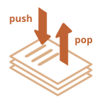
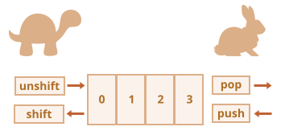
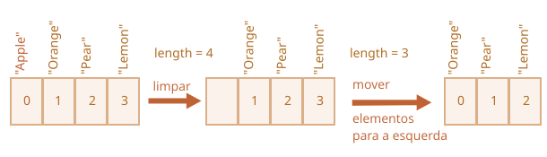
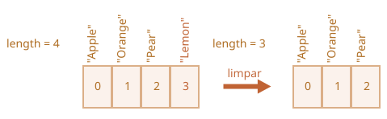

# Arrays

Objetos permitem armazenar coleções de valores indexadas por chave. Isso é ótimo.

Mas, frequentemente, percebemos que precisamos de uma *coleção ordenada*, onde temos um 1º, um 2º, um 3º elemento e assim por diante. Por exemplo, precisamos disso para armazenar uma lista de algo: usuários, produtos, elementos HTML etc.

Não é conveniente usar um objeto aqui, porque ele não oferece métodos para gerenciar a ordem dos elementos. Não podemos inserir uma nova propriedade "entre" as existentes. Objetos simplesmente não servem para esse tipo de uso.

Existe uma estrutura de dados especial chamada `Array`, para armazenar coleções ordenadas.

## Declaração

Existem duas sintaxes para criar um array vazio:

```js
let arr = new Array();
let arr = [];
```

Quase sempre, a segunda sintaxe é usada. Podemos informar os elementos iniciais entre colchetes:

```js
let fruits = ["Apple", "Orange", "Plum"];
```

Os elementos do array são numerados, começando do zero.

Podemos obter um elemento pelo seu número entre colchetes:

```js run
let fruits = ["Apple", "Orange", "Plum"];

alert( fruits[0] ); // Apple
alert( fruits[1] ); // Orange
alert( fruits[2] ); // Plum
```

Podemos substituir um elemento:

```js
fruits[2] = 'Pear'; // agora ["Apple", "Orange", "Pear"]
```

...Ou adicionar um novo ao array:

```js
fruits[3] = 'Lemon'; // agora ["Apple", "Orange", "Pear", "Lemon"]
```

A contagem total de elementos no array é o seu `length`:

```js run
let fruits = ["Apple", "Orange", "Plum"];

alert( fruits.length ); // 3
```

Também podemos usar `alert` para mostrar o array inteiro.

```js run
let fruits = ["Apple", "Orange", "Plum"];

alert( fruits ); // Apple,Orange,Plum
```

Um array pode armazenar elementos de qualquer tipo.

Por exemplo:

```js run no-beautify
// mistura de valores
let arr = [ 'Apple', { name: 'John' }, true, function() { alert('hello'); } ];

// pega o objeto no índice 1 e depois mostra seu name
alert( arr[1].name ); // John

// pega a função no índice 3 e a executa
arr[3](); // hello
```


````smart header="Vírgula no final"
Um array, assim como um objeto, pode terminar com uma vírgula:
```js
let fruits = [
  "Apple",
  "Orange",
  "Plum"*!*,*/!*
];
```

O estilo de "vírgula no final" facilita inserir/remover itens, porque todas as linhas ficam parecidas.
````

## Obtendo os últimos elementos com "at"

[recent browser="new"]

Digamos que queremos o último elemento do array.

Algumas linguagens de programação permitem usar índices negativos para esse mesmo propósito, como `fruits[-1]`.

Porém, no JavaScript isso não funciona. O resultado vai ser `undefined`, porque o índice entre colchetes é tratado literalmente.

Podemos calcular explicitamente o índice do último elemento e então acessá-lo: `fruits[fruits.length - 1]`.

```js run
let fruits = ["Apple", "Orange", "Plum"];

alert( fruits[fruits.length-1] ); // Plum
```

Um pouco incômodo, não é mesmo? Precisamos escrever o nome da variável duas vezes.

Felizmente, existe uma sintaxe mais curta: `fruits.at(-1)`:

```js run
let fruits = ["Apple", "Orange", "Plum"];

// o mesmo que fruits[fruits.length-1]
alert( fruits.at(-1) ); // Plum
```

Em outras palavras, `arr.at(i)`:
- é exatamente igual a `arr[i]`, se `i >= 0`.
- para valores negativos de `i`, ele volta a partir do final do array.

## Métodos pop/push, shift/unshift

Uma [fila](https://en.wikipedia.org/wiki/Queue_(abstract_data_type)) é um dos usos mais comuns de um array. Em ciência da computação, isso significa uma coleção ordenada de elementos que suporta duas operações:

- `push` acrescenta um elemento ao final.
- `shift` pega um elemento do início, avançando a fila, de forma que o 2º elemento se torna o 1º.


Arrays suportam as duas operações.

Na prática, precisamos disso com bastante frequência. Por exemplo, uma fila de mensagens que precisam ser mostradas na tela.

Existe outro caso de uso para arrays -- a estrutura de dados chamada [pilha](https://pt.wikipedia.org/wiki/Pilha_(estrutura_de_dados)).

Ela suporta duas operações:

- `push` adiciona um elemento ao final.
- `pop` pega um elemento do final.

Então novos elementos são sempre adicionados ou retirados do "final".

Uma pilha geralmente é ilustrada como um maço de cartas: novas cartas são adicionadas ao topo ou retiradas do topo:



Para pilhas, o último item empilhado é o primeiro a ser recebido, isso também é chamado de princípio LIFO (*Last-In-First-Out*, "último a entrar, primeiro a sair"). Para filas, temos o FIFO (*First-In-First-Out*, "primeiro a entrar, primeiro a sair").

Arrays no JavaScript podem funcionar tanto como fila quanto como pilha. Eles permitem adicionar/remover elementos, tanto do início quanto do final.

Em ciência da computação, a estrutura de dados que permite isso é chamada de [deque](https://pt.wikipedia.org/wiki/Deque_(estruturas_de_dados)).

**Métodos que trabalham com o final do array:**

`pop`
: Extrai o último elemento do array e o retorna:

    ```js run
    let fruits = ["Apple", "Orange", "Pear"];

    alert( fruits.pop() ); // remove "Pear" e o exibe

    alert( fruits ); // Apple, Orange
    ```

    Tanto `fruits.pop()` quanto `fruits.at(-1)` retornam o último elemento do array, mas `fruits.pop()` também modifica o array, removendo-o.

`push`
: Acrescenta o elemento ao final do array:

    ```js run
    let fruits = ["Apple", "Orange"];

    fruits.push("Pear");

    alert( fruits ); // Apple, Orange, Pear
    ```

    A chamada `fruits.push(...)` equivale a `fruits[fruits.length] = ...`.

**Métodos que trabalham com o início do array:**

`shift`
: Extrai o primeiro elemento do array e o retorna:

    ```js run
    let fruits = ["Apple", "Orange", "Pear"];

    alert( fruits.shift() ); // remove Apple e o exibe

    alert( fruits ); // Orange, Pear
    ```

`unshift`
: Adiciona o elemento ao início do array:

    ```js run
    let fruits = ["Orange", "Pear"];

    fruits.unshift('Apple');

    alert( fruits ); // Apple, Orange, Pear
    ```

Os métodos `push` e `unshift` podem adicionar vários elementos de uma vez:

```js run
let fruits = ["Apple"];

fruits.push("Orange", "Peach");
fruits.unshift("Pineapple", "Lemon");

// ["Pineapple", "Lemon", "Apple", "Orange", "Peach"]
alert( fruits );
```

## Por dentro

Um array é um tipo especial de objeto. Os colchetes usados para acessar uma propriedade, `arr[0]`, na verdade vêm da sintaxe de objeto. Isso é essencialmente igual a `obj[key]`, onde `arr` é o objeto, e números são usados como chaves.

Eles estendem os objetos, oferecendo métodos especiais para trabalhar com coleções ordenadas de dados e também a propriedade `length`. Mas, no fundo, ainda é um objeto.

Lembre-se, existem apenas oito tipos de dados básicos no JavaScript (veja o capítulo [Tipos de dados](info:types) para mais informações). Array é um objeto e, portanto, se comporta como um objeto.

Por exemplo, ele é copiado por referência:

```js run
let fruits = ["Banana"]

let arr = fruits; // cópia por referência (duas variáveis referenciam o mesmo array)

alert( arr === fruits ); // true

arr.push("Pear"); // modifica o array por referência

alert( fruits ); // Banana, Pear - 2 itens agora
```

...Mas o que torna os arrays realmente especiais é sua representação interna. O motor tenta armazenar seus elementos numa área contígua de memória, um após o outro, exatamente como mostrado nas ilustrações deste capítulo, e existem outras otimizações também, para fazer os arrays funcionarem bem rápido.

Mas tudo isso para de funcionar se deixarmos de trabalhar com um array como uma "coleção ordenada" e começarmos a trabalhar com ele como se fosse um objeto comum.

Por exemplo, tecnicamente podemos fazer isto:

```js
let fruits = []; // cria um array

fruits[99999] = 5; // atribui uma propriedade com um índice bem maior que seu length

fruits.age = 25; // cria uma propriedade com um nome arbitrário
```

Isso é possível, porque arrays são objetos em sua base. Podemos adicionar qualquer propriedade a eles.

Mas o motor vai perceber que estamos trabalhando com o array como se fosse um objeto comum. As otimizações específicas de array não são adequadas para esses casos e serão desativadas, seus benefícios desaparecem.

Formas de usar um array incorretamente:

- Adicionar uma propriedade não numérica, como `arr.test = 5`.
- Criar buracos, tipo: adicionar `arr[0]` e depois `arr[1000]` (e nada entre eles).
- Preencher o array na ordem reversa, tipo `arr[1000]`, `arr[999]` e assim por diante.

Pense nos arrays como estruturas especiais para trabalhar com *dados ordenados*. Eles oferecem métodos especiais para isso. Os arrays são cuidadosamente ajustados dentro dos motores do JavaScript para trabalhar com dados ordenados e contíguos, por favor, use-os dessa forma. E se você precisar de chaves arbitrárias, é bem provável que você precise, na verdade, de um objeto comum `{}`.

## Desempenho

Os métodos `push/pop` são rápidos, enquanto `shift/unshift` são lentos.



Por que é mais rápido trabalhar com o final de um array do que com seu início? Vamos ver o que acontece durante a execução:

```js
fruits.shift(); // pega 1 elemento do início
```

Não basta pegar e remover o elemento com o índice `0`. Os outros elementos também precisam ser renumerados.

A operação `shift` precisa fazer 3 coisas:

1. Remover o elemento com o índice `0`.
2. Mover todos os elementos para a esquerda, renumerando-os do índice `1` para `0`, de `2` para `1` e assim por diante.
3. Atualizar a propriedade `length`.



**Quanto mais elementos no array, mais tempo leva para movê-los, mais operações em memória.**

Algo parecido acontece com `unshift`: para adicionar um elemento ao início do array, primeiro precisamos mover os elementos existentes para a direita, aumentando seus índices.

E o que acontece com `push/pop`? Eles não precisam mover nada. Para extrair um elemento do final, o método `pop` limpa o índice e reduz o `length`.

As ações da operação `pop`:

```js
fruits.pop(); // pega 1 elemento do final
```



**O método `pop` não precisa mover nada, porque os outros elementos mantêm seus índices. É por isso que ele é extremamente rápido.**

O mesmo vale para o método `push`.

## Laços

Uma das formas mais antigas de percorrer os itens de um array é o laço `for` sobre os índices:

```js run
let arr = ["Apple", "Orange", "Pear"];

*!*
for (let i = 0; i < arr.length; i++) {
*/!*
  alert( arr[i] );
}
```

Mas, para arrays, existe outra forma de laço, o `for..of`:

```js run
let fruits = ["Apple", "Orange", "Plum"];

// itera sobre os elementos do array
for (let fruit of fruits) {
  alert( fruit );
}
```

O `for..of` não dá acesso ao número do elemento atual, só ao seu valor, mas, na maioria dos casos, isso é suficiente. E é mais curto.

Tecnicamente, como arrays são objetos, também é possível usar `for..in`:

```js run
let arr = ["Apple", "Orange", "Pear"];

*!*
for (let key in arr) {
*/!*
  alert( arr[key] ); // Apple, Orange, Pear
}
```

Mas isso na verdade é uma má ideia. Existem problemas em potencial com isso:

1. O laço `for..in` itera sobre *todas as propriedades*, não só as numéricas.

    Existem os chamados objetos "semelhantes a array" no navegador e em outros ambientes, que *parecem arrays*. Ou seja, eles têm propriedades `length` e índices, mas também podem ter outras propriedades e métodos não numéricos, dos quais normalmente não precisamos. O laço `for..in`, porém, vai listá-los também. Então, se precisarmos trabalhar com objetos semelhantes a array, essas propriedades "extras" podem se tornar um problema.

2. O laço `for..in` é otimizado para objetos genéricos, não para arrays, e por isso é de 10 a 100 vezes mais lento. Claro, ainda é bem rápido. A diferença de velocidade só costuma importar em gargalos. Mas, mesmo assim, devemos estar cientes dessa diferença.

De modo geral, não devemos usar `for..in` para arrays.


## Uma palavra sobre "length"

A propriedade `length` se atualiza automaticamente quando modificamos o array. Para ser mais preciso, na verdade ela não é a contagem de valores no array, mas sim o maior índice numérico mais um.

Por exemplo, um único elemento com um índice grande gera um length grande:

```js run
let fruits = [];
fruits[123] = "Apple";

alert( fruits.length ); // 124
```

Observe que normalmente não usamos arrays dessa forma.

Outra coisa interessante sobre a propriedade `length` é que ela é gravável.

Se a aumentarmos manualmente, nada de interessante acontece. Mas se a diminuirmos, o array é truncado. O processo é irreversível, aqui está o exemplo:

```js run
let arr = [1, 2, 3, 4, 5];

arr.length = 2; // trunca para 2 elementos
alert( arr ); // [1, 2]

arr.length = 5; // retorna o length de volta
alert( arr[3] ); // undefined: os valores não voltam
```

Então, a forma mais simples de limpar o array é: `arr.length = 0;`.


## new Array() [#new-array]

Existe mais uma sintaxe para criar um array:

```js
let arr = *!*new Array*/!*("Apple", "Pear", "etc");
```

É raramente usada, porque os colchetes `[]` são mais curtos. Além disso, há uma peculiaridade nela.

Se `new Array` for chamado com um único argumento que seja um número, então ele cria um array *sem itens, mas com o length dado*.

Vamos ver como alguém pode atirar no próprio pé:

```js run
let arr = new Array(2); // será que isso cria um array [2] ?

alert( arr[0] ); // undefined! sem elementos.

alert( arr.length ); // length 2
```

Para evitar essas surpresas, normalmente usamos os colchetes, a menos que realmente saibamos o que estamos fazendo.

## Arrays multidimensionais

Arrays podem ter itens que também são arrays. Podemos usar isso para arrays multidimensionais, por exemplo, para armazenar matrizes:

```js run
let matrix = [
  [1, 2, 3],
  [4, 5, 6],
  [7, 8, 9]
];

alert( matrix[0][1] ); // 2, o segundo valor do primeiro array interno
```

## toString

Arrays têm sua própria implementação do método `toString`, que retorna uma lista de elementos separados por vírgula.

Por exemplo:


```js run
let arr = [1, 2, 3];

alert( arr ); // 1,2,3
alert( String(arr) === '1,2,3' ); // true
```

Além disso, vamos tentar isto:

```js run
alert( [] + 1 ); // "1"
alert( [1] + 1 ); // "11"
alert( [1,2] + 1 ); // "1,21"
```

Arrays não têm `Symbol.toPrimitive`, nem um `valueOf` viável, eles implementam apenas a conversão `toString`, então aqui `[]` se torna uma string vazia, `[1]` se torna `"1"` e `[1,2]` se torna `"1,2"`.

Quando o operador de adição binário `"+"` soma algo a uma string, ele também converte isso para uma string, então o próximo passo fica assim:

```js run
alert( "" + 1 ); // "1"
alert( "1" + 1 ); // "11"
alert( "1,2" + 1 ); // "1,21"
```

## Não compare arrays com ==

Arrays no JavaScript, diferente de outras linguagens de programação, não devem ser comparados com o operador `==`.

Esse operador não tem nenhum tratamento especial para arrays, ele funciona com eles como com qualquer objeto.

Vamos relembrar as regras:

- Dois objetos são iguais com `==` apenas se forem referências ao mesmo objeto.
- Se um dos argumentos de `==` for um objeto, e o outro for um primitivo, então o objeto é convertido para primitivo, como explicado no capítulo <info:object-toprimitive>.
- ...Com exceção de `null` e `undefined`, que são iguais com `==` um ao outro e a mais nada.

A comparação estrita `===` é ainda mais simples, já que ela não converte tipos.

Então, se compararmos arrays com `==`, eles nunca serão os mesmos, a menos que comparemos duas variáveis que referenciam exatamente o mesmo array.

Por exemplo:
```js run
alert( [] == [] ); // false
alert( [0] == [0] ); // false
```

Esses arrays são, tecnicamente, objetos diferentes. Então eles não são iguais. O operador `==` não faz uma comparação item por item.

A comparação com primitivos também pode dar resultados aparentemente estranhos:

```js run
alert( 0 == [] ); // true

alert('0' == [] ); // false
```

Aqui, nos dois casos, estamos comparando um primitivo com um objeto array. Então o array `[]` é convertido para primitivo para fins de comparação e se torna uma string vazia `''`.

Então o processo de comparação continua com os primitivos, como descrito no capítulo <info:type-conversions>:

```js run
// depois que [] foi convertido para ''
alert( 0 == '' ); // true, já que '' é convertido para o número 0

alert('0' == '' ); // false, sem conversão de tipo, strings diferentes
```

Então, como comparar arrays?

É simples: não use o operador `==`. Em vez disso, compare-os item por item num laço ou usando os métodos de iteração explicados no próximo capítulo.

## Resumo

Array é um tipo especial de objeto, adequado para armazenar e gerenciar itens de dados ordenados.

A declaração:

```js
// colchetes (usual)
let arr = [item1, item2...];

// new Array (excepcionalmente raro)
let arr = new Array(item1, item2...);
```

A chamada `new Array(number)` cria um array com o length dado, mas sem elementos.

- A propriedade `length` é o comprimento do array ou, para ser mais preciso, seu último índice numérico mais um. Ela é ajustada automaticamente pelos métodos de array.
- Se diminuirmos o `length` manualmente, o array é truncado.

Obtendo os elementos:

- podemos obter um elemento pelo seu índice, como `arr[0]`
- também podemos usar o método `at(i)`, que permite índices negativos. Para valores negativos de `i`, ele volta a partir do final do array. Se `i >= 0`, funciona igual a `arr[i]`.

Podemos usar um array como um deque com as seguintes operações:

- `push(...items)` adiciona `items` ao final.
- `pop()` remove o elemento do final e o retorna.
- `shift()` remove o elemento do início e o retorna.
- `unshift(...items)` adiciona `items` ao início.

Para percorrer os elementos do array:
  - `for (let i=0; i<arr.length; i++)` -- funciona mais rápido, compatível com navegadores antigos.
  - `for (let item of arr)` -- a sintaxe moderna, só para os itens,
  - `for (let i in arr)` -- nunca use.

Para comparar arrays, não use o operador `==` (nem `>`, `<` e outros), já que eles não têm nenhum tratamento especial para arrays. Eles os tratam como qualquer objeto, e não é isso que normalmente queremos.

Em vez disso, você pode usar o laço `for..of` para comparar arrays item por item.

Vamos continuar com arrays e estudar mais métodos para adicionar, remover, extrair elementos e ordenar arrays no próximo capítulo <info:array-methods>.
