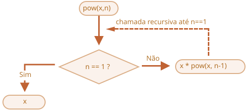

# Recursão e pilha

Vamos voltar às funções e estudá-las mais a fundo.

Nosso primeiro tópico vai ser a *recursão*.

Se você não é novo em programação, isso provavelmente já é familiar e você pode pular este capítulo.

Recursão é um padrão de programação útil em situações em que uma tarefa pode ser naturalmente dividida em várias tarefas do mesmo tipo, mas mais simples. Ou quando uma tarefa pode ser simplificada numa ação fácil mais uma variante mais simples da mesma tarefa. Ou, como veremos em breve, para lidar com certas estruturas de dados.

Quando uma função resolve uma tarefa, no processo ela pode chamar muitas outras funções. Um caso particular disso é quando uma função chama *a si mesma*. Isso é chamado de *recursão*.

## Duas formas de pensar

Para começar com algo simples -- vamos escrever uma função `pow(x, n)` que eleva `x` a uma potência natural `n`. Em outras palavras, multiplica `x` por si mesmo `n` vezes.

```js
pow(2, 2) = 4
pow(2, 3) = 8
pow(2, 4) = 16
```

Existem duas formas de implementar isso.

1. Pensamento iterativo: o laço `for`:

    ```js run
    function pow(x, n) {
      let result = 1;

      // multiplica result por x n vezes no laço
      for (let i = 0; i < n; i++) {
        result *= x;
      }

      return result;
    }

    alert( pow(2, 3) ); // 8
    ```

2. Pensamento recursivo: simplifique a tarefa e chame a si mesma:

    ```js run
    function pow(x, n) {
      if (n == 1) {
        return x;
      } else {
        return x * pow(x, n - 1);
      }
    }

    alert( pow(2, 3) ); // 8
    ```

Observe como a variante recursiva é fundamentalmente diferente.

Quando `pow(x, n)` é chamada, a execução se divide em duas ramificações:

```js
              if n==1  = x
             /
pow(x, n) =
             \
              else     = x * pow(x, n - 1)
```

1. Se `n == 1`, então tudo é trivial. Isso é chamado de *base* da recursão, porque produz imediatamente o resultado óbvio: `pow(x, 1)` é igual a `x`.
2. Caso contrário, podemos representar `pow(x, n)` como `x * pow(x, n - 1)`. Na matemática, escreveríamos <code>x<sup>n</sup> = x * x<sup>n-1</sup></code>. Isso é chamado de *um passo recursivo*: transformamos a tarefa numa ação mais simples (multiplicação por `x`) e numa chamada mais simples da mesma tarefa (`pow` com `n` menor). Os próximos passos simplificam ainda mais, até que `n` chegue a `1`.

Também podemos dizer que `pow` *chama a si mesma recursivamente* até `n == 1`.




Por exemplo, para calcular `pow(2, 4)` a variante recursiva faz estes passos:

1. `pow(2, 4) = 2 * pow(2, 3)`
2. `pow(2, 3) = 2 * pow(2, 2)`
3. `pow(2, 2) = 2 * pow(2, 1)`
4. `pow(2, 1) = 2`

Então, a recursão reduz uma chamada de função a uma mais simples, e depois -- a uma ainda mais simples, e assim por diante, até o resultado se tornar óbvio.

````smart header="A recursão geralmente é mais curta"
Uma solução recursiva geralmente é mais curta do que uma iterativa.

Aqui podemos reescrever a mesma coisa usando o operador condicional `?` em vez de `if` para deixar `pow(x, n)` mais conciso e ainda bem legível:

```js run
function pow(x, n) {
  return (n == 1) ? x : (x * pow(x, n - 1));
}
```
````

O número máximo de chamadas aninhadas (incluindo a primeira) é chamado de *profundidade de recursão*. No nosso caso, vai ser exatamente `n`.

A profundidade máxima de recursão é limitada pelo motor do JavaScript. Podemos contar com ela sendo 10000, alguns motores permitem mais, mas 100000 provavelmente está fora do limite para a maioria deles. Existem otimizações automáticas que ajudam a aliviar isso ("otimizações de chamada de cauda"), mas elas ainda não são suportadas em todo lugar e funcionam só em casos simples.

Isso limita a aplicação da recursão, mas ela ainda continua bem ampla. Existem muitas tarefas em que a forma recursiva de pensar dá um código mais simples, mais fácil de manter.

## O contexto de execução e a pilha

Agora vamos examinar como as chamadas recursivas funcionam. Para isso, vamos olhar por baixo dos panos das funções.

A informação sobre o processo de execução de uma função em execução é armazenada no seu *contexto de execução*.

O [contexto de execução](https://tc39.github.io/ecma262/#sec-execution-contexts) é uma estrutura de dados interna que contém detalhes sobre a execução de uma função: onde o fluxo de controle está agora, as variáveis atuais, o valor de `this` (não usamos isso aqui) e mais alguns detalhes internos.

Uma chamada de função tem exatamente um contexto de execução associado a ela.

Quando uma função faz uma chamada aninhada, o seguinte acontece:

- A função atual é pausada.
- O contexto de execução associado a ela é lembrado numa estrutura de dados especial chamada *pilha de contexto de execução*.
- A chamada aninhada é executada.
- Depois que ela termina, o contexto de execução antigo é recuperado da pilha, e a função externa é retomada de onde parou.

Vamos ver o que acontece durante a chamada `pow(2, 3)`.

### pow(2, 3)

No início da chamada `pow(2, 3)`, o contexto de execução vai armazenar as variáveis: `x = 2, n = 3`, o fluxo de execução está na linha `1` da função.

Podemos esboçar isso como:

<ul class="function-execution-context-list">
  <li>
    <span class="function-execution-context">Contexto: { x: 2, n: 3, na linha 1 }</span>
    <span class="function-execution-context-call">pow(2, 3)</span>
  </li>
</ul>

É quando a função começa a executar. A condição `n == 1` é falsa, então o fluxo continua para segunda ramificação do `if`:

```js run
function pow(x, n) {
  if (n == 1) {
    return x;
  } else {
*!*
    return x * pow(x, n - 1);
*/!*
  }
}

alert( pow(2, 3) );
```


As variáveis são as mesmas, mas a linha muda, então o contexto agora é:

<ul class="function-execution-context-list">
  <li>
    <span class="function-execution-context">Contexto: { x: 2, n: 3, na linha 5 }</span>
    <span class="function-execution-context-call">pow(2, 3)</span>
  </li>
</ul>

Para calcular `x * pow(x, n - 1)`, precisamos fazer uma subchamada de `pow` com os novos argumentos `pow(2, 2)`.

### pow(2, 2)

Para fazer uma chamada aninhada, o JavaScript lembra o contexto de execução atual na *pilha de contexto de execução*.

Aqui chamamos a mesma função `pow`, mas isso não importa nem um pouco. O processo é o mesmo para todas as funções:

1. O contexto atual é "lembrado" no topo da pilha.
2. O novo contexto é criado para a subchamada.
3. Quando a subchamada termina -- o contexto anterior é retirado da pilha, e sua execução continua.

Aqui está a pilha de contexto quando entramos na subchamada `pow(2, 2)`:

<ul class="function-execution-context-list">
  <li>
    <span class="function-execution-context">Contexto: { x: 2, n: 2, na linha 1 }</span>
    <span class="function-execution-context-call">pow(2, 2)</span>
  </li>
  <li>
    <span class="function-execution-context">Contexto: { x: 2, n: 3, na linha 5 }</span>
    <span class="function-execution-context-call">pow(2, 3)</span>
  </li>
</ul>

O novo contexto de execução atual está em cima (e em negrito), e os contextos lembrados anteriores estão abaixo.

Quando terminamos a subchamada -- é fácil retomar o contexto anterior, porque ele guarda tanto as variáveis quanto o lugar exato do código onde parou.

```smart
Aqui na imagem usamos a palavra "linha", já que no nosso exemplo há apenas uma subchamada por linha, mas, em geral, uma única linha de código pode conter múltiplas subchamadas, como `pow(…) + pow(…) + somethingElse(…)`.

Então seria mais preciso dizer que a execução é retomada "imediatamente depois da subchamada".
```

### pow(2, 1)

O processo se repete: uma nova subchamada é feita na linha `5`, agora com os argumentos `x=2`, `n=1`.

Um novo contexto de execução é criado, o anterior é empilhado no topo da pilha:

<ul class="function-execution-context-list">
  <li>
    <span class="function-execution-context">Contexto: { x: 2, n: 1, na linha 1 }</span>
    <span class="function-execution-context-call">pow(2, 1)</span>
  </li>
  <li>
    <span class="function-execution-context">Contexto: { x: 2, n: 2, na linha 5 }</span>
    <span class="function-execution-context-call">pow(2, 2)</span>
  </li>
  <li>
    <span class="function-execution-context">Contexto: { x: 2, n: 3, na linha 5 }</span>
    <span class="function-execution-context-call">pow(2, 3)</span>
  </li>
</ul>

Agora existem 2 contextos antigos e 1 rodando no momento para `pow(2, 1)`.

### A saída

Durante a execução de `pow(2, 1)`, diferente de antes, a condição `n == 1` é verdadeira, então a primeira ramificação do `if` funciona:

```js
function pow(x, n) {
  if (n == 1) {
*!*
    return x;
*/!*
  } else {
    return x * pow(x, n - 1);
  }
}
```

Não há mais chamadas aninhadas, então a função termina, retornando `2`.

Como a função termina, seu contexto de execução não é mais necessário, então é removido da memória. O anterior é restaurado do topo da pilha:


<ul class="function-execution-context-list">
  <li>
    <span class="function-execution-context">Contexto: { x: 2, n: 2, na linha 5 }</span>
    <span class="function-execution-context-call">pow(2, 2)</span>
  </li>
  <li>
    <span class="function-execution-context">Contexto: { x: 2, n: 3, na linha 5 }</span>
    <span class="function-execution-context-call">pow(2, 3)</span>
  </li>
</ul>

A execução de `pow(2, 2)` é retomada. Ela tem o resultado da subchamada `pow(2, 1)`, então também consegue terminar a avaliação de `x * pow(x, n - 1)`, retornando `4`.

Então o contexto anterior é restaurado:

<ul class="function-execution-context-list">
  <li>
    <span class="function-execution-context">Contexto: { x: 2, n: 3, na linha 5 }</span>
    <span class="function-execution-context-call">pow(2, 3)</span>
  </li>
</ul>

Quando ela termina, temos um resultado de `pow(2, 3) = 8`.

A profundidade de recursão nesse caso foi: **3**.

Como podemos ver pelas ilustrações acima, a profundidade de recursão é igual ao número máximo de contextos na pilha.

Observe os requisitos de memória. Contextos ocupam memória. No nosso caso, elevar à potência de `n` na verdade exige memória para `n` contextos, para todos os valores menores de `n`.

Um algoritmo baseado em laço economiza mais memória:

```js
function pow(x, n) {
  let result = 1;

  for (let i = 0; i < n; i++) {
    result *= x;
  }

  return result;
}
```

O `pow` iterativo usa um único contexto, mudando `i` e `result` no processo. Seus requisitos de memória são pequenos, fixos, e não dependem de `n`.

**Qualquer recursão pode ser reescrita como um laço. A variante com laço geralmente pode ser feita de forma mais eficiente.**

...Mas às vezes a reescrita não é trivial, especialmente quando uma função usa diferentes subchamadas recursivas dependendo de condições e combina seus resultados, ou quando a ramificação é mais complexa. E a otimização pode ser desnecessária e totalmente não valer o esforço.

A recursão pode dar um código mais curto, mais fácil de entender e manter. Otimizações não são necessárias em todo lugar, na maior parte do tempo precisamos de um bom código, e é por isso que ela é usada.

## Percursos recursivos

Outra ótima aplicação da recursão é um percurso recursivo.

Imagine que temos uma empresa. A estrutura de funcionários pode ser representada como um objeto:

```js
let company = {
  sales: [{
    name: 'John',
    salary: 1000
  }, {
    name: 'Alice',
    salary: 1600
  }],

  development: {
    sites: [{
      name: 'Peter',
      salary: 2000
    }, {
      name: 'Alex',
      salary: 1800
    }],

    internals: [{
      name: 'Jack',
      salary: 1300
    }]
  }
};
```

Em outras palavras, uma empresa tem departamentos.

- Um departamento pode ter um array de funcionários. Por exemplo, o departamento `sales` tem 2 funcionários: John e Alice.
- Ou um departamento pode se dividir em subdepartamentos, como `development`, que tem duas ramificações: `sites` e `internals`. Cada um deles tem seu próprio time.
- Também é possível que, quando um subdepartamento cresce, ele se divida em sub-subdepartamentos (ou times).

    Por exemplo, o departamento `sites` no futuro pode ser dividido em times para `siteA` e `siteB`. E eles, potencialmente, podem se dividir ainda mais. Isso não está na imagem, é só algo para ter em mente.

Agora digamos que queremos uma função para obter a soma de todos os salários. Como podemos fazer isso?

Uma abordagem iterativa não é fácil, porque a estrutura não é simples. A primeira ideia pode ser fazer um laço `for` sobre `company` com um sublaço aninhado sobre os departamentos de 1º nível. Mas aí precisamos de mais sublaços aninhados para iterar sobre os funcionários em departamentos de 2º nível como `sites`... E então outro sublaço dentro daqueles para departamentos de 3º nível que possam aparecer no futuro? Se colocarmos 3-4 sublaços aninhados no código para percorrer um único objeto, fica meio feio.

Vamos tentar a recursão.

Como podemos ver, quando nossa função recebe um departamento para somar, existem dois casos possíveis:

1. Ou é um departamento "simples", com um *array* de pessoas -- então podemos somar os salários num laço simples.
2. Ou é *um objeto* com `N` subdepartamentos -- então podemos fazer `N` chamadas recursivas para obter a soma de cada um dos subdeps e combinar os resultados.

O 1º caso é a base da recursão, o caso trivial, quando recebemos um array.

O 2º caso, quando recebemos um objeto, é o passo recursivo. Uma tarefa complexa é dividida em subtarefas para departamentos menores. Eles podem, por sua vez, se dividir de novo, mas, cedo ou tarde, a divisão vai terminar em (1).

O algoritmo provavelmente é até mais fácil de entender pelo código:


```js run
let company = { // o mesmo objeto, compactado por brevidade
  sales: [{name: 'John', salary: 1000}, {name: 'Alice', salary: 1600 }],
  development: {
    sites: [{name: 'Peter', salary: 2000}, {name: 'Alex', salary: 1800 }],
    internals: [{name: 'Jack', salary: 1300}]
  }
};

// A função que faz o trabalho
*!*
function sumSalaries(department) {
  if (Array.isArray(department)) { // caso (1)
    return department.reduce((prev, current) => prev + current.salary, 0); // soma o array
  } else { // caso (2)
    let sum = 0;
    for (let subdep of Object.values(department)) {
      sum += sumSalaries(subdep); // chama recursivamente para os subdepartamentos, soma os resultados
    }
    return sum;
  }
}
*/!*

alert(sumSalaries(company)); // 7700
```

O código é curto e fácil de entender (espero?). Esse é o poder da recursão. Também funciona para qualquer nível de aninhamento de subdepartamento.

Aqui está o diagrama das chamadas:


Podemos ver facilmente o princípio: para um objeto `{...}` são feitas subchamadas, enquanto arrays `[...]` são as "folhas" da árvore de recursão, elas dão o resultado imediato.

Observe que o código usa recursos espertos que já cobrimos antes:

- O método `arr.reduce`, explicado no capítulo <info:array-methods>, para obter a soma do array.
- O laço `for(val of Object.values(obj))`, para iterar sobre os valores do objeto: `Object.values` retorna um array deles.


## Estruturas recursivas

Uma estrutura de dados recursiva (definida recursivamente) é uma estrutura que replica a si mesma em partes.

Acabamos de ver isso no exemplo da estrutura de uma empresa acima.

Um *departamento* de uma empresa é:
- Ou um array de pessoas.
- Ou um objeto com *departamentos*.

Para desenvolvedores web existem exemplos muito mais conhecidos: documentos HTML e XML.

No documento HTML, uma *tag HTML* pode conter uma lista de:
- Pedaços de texto.
- Comentários HTML.
- Outras *tags HTML* (que, por sua vez, podem conter pedaços de texto/comentários ou outras tags etc).

Essa é, mais uma vez, uma definição recursiva.

Para entender melhor, vamos abordar mais uma estrutura recursiva chamada "lista ligada", que pode ser uma alternativa melhor para arrays em alguns casos.

### Lista ligada

Imagine que queremos armazenar uma lista ordenada de objetos.

A escolha natural seria um array:

```js
let arr = [obj1, obj2, obj3];
```

...Mas existe um problema com arrays. As operações "remover elemento" e "inserir elemento" são caras. Por exemplo, a operação `arr.unshift(obj)` precisa renumerar todos os elementos para abrir espaço para o novo `obj`, e, se o array for grande, isso leva tempo. O mesmo vale para `arr.shift()`.

As únicas modificações estruturais que não exigem renumeração em massa são aquelas que operam no final do array: `arr.push/pop`. Então um array pode ser bem lento para filas grandes, quando precisamos trabalhar com o início.

Alternativamente, se realmente precisamos de inserção/remoção rápida, podemos escolher outra estrutura de dados chamada [lista ligada](https://pt.wikipedia.org/wiki/Lista_ligada).

O *elemento da lista ligada* é definido recursivamente como um objeto com:
- `value`.
- propriedade `next` referenciando o próximo *elemento da lista ligada*, ou `null` se for o fim.

Por exemplo:

```js
let list = {
  value: 1,
  next: {
    value: 2,
    next: {
      value: 3,
      next: {
        value: 4,
        next: null
      }
    }
  }
};
```

Representação gráfica da lista:


Um código alternativo para a criação:

```js no-beautify
let list = { value: 1 };
list.next = { value: 2 };
list.next.next = { value: 3 };
list.next.next.next = { value: 4 };
list.next.next.next.next = null;
```

Aqui podemos ver ainda mais claramente que existem vários objetos, cada um tem o `value` e o `next` apontando para o vizinho. A variável `list` é o primeiro objeto da cadeia, então seguindo os ponteiros `next` a partir dela podemos alcançar qualquer elemento.

A lista pode ser facilmente dividida em várias partes e depois reunida de novo:

```js
let secondList = list.next.next;
list.next.next = null;
```


Para juntar:

```js
list.next.next = secondList;
```

E com certeza podemos inserir ou remover itens em qualquer lugar.

Por exemplo, para adicionar um novo valor no início, precisamos atualizar a cabeça da lista:

```js
let list = { value: 1 };
list.next = { value: 2 };
list.next.next = { value: 3 };
list.next.next.next = { value: 4 };

*!*
// adiciona o novo valor no início da lista
list = { value: "new item", next: list };
*/!*
```


Para remover um valor do meio, mudamos o `next` do anterior:

```js
list.next = list.next.next;
```


Fizemos `list.next` pular o `1` e ir direto para o valor `2`. O valor `1` agora está excluído da cadeia. Se ele não estiver armazenado em nenhum outro lugar, vai ser removido automaticamente da memória.

Diferente dos arrays, não há renumeração em massa, podemos facilmente reorganizar os elementos.

Naturalmente, listas nem sempre são melhores que arrays. Senão todo mundo usaria só listas.

A principal desvantagem é que não conseguimos acessar facilmente um elemento pelo seu número. Num array isso é fácil: `arr[n]` é uma referência direta. Mas na lista precisamos começar do primeiro item e seguir `next` `N` vezes para chegar ao N-ésimo elemento.

...Mas nem sempre precisamos desse tipo de operação. Por exemplo, quando precisamos de uma fila ou até de um [deque](https://pt.wikipedia.org/wiki/Deque_(estruturas_de_dados)) -- a estrutura ordenada que precisa permitir adicionar/remover elementos muito rapidamente dos dois lados, mas o acesso ao meio não é necessário.

Listas podem ser aprimoradas:
- Podemos adicionar a propriedade `prev`, além de `next`, para referenciar o elemento anterior, para voltar facilmente.
- Também podemos adicionar uma variável chamada `tail`, referenciando o último elemento da lista (e atualizá-la ao adicionar/remover elementos do final).
- ...A estrutura de dados pode variar de acordo com nossas necessidades.

## Resumo

Termos:
- *Recursão* é um termo de programação que significa chamar uma função a partir dela mesma. Funções recursivas podem ser usadas para resolver tarefas de formas elegantes.

    Quando uma função chama a si mesma, isso é chamado de *passo de recursão*. A *base* da recursão são os argumentos da função que tornam a tarefa tão simples que a função não faz mais chamadas.

- Uma estrutura de dados [definida recursivamente](https://en.wikipedia.org/wiki/Recursive_data_type) é uma estrutura de dados que pode ser definida usando a si mesma.

    Por exemplo, a lista ligada pode ser definida como uma estrutura de dados consistindo de um objeto referenciando uma lista (ou null).

    ```js
    list = { value, next -> list }
    ```

    Árvores como a árvore de elementos HTML ou a árvore de departamentos deste capítulo também são naturalmente recursivas: elas têm ramificações, e cada ramificação pode ter outras ramificações.

    Funções recursivas podem ser usadas para percorrê-las, como vimos no exemplo do `sumSalary`.

Qualquer função recursiva pode ser reescrita como uma iterativa. E isso às vezes é necessário para otimizar coisas. Mas, para muitas tarefas, uma solução recursiva é rápida o suficiente e mais fácil de escrever e manter.
