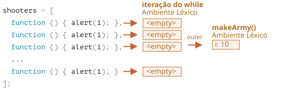
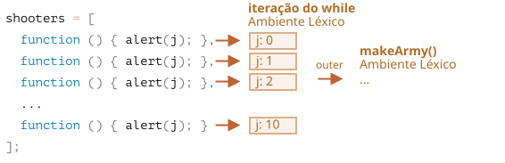
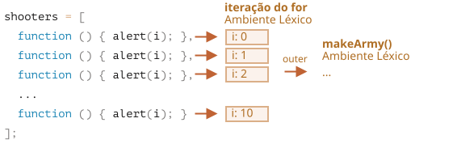

Vamos examinar o que exatamente acontece dentro de `makeArmy`, e a solução vai ficar óbvia.

1. Ele cria um array vazio `shooters`:

    ```js
    let shooters = [];
    ```
2. Preenche ele com funções via `shooters.push(function)` no laço.

    Cada elemento é uma função, então o array resultante fica assim:

    ```js no-beautify
    shooters = [
      function () { alert(i); },
      function () { alert(i); },
      function () { alert(i); },
      function () { alert(i); },
      function () { alert(i); },
      function () { alert(i); },
      function () { alert(i); },
      function () { alert(i); },
      function () { alert(i); },
      function () { alert(i); }
    ];
    ```

3. O array é retornado pela função.
    
    Então, mais tarde, a chamada a qualquer membro, ex.: `army[5]()`, vai pegar o elemento `army[5]` do array (que é uma função) e chamá-lo.
    
    Agora, por que todas essas funções mostram o mesmo valor, `10`?
    
    Isso acontece porque não existe uma variável local `i` dentro das funções `shooter`. Quando uma dessas funções é chamada, ela pega `i` do seu ambiente léxico externo.
    
    Então, qual vai ser o valor de `i`?
    
    Se olharmos o código-fonte:
    
    ```js
    function makeArmy() {
      ...
      let i = 0;
      while (i < 10) {
        let shooter = function() { // função shooter
          alert( i ); // deveria mostrar seu número
        };
        shooters.push(shooter); // adiciona a função ao array
        i++;
      }
      ...
    }
    ```
    
    Podemos ver que todas as funções `shooter` são criadas no ambiente léxico da função `makeArmy()`. Mas quando `army[5]()` é chamada, `makeArmy` já terminou seu trabalho, e o valor final de `i` é `10` (`while` para em `i=10`).
    
    Como resultado, todas as funções `shooter` pegam o mesmo valor do ambiente léxico externo, que é o último valor, `i=10`.
    
    
    
    Como você pode ver acima, em cada iteração de um bloco `while {...}`, um novo ambiente léxico é criado. Então, para corrigir isso, podemos copiar o valor de `i` para uma variável dentro do bloco `while {...}`, assim:
    
    ```js run
    function makeArmy() {
      let shooters = [];
    
      let i = 0;
      while (i < 10) {
        *!*
          let j = i;
        */!*
          let shooter = function() { // função shooter
            alert( *!*j*/!* ); // deveria mostrar seu número
          };
        shooters.push(shooter);
        i++;
      }
    
      return shooters;
    }
    
    let army = makeArmy();
    
    // Agora o código funciona corretamente
    army[0](); // 0
    army[5](); // 5
    ```
    
    Aqui, `let j = i` declara uma variável "local à iteração", `j`, e copia `i` para ela. Primitivos são copiados "por valor", então na verdade obtemos uma cópia independente de `i`, pertencente à iteração atual do laço.
    
    Os shooters funcionam corretamente, porque o valor de `i` agora vive um pouco mais perto. Não no Ambiente Léxico de `makeArmy()`, mas no Ambiente Léxico que corresponde à iteração atual do laço:
    
    
    
    Esse problema também poderia ser evitado se usássemos `for` desde o início, assim:
    
    ```js run demo
    function makeArmy() {
    
      let shooters = [];
    
    *!*
      for(let i = 0; i < 10; i++) {
    */!*
        let shooter = function() { // função shooter
          alert( i ); // deveria mostrar seu número
        };
        shooters.push(shooter);
      }
    
      return shooters;
    }
    
    let army = makeArmy();
    
    army[0](); // 0
    army[5](); // 5
    ```
    
    Isso é essencialmente a mesma coisa, porque o `for`, em cada iteração, gera um novo ambiente léxico, com sua própria variável `i`. Então o `shooter` gerado em cada iteração referencia seu próprio `i`, daquela mesma iteração.
    
    

Agora, já que você se esforçou tanto pra ler isso tudo, e a receita final é tão simples -- só usar `for` -- você deve estar se perguntando -- valeu a pena?

Bom, se você conseguisse responder a pergunta facilmente, não leria a solução. Então, esperamos que essa tarefa tenha ajudado você a entender as coisas um pouco melhor. 

Além disso, existem sim casos em que se prefere `while` a `for`, e outros cenários, onde esses problemas são reais.

