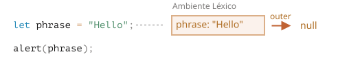
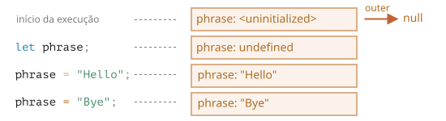
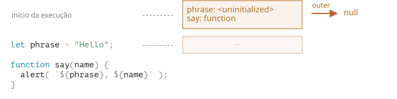
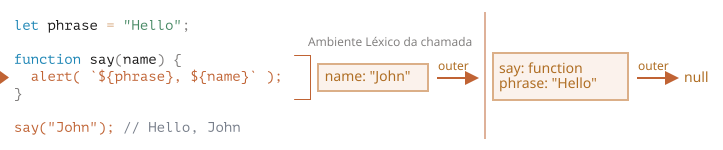
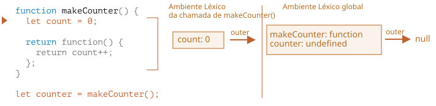
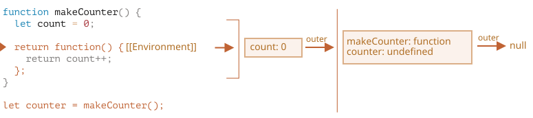
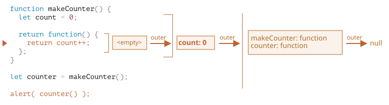
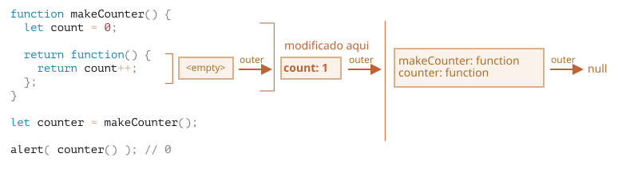

# Escopo de variável, closure

O JavaScript é uma linguagem muito orientada a funções. Ele nos dá muita liberdade. Uma função pode ser criada a qualquer momento, passada como argumento para outra função, e então chamada depois, a partir de um lugar totalmente diferente do código.

Já sabemos que uma função pode acessar variáveis fora dela (variáveis "externas").

Mas o que acontece se as variáveis externas mudarem depois que a função é criada? A função vai pegar os valores mais novos ou os antigos?

E se uma função for passada adiante como argumento e chamada de outro lugar do código, ela vai ter acesso às variáveis externas no novo lugar?

Vamos expandir nosso conhecimento para entender esses cenários e outros mais complexos.

```smart header="Vamos falar sobre variáveis `let/const` aqui"
No JavaScript, existem 3 formas de declarar uma variável: `let`, `const` (as modernas), e `var` (o resquício do passado).

- Neste artigo vamos usar variáveis `let` nos exemplos.
- Variáveis declaradas com `const` se comportam da mesma forma, então este artigo também é sobre `const`.
- O antigo `var` tem algumas diferenças notáveis, que serão cobertas no artigo <info:var>.
```

## Blocos de código

Se uma variável é declarada dentro de um bloco de código `{...}`, ela só é visível dentro desse bloco.

Por exemplo:

```js run
{
  // faz algum trabalho com variáveis locais que não devem ser vistas fora

  let message = "Hello"; // só visível neste bloco

  alert(message); // Hello
}

alert(message); // Erro: message não está definido
```

Podemos usar isso para isolar um trecho de código que faz sua própria tarefa, com variáveis que pertencem só a ele:

```js run
{
  // mostra mensagem
  let message = "Hello";
  alert(message);
}

{
  // mostra outra mensagem
  let message = "Goodbye";
  alert(message);
}
```

````smart header="Haveria um erro sem os blocos"
Observe que, sem blocos separados, haveria um erro, se usássemos `let` com um nome de variável já existente:

```js run
// mostra mensagem
let message = "Hello";
alert(message);

// mostra outra mensagem
*!*
let message = "Goodbye"; // Erro: variável já declarada
*/!*
alert(message);
```
````

Para `if`, `for`, `while` e assim por diante, variáveis declaradas em `{...}` também só são visíveis internamente:

```js run
if (true) {
  let phrase = "Hello!";

  alert(phrase); // Hello!
}

alert(phrase); // Erro, essa variável não existe!
```

Aqui, depois que o `if` termina, o `alert` abaixo não vai ver a `phrase`, daí o erro.

Isso é ótimo, já que nos permite criar variáveis locais a um bloco, específicas a uma ramificação de `if`.

A mesma coisa vale para laços `for` e `while`:

```js run
for (let i = 0; i < 3; i++) {
  // a variável i só é visível dentro deste for
  alert(i); // 0, depois 1, depois 2
}

alert(i); // Erro, essa variável não existe
```

Visualmente, `let i` está fora de `{...}`. Mas a construção `for` é especial aqui: a variável, declarada dentro dela, é considerada parte do bloco.

## Funções aninhadas

Uma função é chamada de "aninhada" quando é criada dentro de outra função.

Isso é facilmente possível com o JavaScript.

Podemos usar isso para organizar nosso código, assim:

```js
function sayHiBye(firstName, lastName) {

  // função aninhada auxiliar pra usar abaixo
  function getFullName() {
    return firstName + " " + lastName;
  }

  alert( "Hello, " + getFullName() );
  alert( "Bye, " + getFullName() );

}
```

Aqui a função *aninhada* `getFullName()` é feita por conveniência. Ela pode acessar as variáveis externas e, assim, consegue retornar o nome completo. Funções aninhadas são bem comuns no JavaScript.

O que é bem mais interessante, uma função aninhada pode ser retornada: seja como propriedade de um novo objeto, seja como resultado por si só. Ela pode então ser usada em outro lugar. Não importa onde, ela ainda tem acesso às mesmas variáveis externas.

Abaixo, `makeCounter` cria a função "counter" que retorna o próximo número a cada chamada:

```js run
function makeCounter() {
  let count = 0;

  return function() {
    return count++;
  };
}

let counter = makeCounter();

alert( counter() ); // 0
alert( counter() ); // 1
alert( counter() ); // 2
```

Apesar de simples, variantes ligeiramente modificadas desse código têm usos práticos, por exemplo, como um [gerador de números pseudoaleatórios](https://pt.wikipedia.org/wiki/Gerador_de_n%C3%BAmeros_pseudoaleat%C3%B3rios) para gerar valores aleatórios em testes automatizados.

Como isso funciona? Se criarmos vários contadores, eles vão ser independentes? O que está acontecendo com as variáveis aqui?

Entender essas coisas é ótimo para o conhecimento geral do JavaScript e benéfico para cenários mais complexos. Então vamos nos aprofundar um pouco.

## Ambiente Léxico

```warn header="Aqui existem dragões!"
A explicação técnica aprofundada vem a seguir.

Por mais que eu gostaria de evitar detalhes de baixo nível da linguagem, qualquer entendimento sem eles ficaria incompleto e deficiente, então se prepare.
```

Para clareza, a explicação é dividida em várias etapas.

### Passo 1. Variáveis

No JavaScript, toda função em execução, bloco de código `{...}`, e o script como um todo têm um objeto interno (oculto) associado conhecido como *Ambiente Léxico*.

O objeto Ambiente Léxico consiste em duas partes:

1. *Environment Record* -- um objeto que armazena todas as variáveis locais como suas propriedades (e algumas outras informações, como o valor de `this`).
2. Uma referência ao *ambiente léxico externo*, aquele associado ao código externo.

**Uma "variável" é só uma propriedade do objeto interno especial, `Environment Record`. "Obter ou mudar uma variável" significa "obter ou mudar uma propriedade desse objeto".**

Neste código simples, sem funções, existe apenas um Ambiente Léxico:



Esse é o chamado Ambiente Léxico *global*, associado ao script inteiro.

Na imagem acima, o retângulo representa o Environment Record (o armazenamento de variáveis) e a seta representa a referência externa. O Ambiente Léxico global não tem referência externa, por isso a seta aponta para `null`.

Conforme o código começa a executar e avança, o Ambiente Léxico muda.

Aqui está um código um pouco mais longo:



Os retângulos do lado direito demonstram como o Ambiente Léxico global muda durante a execução:

1. Quando o script começa, o Ambiente Léxico já vem pré-populado com todas as variáveis declaradas.
    - Inicialmente, elas estão no estado "Não inicializado" (*Uninitialized*). Esse é um estado interno especial, significa que o motor sabe sobre a variável, mas ela não pode ser referenciada até ter sido declarada com `let`. É quase como se a variável não existisse.
2. Então a definição `let phrase` aparece. Ainda não há atribuição, então seu valor é `undefined`. Podemos usar a variável a partir desse ponto em diante.
3. `phrase` recebe um valor atribuído.
4. `phrase` muda de valor.

Por enquanto tudo parece simples, certo?

- Uma variável é uma propriedade de um objeto interno especial, associado ao bloco/função/script que está sendo executado no momento.
- Trabalhar com variáveis, na verdade, é trabalhar com as propriedades desse objeto.

```smart header="Ambiente Léxico é um objeto de especificação"
"Ambiente Léxico" é um objeto de especificação: ele só existe "teoricamente" na [especificação da linguagem](https://tc39.es/ecma262/#sec-lexical-environments) para descrever como as coisas funcionam. Não conseguimos obter esse objeto no nosso código e manipulá-lo diretamente.

Os motores do JavaScript também podem otimizá-lo, descartar variáveis que não são usadas para economizar memória e realizar outros truques internos, desde que o comportamento visível continue sendo o descrito.
```

### Passo 2. Declarações de Função

Uma função também é um valor, assim como uma variável.

**A diferença é que uma Declaração de Função é totalmente inicializada instantaneamente.**

Quando um Ambiente Léxico é criado, uma Declaração de Função se torna imediatamente uma função pronta pra uso (diferente de `let`, que fica inutilizável até a declaração).

É por isso que podemos usar uma função, declarada como Declaração de Função, até mesmo antes da própria declaração.

Por exemplo, aqui está o estado inicial do Ambiente Léxico global quando adicionamos uma função:



Naturalmente, esse comportamento só se aplica a Declarações de Função, não a Expressões de Função, onde atribuímos uma função a uma variável, como `let say = function(name)...`.

### Passo 3. Ambiente Léxico interno e externo

Quando uma função roda, no início da chamada, um novo Ambiente Léxico é criado automaticamente para armazenar as variáveis locais e os parâmetros da chamada.

Por exemplo, para `say("John")`, fica assim (a execução está na linha marcada com uma seta):

<!--
    ```js
    let phrase = "Hello";

    function say(name) {
     alert( `${phrase}, ${name}` );
    }

    say("John"); // Hello, John
    ```-->



Durante a chamada da função temos dois Ambientes Léxicos: o interno (da chamada da função) e o externo (global):

- O Ambiente Léxico interno corresponde à execução atual de `say`. Ele tem uma única propriedade: `name`, o argumento da função. Chamamos `say("John")`, então o valor de `name` é `"John"`.
- O Ambiente Léxico externo é o Ambiente Léxico global. Ele tem a variável `phrase` e a própria função.

O Ambiente Léxico interno tem uma referência ao externo (`outer`).

**Quando o código quer acessar uma variável -- o Ambiente Léxico interno é pesquisado primeiro, depois o externo, depois o mais externo ainda, e assim por diante, até o global.**

Se uma variável não for encontrada em lugar nenhum, isso é um erro no modo estrito (sem `use strict`, uma atribuição a uma variável inexistente cria uma nova variável global, para compatibilidade com código antigo).

Neste exemplo, a busca acontece assim:

- Para a variável `name`, o `alert` dentro de `say` a encontra imediatamente no Ambiente Léxico interno.
- Quando ele quer acessar `phrase`, não existe `phrase` localmente, então ele segue a referência para o Ambiente Léxico externo e a encontra lá.


### Passo 4. Retornando uma função

Vamos voltar ao exemplo do `makeCounter`.

```js
function makeCounter() {
  let count = 0;

  return function() {
    return count++;
  };
}

let counter = makeCounter();
```

No início de cada chamada de `makeCounter()`, um novo objeto Ambiente Léxico é criado, para armazenar variáveis dessa execução de `makeCounter`.

Então temos dois Ambientes Léxicos aninhados, assim como no exemplo acima:



O que é diferente é que, durante a execução de `makeCounter()`, uma pequena função aninhada é criada, com só uma linha: `return count++`. Ainda não a executamos, só a criamos.

Todas as funções lembram o Ambiente Léxico no qual foram criadas. Tecnicamente, não existe mágica alguma aqui: todas as funções têm a propriedade oculta chamada `[[Environment]]`, que guarda a referência ao Ambiente Léxico onde a função foi criada:



Então, `counter.[[Environment]]` tem a referência ao Ambiente Léxico `{count: 0}`. É assim que a função lembra onde foi criada, não importa onde seja chamada. A referência `[[Environment]]` é definida uma vez e para sempre no momento da criação da função.

Mais tarde, quando `counter()` é chamada, um novo Ambiente Léxico é criado para a chamada, e sua referência de Ambiente Léxico externo é pega de `counter.[[Environment]]`:



Agora, quando o código dentro de `counter()` procura pela variável `count`, ele primeiro pesquisa seu próprio Ambiente Léxico (vazio, já que não há variáveis locais ali), depois o Ambiente Léxico da chamada externa de `makeCounter()`, onde a encontra e a modifica.

**Uma variável é atualizada no Ambiente Léxico onde ela vive.**

Aqui está o estado depois da execução:



Se chamarmos `counter()` várias vezes, a variável `count` vai aumentar para `2`, `3` e assim por diante, no mesmo lugar.

```smart header="Closure"
Existe um termo geral de programação, "closure", que os desenvolvedores geralmente deveriam conhecer.

Uma [closure](https://en.wikipedia.org/wiki/Closure_(computer_programming)) é uma função que lembra suas variáveis externas e consegue acessá-las. Em algumas linguagens, isso não é possível, ou uma função precisa ser escrita de uma forma especial pra isso acontecer. Mas, como explicado acima, no JavaScript, todas as funções são naturalmente closures (existe só uma exceção, que será coberta em <info:new-function>).

Ou seja: elas lembram automaticamente onde foram criadas usando uma propriedade oculta `[[Environment]]`, e então seu código pode acessar as variáveis externas.

Numa entrevista, quando um desenvolvedor frontend recebe uma pergunta sobre "o que é uma closure?", uma resposta válida seria uma definição de closure e uma explicação de que todas as funções no JavaScript são closures, e talvez mais algumas palavras sobre detalhes técnicos: a propriedade `[[Environment]]` e como os Ambientes Léxicos funcionam.
```

## Coleta de lixo

Normalmente, um Ambiente Léxico é removido da memória, com todas as suas variáveis, depois que a chamada da função termina. Isso acontece porque não há referências a ele. Como qualquer objeto do JavaScript, ele só é mantido na memória enquanto for alcançável.

Porém, se existir uma função aninhada que ainda seja alcançável depois do fim de uma função, então ela tem a propriedade `[[Environment]]` que referencia o ambiente léxico.

Nesse caso, o Ambiente Léxico ainda é alcançável mesmo depois da conclusão da função, então ele continua vivo.

Por exemplo:

```js
function f() {
  let value = 123;

  return function() {
    alert(value);
  }
}

let g = f(); // g.[[Environment]] guarda uma referência ao Ambiente Léxico
// da chamada de f() correspondente
```

Observe que, se `f()` for chamada muitas vezes, e as funções resultantes forem salvas, então todos os objetos Ambiente Léxico correspondentes também vão ser retidos na memória. No código abaixo, os 3:

```js
function f() {
  let value = Math.random();

  return function() { alert(value); };
}

// 3 funções no array, cada uma delas linkada a um Ambiente Léxico
// da execução correspondente de f()
let arr = [f(), f(), f()];
```

Um objeto Ambiente Léxico morre quando se torna inalcançável (assim como qualquer outro objeto). Em outras palavras, ele existe só enquanto houver pelo menos uma função aninhada o referenciando.

No código abaixo, depois que a função aninhada é removida, seu Ambiente Léxico envolvente (e, portanto, o `value`) é limpo da memória:

```js
function f() {
  let value = 123;

  return function() {
    alert(value);
  }
}

let g = f(); // enquanto a função g existir, o value fica na memória

g = null; // ...e agora a memória é limpa
```

### Otimizações da vida real

Como vimos, em teoria, enquanto uma função estiver viva, todas as variáveis externas também são retidas.

Mas, na prática, os motores do JavaScript tentam otimizar isso. Eles analisam o uso das variáveis e, se for óbvio pelo código que uma variável externa não é usada -- ela é removida.

**Um efeito colateral importante no V8 (Chrome, Edge, Opera) é que essa variável vai ficar indisponível na depuração.**

Tente rodar o exemplo abaixo no Chrome com as Ferramentas do Desenvolvedor abertas.

Quando ele pausar, no console, digite `alert(value)`.

```js run
function f() {
  let value = Math.random();

  function g() {
    debugger; // no console: digite alert(value); Não existe essa variável!
  }

  return g;
}

let g = f();
g();
```

Como você pôde ver -- não existe essa variável! Em teoria, ela deveria ser acessível, mas o motor a otimizou e removeu.

Isso pode levar a problemas de depuração engraçados (se não tão demorados). Um deles -- podemos ver uma variável externa de mesmo nome em vez da esperada:

```js run global
let value = "Surprise!";

function f() {
  let value = "the closest value";

  function g() {
    debugger; // no console: digite alert(value); Surprise!
  }

  return g;
}

let g = f();
g();
```

Esse recurso do V8 é bom de se conhecer. Se você está depurando com Chrome/Edge/Opera, mais cedo ou mais tarde vai se deparar com ele.

Isso não é um bug no depurador, mas sim um recurso especial do V8. Talvez seja mudado em algum momento. Você sempre pode checar isso rodando os exemplos desta página.
