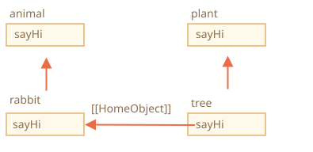

# Herança de classes

Herança de classes é uma forma de uma classe estender outra classe.

Assim podemos criar novas funcionalidades em cima do que já existe.

## A palavra-chave "extends"

Digamos que temos a classe `Animal`:

```js
class Animal {
  constructor(name) {
    this.speed = 0;
    this.name = name;
  }
  run(speed) {
    this.speed = speed;
    alert(`${this.name} runs with speed ${this.speed}.`);
  }
  stop() {
    this.speed = 0;
    alert(`${this.name} stands still.`);
  }
}

let animal = new Animal("My animal");
```

Aqui está como podemos representar graficamente o objeto `animal` e a classe `Animal`:


...E gostaríamos de criar outra `class Rabbit`.

Como coelhos são animais, a classe `Rabbit` deveria ser baseada em `Animal`, ter acesso aos métodos de animal, para que coelhos possam fazer o que animais "genéricos" conseguem fazer.

A sintaxe para estender outra classe é: `class Filha extends Pai`.

Vamos criar a `class Rabbit` que herda de `Animal`:

```js
*!*
class Rabbit extends Animal {
*/!*
  hide() {
    alert(`${this.name} hides!`);
  }
}

let rabbit = new Rabbit("White Rabbit");

rabbit.run(5); // White Rabbit runs with speed 5.
rabbit.hide(); // White Rabbit hides!
```

Objetos da classe `Rabbit` têm acesso tanto aos métodos de `Rabbit`, como `rabbit.hide()`, quanto aos métodos de `Animal`, como `rabbit.run()`.

Internamente, a palavra-chave `extends` funciona usando a boa e velha mecânica de protótipos. Ela define `Rabbit.prototype.[[Prototype]]` como `Animal.prototype`. Então, se um método não é encontrado em `Rabbit.prototype`, o JavaScript o busca em `Animal.prototype`.


Por exemplo, para encontrar o método `rabbit.run`, o motor verifica (de baixo para cima na imagem):
1. O objeto `rabbit` (não tem `run`).
2. Seu protótipo, que é `Rabbit.prototype` (tem `hide`, mas não `run`).
3. Seu protótipo, que é (por causa do `extends`) `Animal.prototype`, que finalmente tem o método `run`.

Como podemos lembrar do capítulo <info:native-prototypes>, o próprio JavaScript usa herança prototípica para objetos nativos. Por exemplo, `Date.prototype.[[Prototype]]` é `Object.prototype`. É por isso que datas têm acesso aos métodos genéricos de objeto.

````smart header="Qualquer expressão é permitida depois de `extends`"
A sintaxe de classe permite especificar não só uma classe, mas qualquer expressão depois de `extends`.

Por exemplo, uma chamada de função que gera a classe pai:

```js run
function f(phrase) {
  return class {
    sayHi() { alert(phrase); }
  };
}

*!*
class User extends f("Hello") {}
*/!*

new User().sayHi(); // Hello
```
Aqui, a `class User` herda do resultado de `f("Hello")`.

Isso pode ser útil para padrões avançados de programação, quando usamos funções para gerar classes dependendo de várias condições, e podemos herdar delas.
````

## Sobrescrevendo um método

Agora vamos em frente e sobrescrever um método. Por padrão, todos os métodos que não são especificados em `class Rabbit` são usados diretamente "como estão" de `class Animal`.

Mas se especificarmos nosso próprio método em `Rabbit`, como `stop()`, então ele será usado no lugar:

```js
class Rabbit extends Animal {
  stop() {
    // ...agora isso será usado para rabbit.stop()
    // em vez do stop() de class Animal
  }
}
```

Normalmente, porém, não queremos substituir totalmente um método do pai, mas sim construir em cima dele para ajustar ou estender sua funcionalidade. Fazemos algo no nosso método, mas chamamos o método do pai antes/depois dele, ou durante o processo.

As classes fornecem a palavra-chave `"super"` para isso.

- `super.method(...)` para chamar um método do pai.
- `super(...)` para chamar um construtor do pai (apenas dentro do nosso construtor).

Por exemplo, vamos fazer nosso coelho se esconder automaticamente quando parar:

```js run
class Animal {

  constructor(name) {
    this.speed = 0;
    this.name = name;
  }

  run(speed) {
    this.speed = speed;
    alert(`${this.name} runs with speed ${this.speed}.`);
  }

  stop() {
    this.speed = 0;
    alert(`${this.name} stands still.`);
  }

}

class Rabbit extends Animal {
  hide() {
    alert(`${this.name} hides!`);
  }

*!*
  stop() {
    super.stop(); // chama o stop do pai
    this.hide(); // e então se esconde
  }
*/!*
}

let rabbit = new Rabbit("White Rabbit");

rabbit.run(5); // White Rabbit runs with speed 5.
rabbit.stop(); // White Rabbit stands still. White Rabbit hides!
```

Agora `Rabbit` tem o método `stop` que chama o `super.stop()` do pai durante o processo.

````smart header="Funções arrow não têm `super`"
Como foi mencionado no capítulo <info:arrow-functions>, funções arrow não têm `super`.

Se acessado, ele é obtido da função externa. Por exemplo:

```js
class Rabbit extends Animal {
  stop() {
    setTimeout(() => super.stop(), 1000); // chama o stop do pai depois de 1seg
  }
}
```

O `super` na função arrow é o mesmo que em `stop()`, então funciona como pretendido. Se especificássemos uma função "comum" aqui, haveria um erro:

```js
// Unexpected super
setTimeout(function() { super.stop() }, 1000);
```
````

## Sobrescrevendo o construtor

Com construtores, fica um pouco mais complicado.

Até agora, `Rabbit` não tinha seu próprio `constructor`.

De acordo com a [especificação](https://tc39.github.io/ecma262/#sec-runtime-semantics-classdefinitionevaluation), se uma classe estende outra classe e não tem `constructor`, então o seguinte `constructor` "vazio" é gerado:

```js
class Rabbit extends Animal {
  // gerado para classes que estendem outras sem construtor próprio
*!*
  constructor(...args) {
    super(...args);
  }
*/!*
}
```

Como podemos ver, ele basicamente chama o `constructor` do pai, passando a ele todos os argumentos. Isso acontece se não escrevermos um construtor próprio.

Agora vamos adicionar um construtor personalizado a `Rabbit`. Ele vai especificar o `earLength`, além do `name`:

```js run
class Animal {
  constructor(name) {
    this.speed = 0;
    this.name = name;
  }
  // ...
}

class Rabbit extends Animal {

*!*
  constructor(name, earLength) {
    this.speed = 0;
    this.name = name;
    this.earLength = earLength;
  }
*/!*

  // ...
}

*!*
// Não funciona!
let rabbit = new Rabbit("White Rabbit", 10); // Error: this is not defined.
*/!*
```

Opa! Recebemos um erro. Agora não conseguimos criar coelhos. O que deu errado?

A resposta curta é:

- **Construtores em classes que herdam devem chamar `super(...)`, e (!) fazer isso antes de usar `this`.**

...Mas por quê? O que está acontecendo aqui? De fato, esse requisito parece estranho.

Claro, existe uma explicação. Vamos entrar nos detalhes, para você realmente entender o que está acontecendo.

No JavaScript, existe uma distinção entre a função construtora de uma classe que herda (chamada de "construtor derivado") e outras funções. Um construtor derivado tem uma propriedade interna especial `[[ConstructorKind]]:"derived"`. Esse é um rótulo interno especial.

Esse rótulo afeta seu comportamento com `new`.

- Quando uma função comum é executada com `new`, ela cria um objeto vazio e o atribui a `this`.
- Mas quando um construtor derivado roda, ele não faz isso. Ele espera que o construtor do pai faça esse trabalho.

Então um construtor derivado precisa chamar `super` para executar seu construtor pai (base), senão o objeto para `this` não será criado. E teremos um erro.

Para o construtor de `Rabbit` funcionar, ele precisa chamar `super()` antes de usar `this`, assim:

```js run
class Animal {

  constructor(name) {
    this.speed = 0;
    this.name = name;
  }

  // ...
}

class Rabbit extends Animal {

  constructor(name, earLength) {
*!*
    super(name);
*/!*
    this.earLength = earLength;
  }

  // ...
}

*!*
// agora funciona
let rabbit = new Rabbit("White Rabbit", 10);
alert(rabbit.name); // White Rabbit
alert(rabbit.earLength); // 10
*/!*
```

### Sobrescrevendo campos de classe: uma nota complicada

```warn header="Nota avançada"
Essa nota assume que você já tem alguma experiência com classes, talvez em outras linguagens de programação.

Ela dá uma visão melhor da linguagem, e também explica um comportamento que pode ser fonte de falhas (mas não com muita frequência).

Se achar difícil de entender, tudo bem, continue lendo, e depois volte aqui mais tarde.
```

Podemos sobrescrever não só métodos, mas também campos de classe.

Porém, existe um comportamento complicado quando acessamos um campo sobrescrito no construtor do pai, bem diferente da maioria das outras linguagens de programação.

Considere este exemplo:

```js run
class Animal {
  name = 'animal';

  constructor() {
    alert(this.name); // (*)
  }
}

class Rabbit extends Animal {
  name = 'rabbit';
}

new Animal(); // animal
*!*
new Rabbit(); // animal
*/!*
```

Aqui, a classe `Rabbit` estende `Animal` e sobrescreve o campo `name` com seu próprio valor.

Não há um construtor próprio em `Rabbit`, então o construtor de `Animal` é chamado.

O que é interessante é que, em ambos os casos, `new Animal()` e `new Rabbit()`, o `alert` na linha `(*)` mostra `animal`.

**Em outras palavras, o construtor do pai sempre usa o valor do seu próprio campo, não o sobrescrito.**

O que há de estranho nisso?

Se ainda não estiver claro, compare com métodos.

Aqui está o mesmo código, mas em vez do campo `this.name`, chamamos o método `this.showName()`:

```js run
class Animal {
  showName() {  // em vez de this.name = 'animal'
    alert('animal');
  }

  constructor() {
    this.showName(); // em vez de alert(this.name);
  }
}

class Rabbit extends Animal {
  showName() {
    alert('rabbit');
  }
}

new Animal(); // animal
*!*
new Rabbit(); // rabbit
*/!*
```

Repare: agora a saída é diferente.

E isso é o que naturalmente esperamos. Quando o construtor do pai é chamado na classe derivada, ele usa o método sobrescrito.

...Mas para campos de classe não é assim. Como dito, o construtor do pai sempre usa o campo do pai.

Por que existe essa diferença?

Bem, o motivo é a ordem de inicialização dos campos. O campo de classe é inicializado:
- Antes do construtor, para a classe base (que não estende nada),
- Imediatamente depois do `super()`, para a classe derivada.

No nosso caso, `Rabbit` é a classe derivada. Não há `constructor()` nela. Como dito antes, isso é o mesmo que se houvesse um construtor vazio com apenas `super(...args)`.

Então, `new Rabbit()` chama `super()`, executando assim o construtor do pai, e (de acordo com a regra para classes derivadas) só depois disso seus campos de classe são inicializados. No momento da execução do construtor do pai, ainda não existem campos da classe `Rabbit`, por isso os campos de `Animal` são usados.

Essa diferença sutil entre campos e métodos é específica do JavaScript.

Felizmente, esse comportamento só se revela se um campo sobrescrito for usado no construtor do pai. Nesse caso, pode ficar difícil entender o que está acontecendo, por isso estamos explicando aqui.

Se isso se tornar um problema, dá para resolver usando métodos ou getters/setters em vez de campos.

## Super: detalhes internos, [[HomeObject]]

```warn header="Informação avançada"
Se você está lendo o tutorial pela primeira vez - essa seção pode ser pulada.

É sobre os mecanismos internos por trás da herança e do `super`.
```

Vamos nos aprofundar um pouco mais nos bastidores do `super`. Vamos ver algumas coisas interessantes pelo caminho.

Primeiro, é importante dizer que, por tudo que aprendemos até agora, é impossível o `super` funcionar de jeito nenhum!

É, de fato, vamos nos perguntar, como ele deveria funcionar tecnicamente? Quando um método de objeto roda, ele recebe o objeto atual como `this`. Se chamarmos `super.method()`, então o motor precisa pegar o `method` do protótipo do objeto atual. Mas como?

A tarefa pode parecer simples, mas não é. O motor conhece o objeto atual `this`, então ele poderia obter o `method` do pai como `this.__proto__.method`. Infelizmente, essa solução "ingênua" não funciona.

Vamos demonstrar o problema. Sem classes, usando objetos simples por uma questão de simplicidade.

Você pode pular essa parte e ir direto para a subseção `[[HomeObject]]` abaixo, se não quiser saber os detalhes. Isso não vai prejudicar em nada. Ou continue lendo se tiver interesse em entender as coisas a fundo.

No exemplo abaixo, `rabbit.__proto__ = animal`. Agora vamos tentar: em `rabbit.eat()` vamos chamar `animal.eat()`, usando `this.__proto__`:

```js run
let animal = {
  name: "Animal",
  eat() {
    alert(`${this.name} eats.`);
  }
};

let rabbit = {
  __proto__: animal,
  name: "Rabbit",
  eat() {
*!*
    // é assim que super.eat() supostamente poderia funcionar
    this.__proto__.eat.call(this); // (*)
*/!*
  }
};

rabbit.eat(); // Rabbit eats.
```

Na linha `(*)` pegamos `eat` do protótipo (`animal`) e o chamamos no contexto do objeto atual. Repare que o `.call(this)` é importante aqui, porque um simples `this.__proto__.eat()` executaria o `eat` do pai no contexto do protótipo, não do objeto atual.

E no código acima isso realmente funciona como pretendido: temos o `alert` correto.

Agora vamos adicionar mais um objeto à cadeia. Vamos ver como as coisas quebram:

```js run
let animal = {
  name: "Animal",
  eat() {
    alert(`${this.name} eats.`);
  }
};

let rabbit = {
  __proto__: animal,
  eat() {
    // ...faz alguma coisa estilo coelho e chama o método pai (animal)
    this.__proto__.eat.call(this); // (*)
  }
};

let longEar = {
  __proto__: rabbit,
  eat() {
    // ...faz alguma coisa com orelhas compridas e chama o método pai (rabbit)
    this.__proto__.eat.call(this); // (**)
  }
};

*!*
longEar.eat(); // Error: Maximum call stack size exceeded
*/!*
```

O código não funciona mais! Podemos ver o erro ao tentar chamar `longEar.eat()`.

Pode não ser tão óbvio, mas se rastrearmos a chamada `longEar.eat()`, conseguimos ver por quê. Em ambas as linhas `(*)` e `(**)`, o valor de `this` é o objeto atual (`longEar`). Isso é essencial: todos os métodos de objeto recebem o objeto atual como `this`, não um protótipo ou qualquer outra coisa.

Então, em ambas as linhas `(*)` e `(**)`, o valor de `this.__proto__` é exatamente o mesmo: `rabbit`. Ambas chamam `rabbit.eat` sem subir na cadeia, em um laço infinito.

Aqui está a imagem do que acontece:


1. Dentro de `longEar.eat()`, a linha `(**)` chama `rabbit.eat`, fornecendo a ele `this=longEar`.
    ```js
    // dentro de longEar.eat() temos this = longEar
    this.__proto__.eat.call(this) // (**)
    // se torna
    longEar.__proto__.eat.call(this)
    // que é
    rabbit.eat.call(this);
    ```
2. Então, na linha `(*)` de `rabbit.eat`, gostaríamos de passar a chamada ainda mais acima na cadeia, mas `this=longEar`, então `this.__proto__.eat` é novamente `rabbit.eat`!

    ```js
    // dentro de rabbit.eat() também temos this = longEar
    this.__proto__.eat.call(this) // (*)
    // se torna
    longEar.__proto__.eat.call(this)
    // ou (de novo)
    rabbit.eat.call(this);
    ```

3. ...Então `rabbit.eat` chama a si mesmo em um laço infinito, porque não consegue subir mais.

O problema não pode ser resolvido usando `this` sozinho.

### `[[HomeObject]]`

Para fornecer a solução, o JavaScript adiciona mais uma propriedade interna especial para funções: `[[HomeObject]]`.

Quando uma função é especificada como um método de classe ou de objeto, sua propriedade `[[HomeObject]]` se torna esse objeto.

Então o `super` a usa para resolver o protótipo pai e seus métodos.

Vamos ver como isso funciona, primeiro com objetos simples:

```js run
let animal = {
  name: "Animal",
  eat() {         // animal.eat.[[HomeObject]] == animal
    alert(`${this.name} eats.`);
  }
};

let rabbit = {
  __proto__: animal,
  name: "Rabbit",
  eat() {         // rabbit.eat.[[HomeObject]] == rabbit
    super.eat();
  }
};

let longEar = {
  __proto__: rabbit,
  name: "Long Ear",
  eat() {         // longEar.eat.[[HomeObject]] == longEar
    super.eat();
  }
};

*!*
// funciona corretamente
longEar.eat();  // Long Ear eats.
*/!*
```

Funciona como pretendido, graças à mecânica do `[[HomeObject]]`. Um método, como `longEar.eat`, conhece seu `[[HomeObject]]` e pega o método pai do seu protótipo. Sem usar `this` de jeito nenhum.

### Métodos não são "livres"

Como já sabíamos antes, geralmente funções são "livres" em JavaScript, não vinculadas a objetos. Então elas podem ser copiadas entre objetos e chamadas com outro `this`.

A própria existência do `[[HomeObject]]` viola esse princípio, porque métodos lembram seus objetos. O `[[HomeObject]]` não pode ser alterado, então esse vínculo é para sempre.

O único lugar na linguagem onde o `[[HomeObject]]` é usado -- é o `super`. Então, se um método não usa `super`, ainda podemos considerá-lo livre e copiá-lo entre objetos. Mas com `super` as coisas podem dar errado.

Aqui está a demonstração de um resultado errado de `super` depois de copiar:

```js run
let animal = {
  sayHi() {
    alert(`I'm an animal`);
  }
};

// rabbit herda de animal
let rabbit = {
  __proto__: animal,
  sayHi() {
    super.sayHi();
  }
};

let plant = {
  sayHi() {
    alert("I'm a plant");
  }
};

// tree herda de plant
let tree = {
  __proto__: plant,
*!*
  sayHi: rabbit.sayHi // (*)
*/!*
};

*!*
tree.sayHi();  // I'm an animal (?!?)
*/!*
```

Uma chamada a `tree.sayHi()` mostra "I'm an animal". Definitivamente errado.

O motivo é simples:
- Na linha `(*)`, o método `tree.sayHi` foi copiado de `rabbit`. Talvez só quiséssemos evitar duplicação de código?
- Seu `[[HomeObject]]` é `rabbit`, já que foi criado em `rabbit`. Não há como mudar o `[[HomeObject]]`.
- O código de `tree.sayHi()` tem `super.sayHi()` dentro dele. Ele sobe a partir de `rabbit` e pega o método de `animal`.

Aqui está o diagrama do que acontece:



### Métodos, não propriedades de função

O `[[HomeObject]]` é definido para métodos tanto em classes quanto em objetos simples. Mas para objetos, os métodos precisam ser especificados exatamente como `method()`, e não como `"method: function()"`.

A diferença pode não ser essencial para nós, mas é importante para o JavaScript.

No exemplo abaixo, uma sintaxe que não é de método é usada para comparação. A propriedade `[[HomeObject]]` não é definida e a herança não funciona:

```js run
let animal = {
  eat: function() { // escrevendo assim de propósito, em vez de eat() {...
    // ...
  }
};

let rabbit = {
  __proto__: animal,
  eat: function() {
    super.eat();
  }
};

*!*
rabbit.eat();  // Error calling super (because there's no [[HomeObject]])
*/!*
```

## Resumo

1. Para estender uma classe: `class Filha extends Pai`:
    - Isso significa que `Filha.prototype.__proto__` vai ser `Pai.prototype`, então os métodos são herdados.
2. Ao sobrescrever um construtor:
    - Precisamos chamar o construtor do pai com `super()` no construtor de `Filha` antes de usar `this`.
3. Ao sobrescrever outro método:
    - Podemos usar `super.method()` em um método de `Filha` para chamar o método de `Pai`.
4. Detalhes internos:
    - Os métodos lembram sua classe/objeto na propriedade interna `[[HomeObject]]`. É assim que o `super` resolve os métodos do pai.
    - Então não é seguro copiar um método com `super` de um objeto para outro.

Além disso:
- Funções arrow não têm seu próprio `this` ou `super`, então elas se encaixam de forma transparente no contexto ao redor.
