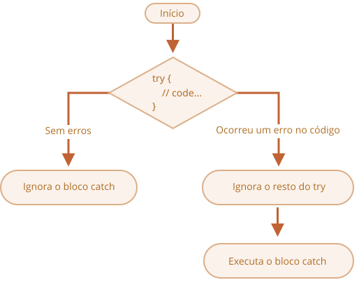

# Tratamento de erros, "try...catch"

Não importa o quão bons sejamos em programação, às vezes nossos scripts têm erros. Eles podem acontecer por causa dos nossos próprios erros, uma entrada inesperada do usuário, uma resposta errada do servidor, e por mil outros motivos.

Geralmente, um script "morre" (para imediatamente) quando ocorre um erro, imprimindo-o no console.

Mas existe uma estrutura de sintaxe, `try...catch`, que nos permite "capturar" erros, para que o script, em vez de morrer, possa fazer algo mais sensato.

## A sintaxe do "try...catch"

A estrutura `try...catch` tem dois blocos principais: `try` e, depois, `catch`:

```js
try {

  // código...

} catch (err) {

  // tratamento do erro

}
```

Funciona assim:

1. Primeiro, o código dentro de `try {...}` é executado.
2. Se não houve erros, o `catch (err)` é ignorado: a execução chega ao fim do `try` e continua, pulando o `catch`.
3. Se ocorrer um erro, a execução do `try` é interrompida, e o controle vai para o começo do `catch (err)`. A variável `err` (podemos usar qualquer nome pra ela) vai conter um objeto de erro com detalhes sobre o que aconteceu.



Então, um erro dentro do bloco `try {...}` não mata o script -- temos a chance de tratá-lo no `catch`.

Vamos ver alguns exemplos.

- Um exemplo sem erro: mostra `alert` `(1)` e `(2)`:

    ```js run
    try {

      alert('Início do try executa');  // *!*(1) <--*/!*

      // ...sem erros aqui

      alert('Fim do try executa');   // *!*(2) <--*/!*

    } catch (err) {

      alert('Catch é ignorado, pois não há erros'); // (3)

    }
    ```
- Um exemplo com erro: mostra `(1)` e `(3)`:

    ```js run
    try {

      alert('Início do try executa');  // *!*(1) <--*/!*

    *!*
      lalala; // erro, a variável não está definida!
    */!*

      alert('Fim do try (nunca é alcançado)');  // (2)

    } catch (err) {

      alert(`Error has occurred!`); // *!*(3) <--*/!*

    }
    ```


````warn header="`try...catch` só funciona para erros em tempo de execução"
Para o `try...catch` funcionar, o código precisa ser executável. Em outras palavras, precisa ser um JavaScript válido.

Não vai funcionar se o código estiver sintaticamente errado, por exemplo, com chaves desencontradas:

```js run
try {
  {{{{{{{{{{{{
} catch (err) {
  alert("O motor não consegue entender esse código, ele é inválido");
}
```

O motor do JavaScript primeiro lê o código, e só depois o executa. Os erros que ocorrem na fase de leitura são chamados de erros de "tempo de análise" (*parse-time*), e são irrecuperáveis (de dentro daquele código). Isso acontece porque o motor não consegue entender o código.

Então, o `try...catch` só consegue tratar erros que ocorrem em código válido. Esses erros são chamados de "erros em tempo de execução" ou, às vezes, "exceções".
````


````warn header="`try...catch` funciona de forma síncrona"
Se uma exceção acontece em um código "agendado", como dentro de um `setTimeout`, o `try...catch` não vai capturá-la:

```js run
try {
  setTimeout(function() {
    noSuchVariable; // o script vai morrer aqui
  }, 1000);
} catch (err) {
  alert( "não vai funcionar" );
}
```

Isso acontece porque a própria função é executada depois, quando o motor já saiu da estrutura `try...catch`.

Para capturar uma exceção dentro de uma função agendada, o `try...catch` precisa estar dentro dessa função:
```js run
setTimeout(function() {
  try {
    noSuchVariable; // o try...catch trata o erro!
  } catch {
    alert( "o erro é capturado aqui!" );
  }
}, 1000);
```
````

## O objeto de erro

Quando ocorre um erro, o JavaScript gera um objeto contendo os detalhes sobre ele. Esse objeto então é passado como argumento para o `catch`:

```js
try {
  // ...
} catch (err) { // <-- o "objeto de erro", poderíamos usar outra palavra no lugar de err
  // ...
}
```

Para todos os erros nativos, o objeto de erro tem duas propriedades principais:

`name`
: Nome do erro. Por exemplo, para uma variável não definida, isso é `"ReferenceError"`.

`message`
: Mensagem textual com os detalhes do erro.

Existem outras propriedades não padronizadas, disponíveis na maioria dos ambientes. Uma das mais usadas e suportadas é:

`stack`
: Pilha de chamadas atual: uma string com informações sobre a sequência de chamadas aninhadas que levaram ao erro. Usada para fins de depuração.

Por exemplo:

```js run untrusted
try {
*!*
  lalala; // erro, a variável não está definida!
*/!*
} catch (err) {
  alert(err.name); // ReferenceError
  alert(err.message); // lalala is not defined
  alert(err.stack); // ReferenceError: lalala is not defined at (...call stack)

  // Também podemos mostrar o erro como um todo
  // O erro é convertido para string como "name: message"
  alert(err); // ReferenceError: lalala is not defined
}
```

## Parâmetro opcional do "catch"

[recent browser=new]

Se não precisarmos dos detalhes do erro, o `catch` pode omitir o parâmetro:

```js
try {
  // ...
} catch { // <-- sem (err)
  // ...
}
```

## Usando o "try...catch"

Vamos explorar um caso de uso real do `try...catch`.

Como já sabemos, o JavaScript suporta o método [JSON.parse(str)](mdn:js/JSON/parse) para ler valores codificados em JSON.

Geralmente ele é usado para decodificar dados recebidos pela rede, do servidor ou de outra fonte.

Recebemos os dados e chamamos `JSON.parse` assim:

```js run
let json = '{"name":"John", "age": 30}'; // dados vindos do servidor

*!*
let user = JSON.parse(json); // converte a representação em texto para um objeto JS
*/!*

// agora user é um objeto com propriedades vindas da string
alert( user.name ); // John
alert( user.age );  // 30
```

Você pode encontrar informações mais detalhadas sobre JSON no capítulo <info:json>.

**Se `json` estiver malformado, `JSON.parse` gera um erro, e assim o script "morre".**

Devemos ficar satisfeitos com isso? Claro que não!

Dessa forma, se algo estiver errado com os dados, o visitante nunca vai saber disso (a menos que abra o console do desenvolvedor). E as pessoas realmente não gostam quando algo "simplesmente morre" sem nenhuma mensagem de erro.

Vamos usar o `try...catch` para tratar o erro:

```js run
let json = "{ bad json }";

try {

*!*
  let user = JSON.parse(json); // <-- quando um erro ocorre...
*/!*
  alert( user.name ); // não funciona

} catch (err) {
*!*
  // ...a execução pula pra cá
  alert( "Pedimos desculpas, os dados têm erros, vamos tentar buscá-los novamente." );
  alert( err.name );
  alert( err.message );
*/!*
}
```

Aqui usamos o bloco `catch` só pra mostrar a mensagem, mas podemos fazer muito mais: enviar uma nova requisição de rede, sugerir uma alternativa ao visitante, enviar informações sobre o erro pra um serviço de registro, ... . Tudo isso é bem melhor do que simplesmente morrer.

## Lançando nossos próprios erros

E se `json` for sintaticamente correto, mas não tiver a propriedade `name` obrigatória?

Assim:

```js run
let json = '{ "age": 30 }'; // dados incompletos

try {

  let user = JSON.parse(json); // <-- sem erros
*!*
  alert( user.name ); // sem name!
*/!*

} catch (err) {
  alert( "doesn't execute" );
}
```

Aqui o `JSON.parse` roda normalmente, mas a ausência de `name` é, na verdade, um erro pra nós.

Pra unificar o tratamento de erros, vamos usar o operador `throw`.

### O operador "throw"

O operador `throw` gera um erro.

A sintaxe é:

```js
throw <objeto de erro>
```

Tecnicamente, podemos usar qualquer coisa como objeto de erro. Pode até ser um primitivo, como um número ou uma string, mas é melhor usar objetos, de preferência com propriedades `name` e `message` (pra ficar um pouco compatível com os erros nativos).

O JavaScript tem vários construtores nativos para erros padrão: `Error`, `SyntaxError`, `ReferenceError`, `TypeError`, e outros. Podemos usá-los para criar objetos de erro também.

A sintaxe deles é:

```js
let error = new Error(message);
// ou
let error = new SyntaxError(message);
let error = new ReferenceError(message);
// ...
```

Para erros nativos (não para qualquer objeto, só para erros), a propriedade `name` é exatamente o nome do construtor. E `message` vem do argumento.

Por exemplo:

```js run
let error = new Error("Coisas acontecem o_O");

alert(error.name); // Error
alert(error.message); // Coisas acontecem o_O
```

Vamos ver que tipo de erro o `JSON.parse` gera:

```js run
try {
  JSON.parse("{ bad json o_O }");
} catch (err) {
*!*
  alert(err.name); // SyntaxError
*/!*
  alert(err.message); // Unexpected token b in JSON at position 2
}
```

Como podemos ver, esse é um `SyntaxError`.

E no nosso caso, a ausência de `name` é um erro, já que os usuários precisam ter um `name`.

Então vamos lançá-lo:

```js run
let json = '{ "age": 30 }'; // dados incompletos

try {

  let user = JSON.parse(json); // <-- sem erros

  if (!user.name) {
*!*
    throw new SyntaxError("Incomplete data: no name"); // (*)
*/!*
  }

  alert( user.name );

} catch (err) {
  alert( "Erro de JSON: " + err.message ); // Erro de JSON: Incomplete data: no name
}
```

Na linha `(*)`, o operador `throw` gera um `SyntaxError` com a `message` fornecida, da mesma forma que o próprio JavaScript o geraria. A execução do `try` para imediatamente, e o controle salta pro `catch`.

Agora o `catch` se tornou um lugar único pra todo o tratamento de erro: tanto para o `JSON.parse` quanto para os outros casos.

## Relançando erros

No exemplo acima, usamos o `try...catch` para tratar dados incorretos. Mas é possível que *outro erro inesperado* ocorra dentro do bloco `try {...}`? Tipo um erro de programação (variável não definida) ou outra coisa, não só esse problema de "dados incorretos".

Por exemplo:

```js run
let json = '{ "age": 30 }'; // dados incompletos

try {
  user = JSON.parse(json); // <-- esqueceu de colocar "let" antes de user

  // ...
} catch (err) {
  alert("Erro de JSON: " + err); // Erro de JSON: ReferenceError: user is not defined
  // (na verdade, não é um erro de JSON)
}
```

Claro, tudo é possível! Programadores cometem erros. Mesmo em utilitários de código aberto usados por milhões de pessoas há décadas -- de repente pode ser descoberta uma falha que leva a ataques terríveis.

No nosso caso, o `try...catch` foi colocado pra capturar erros de "dados incorretos". Mas, por sua natureza, o `catch` recebe *todos* os erros vindos do `try`. Aqui ele recebe um erro inesperado, mas mesmo assim mostra a mesma mensagem `"Erro de JSON"`. Isso está errado, e também torna o código mais difícil de depurar.

Pra evitar esses problemas, podemos usar a técnica de "relançamento" (rethrowing). A regra é simples:

**O catch deve processar apenas os erros que ele conhece, e "relançar" todos os outros.**

A técnica de "relançamento" pode ser explicada em mais detalhes assim:

1. O catch recebe todos os erros.
2. No bloco `catch (err) {...}`, analisamos o objeto de erro `err`.
3. Se não sabemos como tratá-lo, fazemos `throw err`.

Geralmente, podemos checar o tipo do erro usando o operador `instanceof`:

```js run
try {
  user = { /*...*/ };
} catch (err) {
*!*
  if (err instanceof ReferenceError) {
*/!*
    alert('ReferenceError'); // "ReferenceError" ao acessar uma variável não definida
  }
}
```

Também podemos obter o nome da classe do erro pela propriedade `err.name`. Todos os erros nativos a possuem. Outra opção é ler `err.constructor.name`.

No código abaixo, usamos o relançamento para que o `catch` só trate `SyntaxError`:

```js run
let json = '{ "age": 30 }'; // dados incompletos
try {

  let user = JSON.parse(json);

  if (!user.name) {
    throw new SyntaxError("Incomplete data: no name");
  }

*!*
  blabla(); // erro inesperado
*/!*

  alert( user.name );

} catch (err) {

*!*
  if (err instanceof SyntaxError) {
    alert( "Erro de JSON: " + err.message );
  } else {
    throw err; // relança (*)
  }
*/!*

}
```

O erro lançado na linha `(*)`, de dentro do bloco `catch`, "cai fora" do `try...catch` e pode ser capturado por um `try...catch` externo (se existir), ou mata o script.

Então o bloco `catch`, na verdade, só trata os erros com que sabe lidar, e "pula" todos os outros.

O exemplo abaixo demonstra como esses erros podem ser capturados por mais um nível de `try...catch`:

```js run
function readData() {
  let json = '{ "age": 30 }';

  try {
    // ...
*!*
    blabla(); // erro!
*/!*
  } catch (err) {
    // ...
    if (!(err instanceof SyntaxError)) {
*!*
      throw err; // relança (não sabe como lidar com isso)
*/!*
    }
  }
}

try {
  readData();
} catch (err) {
*!*
  alert( "Catch externo capturou: " + err ); // capturou!
*/!*
}
```

Aqui, `readData` só sabe tratar `SyntaxError`, enquanto o `try...catch` externo sabe tratar qualquer coisa.

## try...catch...finally

Espera, isso não é tudo.

A estrutura `try...catch` pode ter mais uma cláusula de código: `finally`.

Se ela existir, roda em todos os casos:

- depois do `try`, se não houve erros,
- depois do `catch`, se houve erros.

A sintaxe estendida fica assim:

```js
*!*try*/!* {
   ... tenta executar o código ...
} *!*catch*/!* (err) {
   ... trata os erros ...
} *!*finally*/!* {
   ... executa sempre ...
}
```

Tente rodar esse código:

```js run
try {
  alert( 'try' );
  if (confirm('Provocar um erro?')) BAD_CODE();
} catch (err) {
  alert( 'catch' );
} finally {
  alert( 'finally' );
}
```

O código tem dois caminhos de execução:

1. Se você responder "Sim" para "Provocar um erro?", então `try -> catch -> finally`.
2. Se você disser "Não", então `try -> finally`.

A cláusula `finally` é bastante usada quando começamos a fazer alguma coisa e queremos finalizá-la, não importa qual seja o resultado.

Por exemplo, queremos medir o tempo que uma função de números de Fibonacci `fib(n)` leva pra rodar. Naturalmente, podemos começar a medir antes dela rodar e terminar depois. Mas e se houver um erro durante a chamada da função? Em particular, a implementação de `fib(n)` no código abaixo retorna um erro para números negativos ou não inteiros.

A cláusula `finally` é um ótimo lugar pra terminar as medições, não importa o que aconteça.

Aqui o `finally` garante que o tempo será medido corretamente nas duas situações -- tanto em caso de uma execução bem-sucedida do `fib` quanto em caso de erro nela:

```js run
let num = +prompt("Digite um número inteiro positivo:", 35)

let diff, result;

function fib(n) {
  if (n < 0 || Math.trunc(n) != n) {
    throw new Error("Não pode ser negativo, e deve ser inteiro.");
  }
  return n <= 1 ? n : fib(n - 1) + fib(n - 2);
}

let start = Date.now();

try {
  result = fib(num);
} catch (err) {
  result = 0;
*!*
} finally {
  diff = Date.now() - start;
}
*/!*

alert(result || "ocorreu um erro");

alert( `a execução levou ${diff}ms` );
```

Você pode conferir rodando o código e digitando `35` no `prompt` -- ele executa normalmente, `finally` depois do `try`. E então digite `-1` -- vai dar um erro imediato, e a execução vai levar `0ms`. As duas medições são feitas corretamente.

Em outras palavras, a função pode terminar com `return` ou `throw`, não importa. A cláusula `finally` executa nos dois casos.


```smart header="Variáveis são locais dentro de `try...catch...finally`"
Repare que as variáveis `result` e `diff` no código acima são declaradas *antes* do `try...catch`.

Caso contrário, se declarássemos com `let` dentro do bloco `try`, elas só seriam visíveis dentro dele.
```

````smart header="`finally` e `return`"
A cláusula `finally` funciona para *qualquer* saída do `try...catch`. Isso inclui um `return` explícito.

No exemplo abaixo, há um `return` dentro do `try`. Nesse caso, o `finally` é executado logo antes do controle voltar para o código externo.

```js run
function func() {

  try {
*!*
    return 1;
*/!*

  } catch (err) {
    /* ... */
  } finally {
*!*
    alert( 'finally' );
*/!*
  }
}

alert( func() ); // primeiro executa o alert do finally, e depois este
```
````

````smart header="`try...finally`"

A estrutura `try...finally`, sem a cláusula `catch`, também é útil. Nós a usamos quando não queremos tratar erros ali (deixamos que eles passem adiante), mas queremos garantir que os processos que começamos sejam finalizados.

```js
function func() {
  // começa a fazer algo que precisa ser concluído (como medições)
  try {
    // ...
  } finally {
    // conclui aquilo mesmo que tudo morra
  }
}
```
No código acima, um erro dentro do `try` sempre "cai fora", porque não há `catch`. Mas o `finally` funciona antes do fluxo de execução sair da função.
````

## Captura global

```warn header="Específico do ambiente"
A informação desta seção não é parte do núcleo do JavaScript.
```

Vamos imaginar que tivemos um erro fatal fora do `try...catch`, e o script morreu. Como um erro de programação ou alguma outra coisa terrível.

Existe uma forma de reagir a essas ocorrências? Podemos querer registrar o erro, mostrar algo para o usuário (normalmente eles não veem mensagens de erro), etc.

Não existe nada assim na especificação, mas os ambientes geralmente fornecem isso, porque é realmente útil. Por exemplo, o Node.js tem [`process.on("uncaughtException")`](https://nodejs.org/api/process.html#process_event_uncaughtexception) pra isso. E no navegador, podemos atribuir uma função à propriedade especial [window.onerror](mdn:api/GlobalEventHandlers/onerror), que vai rodar em caso de um erro não capturado.

A sintaxe:

```js
window.onerror = function(message, url, line, col, error) {
  // ...
};
```

`message`
: Mensagem de erro.

`url`
: URL do script onde o erro aconteceu.

`line`, `col`
: Números da linha e coluna onde o erro aconteceu.

`error`
: Objeto de erro.

Por exemplo:

```html run untrusted refresh height=1
<script>
*!*
  window.onerror = function(message, url, line, col, error) {
    alert(`${message}\n At ${line}:${col} of ${url}`);
  };
*/!*

  function readData() {
    badFunc(); // Opa, algo deu errado!
  }

  readData();
</script>
```

O papel do manipulador global `window.onerror` geralmente não é recuperar a execução do script -- isso provavelmente é impossível em caso de erros de programação -- mas sim enviar a mensagem de erro para os desenvolvedores.

Também existem serviços web que fornecem registro de erros para esses casos, como <https://muscula.com> ou <https://www.sentry.io>.

Eles funcionam assim:

1. Nos registramos no serviço e recebemos um trecho de JS (ou uma URL de script) deles, para inserir nas páginas.
2. Esse script JS configura uma função `window.onerror` personalizada.
3. Quando ocorre um erro, ele envia uma requisição de rede sobre isso para o serviço.
4. Podemos entrar na interface web do serviço e ver os erros.

## Resumo

A estrutura `try...catch` permite tratar erros em tempo de execução. Ela literalmente permite "tentar" rodar o código e "capturar" os erros que podem ocorrer nele.

A sintaxe é:

```js
try {
  // roda esse código
} catch (err) {
  // se um erro aconteceu, então pula pra cá
  // err é o objeto de erro
} finally {
  // faz isso em qualquer caso, depois do try/catch
}
```

Pode não haver a seção `catch` ou a `finally`, então as estruturas mais curtas `try...catch` e `try...finally` também são válidas.

Objetos de erro têm as seguintes propriedades:

- `message` -- a mensagem de erro legível para humanos.
- `name` -- a string com o nome do erro (nome do construtor do erro).
- `stack` (não padronizado, mas bem suportado) -- a pilha no momento da criação do erro.

Se um objeto de erro não for necessário, podemos omiti-lo usando `catch {` em vez de `catch (err) {`.

Também podemos gerar nossos próprios erros usando o operador `throw`. Tecnicamente, o argumento de `throw` pode ser qualquer coisa, mas geralmente é um objeto de erro que herda da classe nativa `Error`. Mais sobre estender erros no próximo capítulo.

*Relançar* é um padrão muito importante no tratamento de erros: um bloco `catch` geralmente espera e sabe tratar um tipo específico de erro, então deve relançar os erros que não conhece.

Mesmo que não tenhamos `try...catch`, a maioria dos ambientes nos permite configurar um manipulador de erro "global" para capturar os erros que "caem fora". No navegador, isso é o `window.onerror`.
