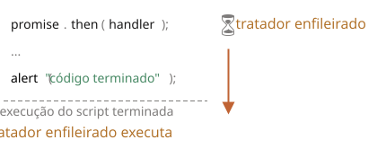

# Microtarefas

Tratadores de promessas `.then`/`.catch`/`.finally` são sempre assíncronos.

Mesmo quando uma promessa é resolvida imediatamente, o código nas linhas *abaixo* de `.then`/`.catch`/`.finally` ainda vai executar antes desses tratadores.

Aqui está uma demonstração:

```js run
let promise = Promise.resolve();

promise.then(() => alert("promessa concluída!"));

alert("código terminado"); // esse alert aparece primeiro
```

Se você rodar isso, verá `código terminado` primeiro, e depois `promessa concluída!`.

Isso é estranho, porque a promessa claramente já está pronta desde o início.

Por que o `.then` disparou depois? O que está acontecendo?

## Fila de microtarefas

Tarefas assíncronas precisam de um gerenciamento adequado. Para isso, o padrão ECMA especifica uma fila interna `PromiseJobs`, mais comumente chamada de "fila de microtarefas" (*microtask queue*, termo do V8).

Como dito na [especificação](https://tc39.github.io/ecma262/#sec-jobs-and-job-queues):

- A fila é "primeiro a entrar, primeiro a sair" (FIFO): tarefas colocadas na fila primeiro são executadas primeiro.
- A execução de uma tarefa só é iniciada quando mais nada está rodando.

Ou, colocando de forma mais simples, quando uma promessa está pronta, seus tratadores `.then/catch/finally` são colocados na fila; eles ainda não são executados. Quando o motor do JavaScript fica livre do código atual, ele pega uma tarefa da fila e a executa.

É por isso que "código terminado" no exemplo acima aparece primeiro.



Tratadores de promessas sempre passam por essa fila interna.

Se houver uma cadeia com múltiplos `.then/catch/finally`, então cada um deles é executado de forma assíncrona. Ou seja, primeiro ele entra na fila, depois é executado quando o código atual termina e os tratadores enfileirados anteriormente são concluídos.

**E se a ordem importa para a gente? Como podemos fazer `código terminado` aparecer depois de `promessa concluída`?**

Fácil, é só colocar na fila com `.then`:

```js run
Promise.resolve()
  .then(() => alert("promessa concluída!"))
  .then(() => alert("código terminado"));
```

Agora a ordem é a pretendida.

## Rejeição não tratada

Lembra do evento `unhandledrejection` do artigo <info:promise-error-handling>?

Agora podemos ver exatamente como o JavaScript descobre que houve uma rejeição não tratada.

**Uma "rejeição não tratada" acontece quando um erro de promessa não é tratado até o fim da fila de microtarefas.**

Normalmente, se esperamos um erro, adicionamos `.catch` à cadeia de promessas para tratá-lo:

```js run
let promise = Promise.reject(new Error("A promessa falhou!"));
*!*
promise.catch(err => alert('capturado'));
*/!*

// não roda: o erro foi tratado
window.addEventListener('unhandledrejection', event => alert(event.reason));
```

Mas se esquecermos de adicionar o `.catch`, então, depois que a fila de microtarefas fica vazia, o motor dispara o evento:

```js run
let promise = Promise.reject(new Error("A promessa falhou!"));

// A promessa falhou!
window.addEventListener('unhandledrejection', event => alert(event.reason));
```

E se tratarmos o erro mais tarde? Assim:

```js run
let promise = Promise.reject(new Error("A promessa falhou!"));
*!*
setTimeout(() => promise.catch(err => alert('capturado')), 1000);
*/!*

// Error: A promessa falhou!
window.addEventListener('unhandledrejection', event => alert(event.reason));
```

Agora, se rodarmos isso, vamos ver `A promessa falhou!` primeiro e depois `capturado`.

Se não soubéssemos sobre a fila de microtarefas, poderíamos nos perguntar: "Por que o tratador de `unhandledrejection` rodou? Nós capturamos e tratamos o erro!"

Mas agora entendemos que o `unhandledrejection` é gerado quando a fila de microtarefas termina de ser processada: o motor examina as promessas e, se qualquer uma delas estiver no estado "rejected", o evento dispara.

No exemplo acima, o `.catch` adicionado pelo `setTimeout` também dispara. Mas isso acontece depois, após o `unhandledrejection` já ter ocorrido, então não muda nada.

## Resumo

O tratamento de promessas é sempre assíncrono, já que todas as ações de promessas passam pela fila interna de "promise jobs", também chamada de "fila de microtarefas" (termo do V8).

Então os tratadores `.then/catch/finally` são sempre chamados depois que o código atual termina.

Se precisarmos garantir que um trecho de código seja executado depois de `.then/catch/finally`, podemos adicioná-lo em uma chamada `.then` encadeada.

Na maioria dos motores JavaScript, incluindo navegadores e Node.js, o conceito de microtarefas está intimamente ligado ao "loop de eventos" e às "macrotarefas". Como eles não têm relação direta com promessas, são abordados em outra parte do tutorial, no artigo <info:event-loop>.
