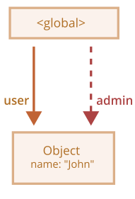
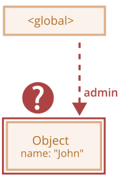
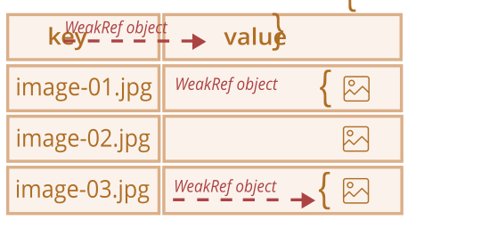
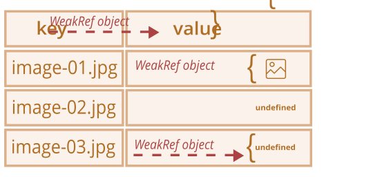
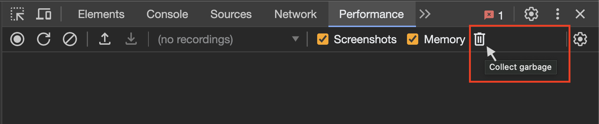
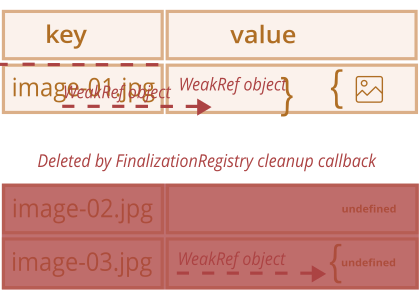
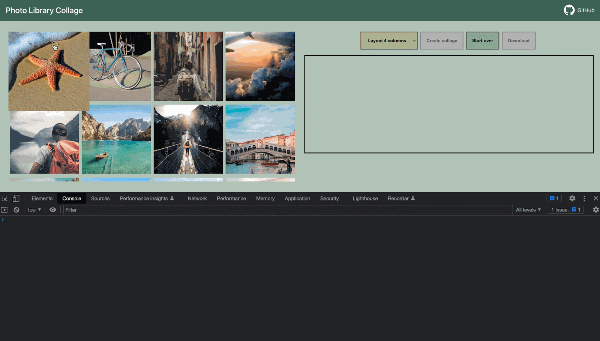

# WeakRef e FinalizationRegistry

```warn header="Recursos \"ocultos\" da linguagem"
Este artigo aborda um tópico muito específico, que a maioria dos desenvolvedores raramente encontra na prática (e pode até não ter conhecimento da sua existência).

Recomendamos pular este capítulo se você está apenas começando a aprender JavaScript.
```

Recordando o conceito básico do *princípio de alcançabilidade* do capítulo <info:garbage-collection>,
podemos notar que o motor JavaScript garante manter em memória os valores que são acessíveis ou estão em uso.

Por exemplo:


```js
//  a variável user mantém uma referência forte ao objeto
let user = { name: "John" };

// vamos sobrescrever o valor da variável user
user = null;

// a referência é perdida e o objeto será excluído da memória

```

Ou um código similar, mas um pouco mais complexo, com duas referências fortes:

```js
//  a variável user mantém uma referência forte ao objeto
let user = { name: "John" };

// copiamos a referência forte ao objeto para a variável admin
*!*
let admin = user;
*/!*

// vamos sobrescrever o valor da variável user
user = null;

// o objeto ainda é alcançável através da variável admin
```
O objeto `{ name: "John" }` só seria excluído da memória se não houvesse referências fortes a ele (se também sobrescrevêssemos o valor da variável `admin`).

Em JavaScript, existe um conceito chamado `WeakRef`, que se comporta de forma um pouco diferente nesse caso.


````smart header="Termos: \"Referência forte\", \"Referência fraca\""
**Referência forte** - é uma referência a um objeto ou valor, que impede que ele seja excluído pelo coletor de lixo. Com isso, mantém o objeto ou valor ao qual aponta na memória.

Isso significa que o objeto ou valor permanece na memória e não é coletado pelo coletor de lixo enquanto houver referências fortes ativas a ele.

Em JavaScript, referências comuns a objetos são referências fortes. Por exemplo:

```js
// a variável user mantém uma referência forte a este objeto
let user = { name: "John" };
```
**Referência fraca** - é uma referência a um objeto ou valor, que *não* impede que ele seja excluído pelo coletor de lixo.
Um objeto ou valor pode ser excluído pelo coletor de lixo se as únicas referências restantes a ele forem referências fracas.
````

## WeakRef


````warn header="Nota de cautela"
Antes de nos aprofundarmos nisso, vale ressaltar que o uso correto das estruturas discutidas neste artigo exige muita atenção, e, se possível, é melhor evitá-las.
````

`WeakRef` - é um objeto que contém uma referência fraca a outro objeto, chamado `target` ou `referent`.

A particularidade do `WeakRef` é que ele não impede que o coletor de lixo exclua seu objeto-referente. Em outras palavras, um objeto `WeakRef` não mantém o objeto `referent` vivo.

Agora vamos usar a variável `user` como o "referent" e criar uma referência fraca dela para a variável `admin`.
Para criar uma referência fraca, é preciso usar o construtor `WeakRef`, passando o objeto de destino (o objeto ao qual se quer criar uma referência fraca).

No nosso caso — essa é a variável `user`:


```js
//  a variável user mantém uma referência forte ao objeto
let user = { name: "John" };

//  a variável admin mantém uma referência fraca ao objeto
*!*
let admin = new WeakRef(user);
*/!*

```

O diagrama abaixo representa dois tipos de referências: uma referência forte usando a variável `user` e uma referência fraca usando a variável `admin`:



Então, em algum momento, deixamos de usar a variável `user` - ela é sobrescrita, sai de escopo, etc., enquanto mantemos a instância de `WeakRef` na variável `admin`:

```js
// vamos sobrescrever o valor da variável user
user = null;
```

Uma referência fraca a um objeto não é suficiente para mantê-lo "vivo". Quando as únicas referências restantes a um objeto-referente são referências fracas, o coletor de lixo tem liberdade para destruir esse objeto e usar sua memória para outra coisa.

No entanto, até que o objeto seja de fato destruído, a referência fraca pode retorná-lo, mesmo que não haja mais referências fortes a esse objeto.
Ou seja, nosso objeto se torna uma espécie de "[gato de Schrödinger](https://pt.wikipedia.org/wiki/Gato_de_Schr%C3%B6dinger)" – não podemos saber com certeza se ele está "vivo" ou "morto":



Neste ponto, para obter o objeto a partir da instância de `WeakRef`, usaremos seu método `deref()`.

O método `deref()` retorna o objeto-referente ao qual o `WeakRef` aponta, se o objeto ainda estiver na memória. Se o objeto já foi excluído pelo coletor de lixo, então o método `deref()` retornará `undefined`:


```js
let ref = admin.deref();

if (ref) {
  // o objeto ainda é acessível: podemos realizar qualquer manipulação com ele
} else {
  // o objeto já foi coletado pelo coletor de lixo
}
```

## Casos de uso do WeakRef

`WeakRef` é normalmente usado para criar caches ou [arrays associativos](https://en.wikipedia.org/wiki/Associative_array) que armazenam objetos que consomem muitos recursos.
Isso permite evitar que esses objetos sejam impedidos de serem coletados pelo coletor de lixo apenas por estarem presentes no cache ou array associativo.

Um dos principais exemplos - é uma situação em que temos numerosos objetos binários de imagem (por exemplo, representados como `ArrayBuffer` ou `Blob`), e queremos associar um nome ou caminho a cada imagem.
As estruturas de dados existentes não são muito adequadas para esse propósito:

- Usar `Map` para criar associações entre nomes e imagens, ou vice-versa, manterá os objetos de imagem na memória, já que eles estão presentes no `Map` como chaves ou valores.
- `WeakMap` também não é adequado para esse objetivo: porque os objetos representados como chaves de `WeakMap` usam referências fracas, e não estão protegidos contra exclusão pelo coletor de lixo.

Mas, nessa situação, precisamos de uma estrutura de dados que use referências fracas em seus valores.

Para esse propósito, podemos usar uma coleção `Map`, cujos valores são instâncias de `WeakRef` referindo-se aos objetos grandes de que precisamos.
Consequentemente, não manteremos esses objetos grandes e desnecessários na memória por mais tempo do que deveríamos.

De outra forma, essa é uma maneira de obter o objeto de imagem do cache se ele ainda estiver alcançável.
Se ele já foi coletado pelo coletor de lixo, iremos gerá-lo ou baixá-lo novamente.

Dessa forma, menos memória é usada em algumas situações.

## Exemplo №1: usando WeakRef para cache

Abaixo está um trecho de código que demonstra a técnica de uso do `WeakRef`.

Em resumo, usamos um `Map` com chaves de string e objetos `WeakRef` como seus valores.
Se o objeto `WeakRef` não tiver sido coletado pelo coletor de lixo, nós o obtemos do cache.
Caso contrário, nós o baixamos novamente e o colocamos no cache para possível reutilização futura:

```js
function fetchImg() {
    // função abstrata para baixar imagens...
}

function weakRefCache(fetchImg) { // (1)
    const imgCache = new Map(); // (2)

    return (imgName) => { // (3)
        const cachedImg = imgCache.get(imgName); // (4)

        if (cachedImg?.deref()) { // (5)
            return cachedImg?.deref();
        }

        const newImg = fetchImg(imgName); // (6)
        imgCache.set(imgName, new WeakRef(newImg)); // (7)

        return newImg;
    };
}

const getCachedImg = weakRefCache(fetchImg);
```

Vamos nos aprofundar nos detalhes do que aconteceu aqui:
1. `weakRefCache` - é uma função de ordem superior que recebe outra função, `fetchImg`, como argumento. Neste exemplo, podemos desconsiderar uma descrição detalhada da função `fetchImg`, já que ela pode ser qualquer lógica para baixar imagens.
2. `imgCache` - é um cache de imagens, que armazena os resultados em cache da função `fetchImg`, na forma de chaves de string (nome da imagem) e objetos `WeakRef` como seus valores.
3. Retorna uma função anônima que recebe o nome da imagem como argumento. Esse argumento será usado como chave para a imagem em cache.
4. Tentando obter o resultado em cache a partir do cache, usando a chave fornecida (nome da imagem).
5. Se o cache contiver um valor para a chave especificada, e o objeto `WeakRef` não tiver sido excluído pelo coletor de lixo, retorna o resultado em cache.
6. Se não houver entrada no cache com a chave solicitada, ou o método `deref()` retornar `undefined` (significando que o objeto `WeakRef` foi coletado pelo coletor de lixo), a função `fetchImg` baixa a imagem novamente.
7. Coloca a imagem baixada no cache como um objeto `WeakRef`.

Agora temos uma coleção `Map`, onde as chaves - são nomes de imagens como strings, e os valores - são objetos `WeakRef` contendo as próprias imagens.

Essa técnica ajuda a evitar a alocação de uma grande quantidade de memória para objetos que consomem muitos recursos e que não são mais usados por ninguém.
Também economiza memória e tempo no caso de reutilização de objetos em cache.

Aqui está uma representação visual de como esse código se parece:



Mas essa implementação tem suas desvantagens: com o tempo, o `Map` será preenchido com strings como chaves, que apontam para um `WeakRef` cujo objeto-referente já foi coletado pelo coletor de lixo:



Uma forma de lidar com esse problema - é limpar periodicamente o cache e remover as entradas "mortas".
Outra forma - é usar finalizadores, que exploraremos a seguir.


## Exemplo №2: Usando WeakRef para rastrear objetos do DOM

Outro caso de uso para `WeakRef` - é rastrear objetos do DOM.

Vamos imaginar um cenário em que algum código ou biblioteca de terceiros interage com elementos da nossa página enquanto eles existirem no DOM.
Por exemplo, pode ser um utilitário externo para monitorar e notificar sobre o estado do sistema (comumente chamado de "logger" – um programa que envia mensagens informativas chamadas "logs").

Exemplo interativo:

[codetabs height=420 src="weakref-dom"]

Quando o botão "Começar a enviar mensagens" é clicado, na chamada "janela de exibição de logs" (um elemento com a classe `.window__body`), mensagens (logs) começam a aparecer.

Mas, assim que esse elemento é excluído do DOM, o logger deve parar de enviar mensagens.
Para reproduzir a remoção desse elemento, basta clicar no botão "Fechar" no canto superior direito.

Para não complicar nosso trabalho, e não notificar o código de terceiros a cada vez que nosso elemento do DOM está disponível, e quando não está, será suficiente criar uma referência fraca a ele usando `WeakRef`.

Uma vez que o elemento é removido do DOM, o logger irá notar isso e parar de enviar mensagens.

Agora vamos dar uma olhada mais de perto no código-fonte (*aba `index.js`*):

1. Obtém o elemento do DOM do botão "Começar a enviar mensagens".
2. Obtém o elemento do DOM do botão "Fechar".
3. Obtém o elemento do DOM da janela de exibição de logs usando o construtor `new WeakRef()`. Dessa forma, a variável `windowElementRef` mantém uma referência fraca ao elemento do DOM.
4. Adiciona um ouvinte de evento no botão "Começar a enviar mensagens", responsável por iniciar o logger quando clicado.
5. Adiciona um ouvinte de evento no botão "Fechar", responsável por fechar a janela de exibição de logs quando clicado.
6. Usa `setInterval` para começar a exibir uma nova mensagem a cada segundo.
7. Se o elemento do DOM da janela de exibição de logs ainda estiver acessível e mantido na memória, cria e envia uma nova mensagem.
8. Se o método `deref()` retornar `undefined`, significa que o elemento do DOM foi excluído da memória. Nesse caso, o logger para de exibir mensagens e limpa o temporizador.
9. `alert`, que será chamado, depois que o elemento do DOM da janela de exibição de logs for excluído da memória (ou seja, após clicar no botão "Fechar"). **Observe que a exclusão da memória pode não ocorrer imediatamente, pois depende apenas dos mecanismos internos do coletor de lixo.**

   Não podemos controlar esse processo diretamente a partir do código. No entanto, apesar disso, ainda temos a opção de forçar a coleta de lixo a partir do navegador.

   No Google Chrome, por exemplo, para fazer isso, é necessário abrir as ferramentas de desenvolvedor (`key:Ctrl` + `key:Shift` + `key:J` no Windows/Linux ou `key:Option` + `key:⌘` + `key:J` no macOS), ir até a aba "Performance" e clicar no botão do ícone de lixeira – "Collect garbage":

   

    <br>
    Essa funcionalidade é suportada na maioria dos navegadores modernos. Após as ações serem realizadas, o <code>alert</code> será disparado imediatamente.

## FinalizationRegistry

Agora é hora de falar sobre finalizadores. Antes de continuarmos, vamos esclarecer a terminologia:

**Callback de limpeza (finalizador)** - é uma função que é executada, quando um objeto, registrado no `FinalizationRegistry`, é excluído da memória pelo coletor de lixo.

Seu propósito - é fornecer a capacidade de realizar operações adicionais, relacionadas ao objeto, depois que ele foi finalmente excluído da memória.

**Registro** (ou `FinalizationRegistry`) - é um objeto especial em JavaScript que gerencia o registro e o cancelamento de registro de objetos e seus callbacks de limpeza.

Esse mecanismo permite registrar um objeto para rastreamento e associar um callback de limpeza a ele.
Essencialmente, é uma estrutura que armazena informações sobre objetos registrados e seus callbacks de limpeza, e então invoca automaticamente esses callbacks quando os objetos são excluídos da memória.

Para criar uma instância de `FinalizationRegistry`, é necessário chamar seu construtor, que recebe um único argumento - o callback de limpeza (finalizador).

Sintaxe:

```js
function cleanupCallback(heldValue) {
  // código do callback de limpeza
}

const registry = new FinalizationRegistry(cleanupCallback);
```

Aqui:

- `cleanupCallback` - um callback de limpeza que será chamado automaticamente quando um objeto registrado for excluído da memória.
- `heldValue` - o valor que é passado como argumento para o callback de limpeza. Se `heldValue` for um objeto, o registro mantém uma referência forte a ele.
- `registry` - uma instância de `FinalizationRegistry`.

Métodos do `FinalizationRegistry`:

- `register(target, heldValue [, unregisterToken])` - usado para registrar objetos no registro.

  `target` - o objeto sendo registrado para rastreamento. Se o `target` for coletado pelo coletor de lixo, o callback de limpeza será chamado com `heldValue` como seu argumento.

  `unregisterToken` opcional – um token de cancelamento de registro. Ele pode ser passado para cancelar o registro de um objeto antes que o coletor de lixo o exclua. Normalmente, o próprio objeto `target` é usado como `unregisterToken`, o que é a prática padrão.
- `unregister(unregisterToken)` - o método `unregister` é usado para cancelar o registro de um objeto no registro. Ele recebe um argumento - `unregisterToken` (o token de cancelamento de registro que foi obtido ao registrar o objeto).

Agora vamos avançar para um exemplo simples. Vamos usar o objeto `user` já conhecido e criar uma instância de `FinalizationRegistry`:

```js
let user = { name: "John" };

const registry = new FinalizationRegistry((heldValue) => {
  console.log(`${heldValue} foi coletado pelo coletor de lixo.`);
});
```

Então, vamos registrar o objeto que requer um callback de limpeza chamando o método `register`:

```js
registry.register(user, user.name);
```

O registro não mantém uma referência forte ao objeto registrado, pois isso frustraria seu propósito. Se o registro mantivesse uma referência forte, então o objeto nunca seria coletado pelo coletor de lixo.

Se o objeto for excluído pelo coletor de lixo, nosso callback de limpeza pode ser chamado em algum momento futuro, com o `heldValue` passado para ele:

```js
// Quando o objeto user é excluído pelo coletor de lixo, a seguinte mensagem será exibida na console:
"John foi coletado pelo coletor de lixo."
```

Também existem situações em que, mesmo em implementações que usam um callback de limpeza, há uma chance de que ele não seja chamado.

Por exemplo:
- Quando o programa termina completamente sua operação (por exemplo, ao fechar uma aba do navegador).
- Quando a própria instância de `FinalizationRegistry` não é mais alcançável pelo código JavaScript.
  Se o objeto que cria a instância de `FinalizationRegistry` sai de escopo ou é excluído, os callbacks de limpeza registrados nesse registro também podem não ser chamados.

## Cache com FinalizationRegistry

Voltando ao nosso exemplo de cache *fraco*, podemos notar o seguinte:
- Mesmo que os valores encapsulados em `WeakRef` tenham sido coletados pelo coletor de lixo, ainda há um problema de "vazamento de memória" na forma das chaves restantes, cujos valores já foram coletados pelo coletor de lixo.

Aqui está um exemplo melhorado de cache usando `FinalizationRegistry`:

```js
function fetchImg() {
  // função abstrata para baixar imagens...
}

function weakRefCache(fetchImg) {
  const imgCache = new Map();

  *!*
  const registry = new FinalizationRegistry((imgName) => { // (1)
    const cachedImg = imgCache.get(imgName);
    if (cachedImg && !cachedImg.deref()) imgCache.delete(imgName);
  });
  */!*

  return (imgName) => {
    const cachedImg = imgCache.get(imgName);

    if (cachedImg?.deref()) {
      return cachedImg?.deref();
    }

    const newImg = fetchImg(imgName);
    imgCache.set(imgName, new WeakRef(newImg));
    *!*
    registry.register(newImg, imgName); // (2)
    */!*

    return newImg;
  };
}

const getCachedImg = weakRefCache(fetchImg);
```

1. Para gerenciar a limpeza de entradas "mortas" do cache, quando os objetos `WeakRef` associados são coletados pelo coletor de lixo, criamos um registro de limpeza `FinalizationRegistry`.

   O ponto importante aqui é que, no callback de limpeza, deve-se verificar se a entrada foi excluída pelo coletor de lixo e não foi adicionada novamente, para não excluir uma entrada "viva".
2. Depois que o novo valor (imagem) é baixado e colocado no cache, nós o registramos no registro do finalizador para rastrear o objeto `WeakRef`.

Essa implementação contém apenas pares chave/valor atuais, ou "vivos".
Nesse caso, cada objeto `WeakRef` é registrado no `FinalizationRegistry`.
E depois que os objetos são limpos pelo coletor de lixo, o callback de limpeza excluirá todos os valores `undefined`.

Aqui está uma representação visual do código atualizado:



Um aspecto fundamental da implementação atualizada é que os finalizadores permitem criar processos paralelos entre o programa "principal" e os callbacks de limpeza.
No contexto do JavaScript, o programa "principal" - é nosso código JavaScript, que roda e é executado na nossa aplicação ou página web.

Portanto, do momento em que um objeto é marcado para exclusão pelo coletor de lixo, até a execução real do callback de limpeza, pode haver um certo intervalo de tempo.
É importante entender que, durante esse intervalo de tempo, o programa principal pode fazer qualquer alteração no objeto ou até trazê-lo de volta à memória.

É por isso que, no callback de limpeza, devemos verificar se uma entrada foi adicionada novamente ao cache pelo programa principal, para evitar excluir entradas "vivas".
Da mesma forma, ao procurar uma chave no cache, há uma chance de que o valor já tenha sido excluído pelo coletor de lixo, mas o callback de limpeza ainda não tenha sido executado.

Tais situações exigem atenção especial se você está trabalhando com `FinalizationRegistry`.

## Usando WeakRef e FinalizationRegistry na prática

Passando da teoria para a prática, imagine um cenário da vida real, em que um usuário sincroniza suas fotos em um dispositivo móvel com algum serviço de nuvem
(como [iCloud](https://en.wikipedia.org/wiki/ICloud) ou [Google Photos](https://en.wikipedia.org/wiki/Google_Photos)),
e quer visualizá-las a partir de outros dispositivos. Além da funcionalidade básica de visualização de fotos, esses serviços oferecem muitos recursos adicionais, por exemplo:

- Edição de fotos e efeitos de vídeo.
- Criação de "memórias" e álbuns.
- Montagem de vídeo a partir de uma série de fotos.
- ...e muito mais.

Aqui, como exemplo, usaremos uma implementação bastante primitiva de um serviço desse tipo.
O ponto principal - é mostrar um possível cenário de uso de `WeakRef` e `FinalizationRegistry` juntos na vida real.

Veja como ele se parece:


<br>
No lado esquerdo, há uma biblioteca de fotos na nuvem (exibidas como miniaturas).
Podemos selecionar as imagens que precisamos e criar uma colagem, clicando no botão "Criar colagem" no lado direito da página.
Em seguida, a colagem resultante pode ser baixada como uma imagem.
</br><br>

Para aumentar a velocidade de carregamento da página, seria razoável baixar e exibir as miniaturas das fotos em qualidade *comprimida*.
Mas, para criar uma colagem a partir das fotos selecionadas, baixá-las e usá-las em qualidade *tamanho real*.

Abaixo, podemos ver que o tamanho intrínseco das miniaturas é 240x240 pixels.
O tamanho foi escolhido propositalmente para aumentar a velocidade de carregamento.
Além disso, não precisamos de fotos em tamanho real no modo de pré-visualização.


<br>
Vamos supor que precisamos criar uma colagem de 4 fotos: nós as selecionamos e, então, clicamos no botão "Criar colagem".
Nesta etapa, a já conhecida função <code>weakRefCache</code> verifica se a imagem necessária está no cache.
Se não estiver, ela a baixa da nuvem e a coloca no cache para uso futuro.
Isso acontece para cada imagem selecionada:
</br><br>



</br>

Observando a saída na console, você pode ver quais das fotos foram baixadas da nuvem - isso é indicado por <span style="background-color:#133159;color:white;font-weight:500">FETCHED_IMAGE</span>.
Como esta é a primeira tentativa de criar uma colagem, isso significa que, nesta etapa, o "cache fraco" ainda estava vazio, e todas as fotos foram baixadas da nuvem e colocadas nele.

Mas, junto com o processo de download de imagens, há também um processo de limpeza de memória pelo coletor de lixo.
Isso significa que o objeto armazenado no cache, ao qual nos referimos usando uma referência fraca, é excluído pelo coletor de lixo.
E nosso finalizador é executado com sucesso, excluindo assim a chave pela qual a imagem estava armazenada no cache.
<span style="background-color:#901e30;color:white;font-weight:500;">CLEANED_IMAGE</span> nos notifica sobre isso:


<br>
A seguir, percebemos que não gostamos da colagem resultante e decidimos trocar uma das imagens e criar uma nova.
Para fazer isso, basta desmarcar a imagem desnecessária, selecionar outra e clicar no botão "Criar colagem" novamente:
</br><br>


<br>
Mas, desta vez, nem todas as imagens foram baixadas da rede, e uma delas foi retirada do cache fraco: a mensagem <span style="background-color:#385950;color:white;font-weight:500;">CACHED_IMAGE</span> nos informa sobre isso.
Isso significa que, no momento da criação da colagem, o coletor de lixo ainda não havia excluído nossa imagem, e nós, com segurança, a retiramos do cache,
reduzindo assim o número de requisições de rede e acelerando o tempo geral do processo de criação da colagem:
</br><br>


<br>
Vamos "brincar" um pouco mais, substituindo uma das imagens novamente e criando uma nova colagem:
</br><br>


<br>
Desta vez, o resultado é ainda mais impressionante. Das 4 imagens selecionadas, 3 delas foram retiradas do cache fraco, e apenas uma precisou ser baixada da rede.
A redução na carga de rede foi de cerca de 75%. Impressionante, não é?
</br><br>


</br>

É claro que é importante lembrar que esse comportamento não é garantido e depende da implementação e operação específicas do coletor de lixo.

Com base nisso, surge imediatamente uma pergunta completamente lógica: por que não usamos um cache comum, onde podemos gerenciar suas entidades nós mesmos, em vez de depender do coletor de lixo?
É isso mesmo, na grande maioria dos casos não há necessidade de usar `WeakRef` e `FinalizationRegistry`.

Aqui, simplesmente demonstramos uma implementação alternativa de funcionalidade semelhante, usando uma abordagem não trivial com recursos interessantes da linguagem.
Ainda assim, não podemos confiar neste exemplo se precisarmos de um resultado constante e previsível.

Você pode [abrir este exemplo no sandbox](sandbox:weakref-finalizationregistry).

## Resumo

`WeakRef` - projetado para criar referências fracas a objetos, permitindo que eles sejam excluídos da memória pelo coletor de lixo caso não haja mais referências fortes a eles.
Isso é benéfico para resolver o uso excessivo de memória e otimizar a utilização de recursos do sistema em aplicações.

`FinalizationRegistry` - é uma ferramenta para registrar callbacks, que são executados quando objetos que não têm mais referências fortes são destruídos.
Isso permite liberar recursos associados ao objeto ou realizar outras operações necessárias antes de excluir o objeto da memória.
