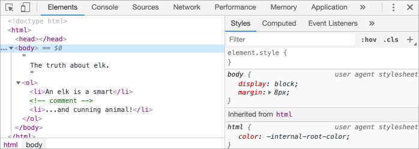
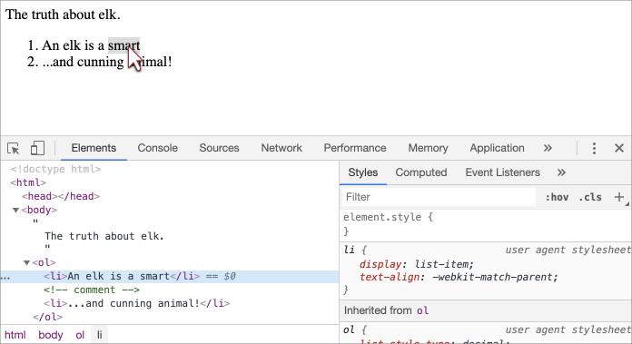
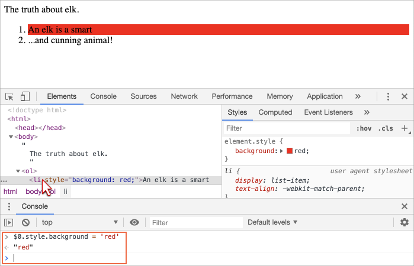
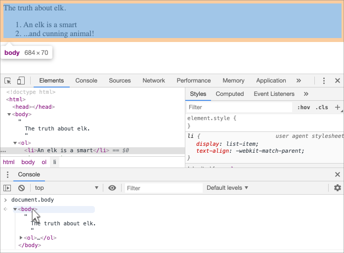

libs:
  - d3
  - domtree

---

# Árvore DOM

A espinha dorsal de um documento HTML são as tags.

De acordo com o Document Object Model (DOM), toda tag HTML é um objeto. Tags aninhadas são "filhas" da que as envolve. O texto dentro de uma tag também é um objeto.

Todos esses objetos são acessíveis usando JavaScript, e podemos usá-los para modificar a página.

Por exemplo, `document.body` é o objeto que representa a tag `<body>`.

Rodar este código vai deixar o `<body>` vermelho por 3 segundos:

```js run
document.body.style.background = 'red'; // deixa o fundo vermelho

setTimeout(() => document.body.style.background = '', 3000); // volta ao normal
```

Aqui usamos `style.background` para mudar a cor de fundo de `document.body`, mas existem muitas outras propriedades, como:

- `innerHTML` -- conteúdo HTML do nó.
- `offsetWidth` -- a largura do nó (em pixels)
- ...e assim por diante.

Em breve vamos aprender mais formas de manipular o DOM, mas primeiro precisamos conhecer sua estrutura.

## Um exemplo do DOM

Vamos começar com o seguinte documento simples:

```html run no-beautify
<!DOCTYPE HTML>
<html>
<head>
  <title>About elk</title>
</head>
<body>
  The truth about elk.
</body>
</html>
```

O DOM representa o HTML como uma estrutura em árvore de tags. Veja como ela se parece:

<div class="domtree"></div>

<script>
let node1 = {"name":"HTML","nodeType":1,"children":[{"name":"HEAD","nodeType":1,"children":[{"name":"#text","nodeType":3,"content":"\n  "},{"name":"TITLE","nodeType":1,"children":[{"name":"#text","nodeType":3,"content":"About elk"}]},{"name":"#text","nodeType":3,"content":"\n"}]},{"name":"#text","nodeType":3,"content":"\n"},{"name":"BODY","nodeType":1,"children":[{"name":"#text","nodeType":3,"content":"\n  The truth about elk.\n"}]}]}

drawHtmlTree(node1, 'div.domtree', 690, 320);
</script>

```online
Na imagem acima, você pode clicar nos nós de elemento e seus filhos vão abrir/fechar.
```

Todo nó da árvore é um objeto.

Tags são *nós de elemento* (ou só elementos) e formam a estrutura em árvore: `<html>` está na raiz, depois `<head>` e `<body>` são seus filhos, etc.

O texto dentro de elementos forma *nós de texto*, rotulados como `#text`. Um nó de texto contém só uma string. Ele não pode ter filhos e é sempre uma folha da árvore.

Por exemplo, a tag `<title>` tem o texto `"About elk"`.

Observe os caracteres especiais nos nós de texto:

- uma quebra de linha: `↵` (no JavaScript conhecida como `\n`)
- um espaço: `␣`

Espaços e quebras de linha são caracteres totalmente válidos, como letras e dígitos. Eles formam nós de texto e se tornam parte do DOM. Então, por exemplo, no exemplo acima a tag `<head>` contém alguns espaços antes de `<title>`, e esse texto se torna um nó `#text` (ele contém uma quebra de linha e alguns espaços apenas).

Existem só duas exclusões de nível superior:
1. Espaços e quebras de linha antes de `<head>` são ignorados por motivos históricos.
2. Se colocarmos algo depois de `</body>`, então isso é movido automaticamente para dentro do `body`, no final, já que a especificação HTML exige que todo o conteúdo esteja dentro de `<body>`. Então não pode haver nenhum espaço depois de `</body>`.

Em outros casos, tudo é direto -- se houver espaços (assim como qualquer caractere) no documento, então eles se tornam nós de texto no DOM, e se os removermos, então não vai haver nenhum.

Aqui não há nós de texto só com espaço:

```html no-beautify
<!DOCTYPE HTML>
<html><head><title>About elk</title></head><body>The truth about elk.</body></html>
```

<div class="domtree"></div>

<script>
let node2 = {"name":"HTML","nodeType":1,"children":[{"name":"HEAD","nodeType":1,"children":[{"name":"TITLE","nodeType":1,"children":[{"name":"#text","nodeType":3,"content":"About elk"}]}]},{"name":"BODY","nodeType":1,"children":[{"name":"#text","nodeType":3,"content":"The truth about elk."}]}]}

drawHtmlTree(node2, 'div.domtree', 690, 210);
</script>

```smart header="Espaços no início/fim de strings e nós de texto só com espaço geralmente ficam ocultos nas ferramentas"
Ferramentas de navegador (que vamos abordar em breve) que trabalham com o DOM geralmente não mostram espaços no início/fim do texto e nós de texto vazios (quebras de linha) entre tags.

As ferramentas de desenvolvedor economizam espaço na tela dessa forma.

Em imagens futuras do DOM, às vezes vamos omiti-los quando forem irrelevantes. Esses espaços geralmente não afetam como o documento é exibido.
```

## Autocorreção

Se o navegador encontrar HTML malformado, ele o corrige automaticamente ao criar o DOM.

Por exemplo, a tag do topo é sempre `<html>`. Mesmo que ela não exista no documento, ela vai existir no DOM, porque o navegador vai criá-la. O mesmo vale para `<body>`.

Como exemplo, se o arquivo HTML for só a palavra `"Hello"`, o navegador vai envolvê-la em `<html>` e `<body>`, e adicionar o `<head>` necessário, e o DOM vai ser:


<div class="domtree"></div>

<script>
let node3 = {"name":"HTML","nodeType":1,"children":[{"name":"HEAD","nodeType":1,"children":[]},{"name":"BODY","nodeType":1,"children":[{"name":"#text","nodeType":3,"content":"Hello"}]}]}

drawHtmlTree(node3, 'div.domtree', 690, 150);
</script>

Ao gerar o DOM, os navegadores processam automaticamente erros no documento, fecham tags e assim por diante.

Um documento com tags não fechadas:

```html no-beautify
<p>Hello
<li>Mom
<li>and
<li>Dad
```

...vai se tornar um DOM normal conforme o navegador lê as tags e restaura as partes que faltam:

<div class="domtree"></div>

<script>
let node4 = {"name":"HTML","nodeType":1,"children":[{"name":"HEAD","nodeType":1,"children":[]},{"name":"BODY","nodeType":1,"children":[{"name":"P","nodeType":1,"children":[{"name":"#text","nodeType":3,"content":"Hello"}]},{"name":"LI","nodeType":1,"children":[{"name":"#text","nodeType":3,"content":"Mom"}]},{"name":"LI","nodeType":1,"children":[{"name":"#text","nodeType":3,"content":"and"}]},{"name":"LI","nodeType":1,"children":[{"name":"#text","nodeType":3,"content":"Dad"}]}]}]}

drawHtmlTree(node4, 'div.domtree', 690, 360);
</script>

````warn header="Tabelas sempre têm `<tbody>`"
Um "caso especial" interessante são as tabelas. Pela especificação do DOM elas devem ter a tag `<tbody>`, mas o texto HTML pode omiti-la. Então o navegador cria `<tbody>` no DOM automaticamente.

Para o HTML:

```html no-beautify
<table id="table"><tr><td>1</td></tr></table>
```

A estrutura do DOM vai ser:
<div class="domtree"></div>

<script>
let node5 = {"name":"TABLE","nodeType":1,"children":[{"name":"TBODY","nodeType":1,"children":[{"name":"TR","nodeType":1,"children":[{"name":"TD","nodeType":1,"children":[{"name":"#text","nodeType":3,"content":"1"}]}]}]}]};

drawHtmlTree(node5,  'div.domtree', 600, 200);
</script>

Viu? A `<tbody>` apareceu do nada. Devemos ter isso em mente ao trabalhar com tabelas para evitar surpresas.
````

## Outros tipos de nó

Existem alguns outros tipos de nó além de elementos e nós de texto.

Por exemplo, comentários:

```html
<!DOCTYPE HTML>
<html>
<body>
  The truth about elk.
  <ol>
    <li>An elk is a smart</li>
*!*
    <!-- comment -->
*/!*
    <li>...and cunning animal!</li>
  </ol>
</body>
</html>
```

<div class="domtree"></div>

<script>
let node6 = {"name":"HTML","nodeType":1,"children":[{"name":"HEAD","nodeType":1,"children":[]},{"name":"BODY","nodeType":1,"children":[{"name":"#text","nodeType":3,"content":"\n  The truth about elk.\n  "},{"name":"OL","nodeType":1,"children":[{"name":"#text","nodeType":3,"content":"\n    "},{"name":"LI","nodeType":1,"children":[{"name":"#text","nodeType":3,"content":"An elk is a smart"}]},{"name":"#text","nodeType":3,"content":"\n    "},{"name":"#comment","nodeType":8,"content":"comment"},{"name":"#text","nodeType":3,"content":"\n    "},{"name":"LI","nodeType":1,"children":[{"name":"#text","nodeType":3,"content":"...and cunning animal!"}]},{"name":"#text","nodeType":3,"content":"\n  "}]},{"name":"#text","nodeType":3,"content":"\n\n\n"}]}]};

drawHtmlTree(node6, 'div.domtree', 690, 500);
</script>

Podemos ver aqui um novo tipo de nó da árvore -- *nó de comentário*, rotulado como `#comment`, entre dois nós de texto.

Podemos pensar -- por que um comentário é adicionado ao DOM? Ele não afeta a representação visual de forma alguma. Mas existe uma regra -- se algo está no HTML, então também deve estar na árvore DOM.

**Tudo no HTML, até mesmo comentários, se torna parte do DOM.**

Até a diretiva `<!DOCTYPE...>` bem no início do HTML também é um nó do DOM. Ela está na árvore DOM bem antes de `<html>`. Pouca gente sabe disso. Não vamos mexer nesse nó, nem desenhá-lo nos diagramas, mas ele está lá.

O objeto `document`, que representa o documento inteiro, também é, formalmente, um nó do DOM.

Existem [12 tipos de nó](https://dom.spec.whatwg.org/#node). Na prática, geralmente trabalhamos com 4 deles:

1. `document` -- o "ponto de entrada" no DOM.
2. nós de elemento -- tags HTML, os blocos de construção da árvore.
3. nós de texto -- contêm texto.
4. comentários -- às vezes podemos colocar informações ali, elas não vão ser mostradas, mas o JS pode lê-las do DOM.

## Veja por si mesmo

Para ver a estrutura do DOM em tempo real, experimente o [Live DOM Viewer](https://software.hixie.ch/utilities/js/live-dom-viewer/). Só digite o documento, e ele vai aparecer como um DOM instantaneamente.

Outra forma de explorar o DOM é usar as ferramentas de desenvolvedor do navegador. Na verdade, é isso que usamos ao desenvolver.

Para fazer isso, abra a página web [elk.html](elk.html), ligue as ferramentas de desenvolvedor do navegador e mude para a aba Elements.

Deve se parecer com isto:



Você pode ver o DOM, clicar nos elementos, ver seus detalhes e assim por diante.

Observe que a estrutura do DOM nas ferramentas de desenvolvedor é simplificada. Nós de texto são mostrados só como texto. E não há nenhum nó de texto "em branco" (só espaço). Tudo bem, porque na maior parte do tempo estamos interessados nos nós de elemento.

Clicar no botão <span class="devtools" style="background-position:-328px -124px"></span> no canto superior esquerdo nos permite escolher um nó da página web usando o mouse (ou outros dispositivos apontadores) e "inspecioná-lo" (rolar até ele na aba Elements). Isso funciona muito bem quando temos uma página HTML enorme (e o DOM enorme correspondente) e gostaríamos de ver o lugar de um elemento específico nela.

Outra forma de fazer isso seria só clicar com o botão direito numa página web e selecionar "Inspecionar" no menu de contexto.



Na parte direita das ferramentas existem as seguintes subabas:
- **Styles** -- podemos ver o CSS aplicado ao elemento atual regra por regra, incluindo regras nativas (em cinza). Quase tudo pode ser editado no local, incluindo as dimensões/margens/preenchimentos da caixa abaixo.
- **Computed** -- para ver o CSS aplicado ao elemento por propriedade: para cada propriedade podemos ver uma regra que a define (incluindo herança de CSS e afins).
- **Event Listeners** -- para ver os ouvintes de evento anexados a elementos do DOM (vamos abordá-los na próxima parte do tutorial).
- ...e assim por diante.

A melhor forma de estudá-los é clicar por aí. A maioria dos valores é editável no local.

## Interação com o console

Conforme trabalhamos com o DOM, também podemos querer aplicar JavaScript a ele. Tipo: pegar um nó e rodar algum código para modificá-lo, para ver o resultado. Aqui estão algumas dicas para transitar entre a aba Elements e o console.

Para começar:

1. Selecione o primeiro `<li>` na aba Elements.
2. Pressione `key:Esc` -- isso vai abrir o console bem abaixo da aba Elements.

Agora o último elemento selecionado está disponível como `$0`, o selecionado anteriormente como `$1` etc.

Podemos rodar comandos neles. Por exemplo, `$0.style.background = 'red'` deixa o item de lista selecionado vermelho, assim:



É assim que se obtém um nó dos Elements no Console.

Também existe um caminho de volta. Se houver uma variável referenciando um nó do DOM, então podemos usar o comando `inspect(node)` no Console para vê-lo no painel Elements.

Ou podemos simplesmente exibir o nó do DOM no console e explorá-lo "no local", como `document.body` abaixo:



Isso é para fins de depuração, claro. A partir do próximo capítulo vamos acessar e modificar o DOM usando JavaScript.

As ferramentas de desenvolvedor do navegador são uma grande ajuda no desenvolvimento: podemos explorar o DOM, tentar coisas e ver o que dá errado.

## Resumo

Um documento HTML/XML é representado dentro do navegador como a árvore DOM.

- Tags se tornam nós de elemento e formam a estrutura.
- Texto se torna nós de texto.
- ...etc, tudo no HTML tem seu lugar no DOM, até mesmo comentários.

Podemos usar as ferramentas de desenvolvedor para inspecionar o DOM e modificá-lo manualmente.

Aqui abordamos o básico, as ações mais usadas e importantes para começar. Existe uma documentação extensa sobre as Chrome Developer Tools em <https://developers.google.com/web/tools/chrome-devtools>. A melhor forma de aprender as ferramentas é clicar aqui e ali, ler os menus: a maioria das opções é óbvia. Depois, quando você já souber delas em geral, leia a documentação e pegue o resto.

Nós do DOM têm propriedades e métodos que nos permitem transitar entre eles, modificá-los, nos mover pela página, e mais. Vamos entrar nisso nos próximos capítulos.
