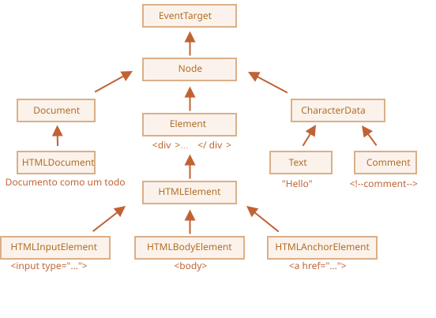

# Propriedades de nó: tipo, tag e conteúdo

Vamos dar uma olhada mais a fundo nos nós do DOM.

Neste capítulo vamos ver mais sobre o que eles são e aprender suas propriedades mais usadas.

## Classes de nó do DOM

Nós do DOM diferentes podem ter propriedades diferentes. Por exemplo, um nó de elemento correspondente à tag `<a>` tem propriedades relacionadas a link, e o correspondente a `<input>` tem propriedades relacionadas a input e assim por diante. Nós de texto não são iguais a nós de elemento. Mas também existem propriedades e métodos comuns entre todos eles, porque todas as classes de nós do DOM formam uma única hierarquia.

Cada nó do DOM pertence à classe nativa correspondente.

A raiz da hierarquia é [EventTarget](https://dom.spec.whatwg.org/#eventtarget), que é herdada por [Node](https://dom.spec.whatwg.org/#interface-node), e outros nós do DOM herdam dela.

Aqui está a imagem, explicações a seguir:



As classes são:

- [EventTarget](https://dom.spec.whatwg.org/#eventtarget) -- é a classe "abstrata" raiz para tudo.

    Objetos dessa classe nunca são criados. Ela serve como base, para que todos os nós do DOM suportem os chamados "eventos", vamos estudá-los mais tarde.

- [Node](https://dom.spec.whatwg.org/#interface-node) -- também é uma classe "abstrata", servindo como base para nós do DOM.

    Ela fornece a funcionalidade central de árvore: `parentNode`, `nextSibling`, `childNodes` e assim por diante (são getters). Objetos da classe `Node` nunca são criados. Mas existem outras classes que herdam dela (e assim herdam a funcionalidade de `Node`).

- [Document](https://dom.spec.whatwg.org/#interface-document), por motivos históricos frequentemente herdada por `HTMLDocument` (embora a especificação mais recente não exija isso) -- é um documento como um todo.

    O objeto global `document` pertence exatamente a essa classe. Ele serve como ponto de entrada para o DOM.

- [CharacterData](https://dom.spec.whatwg.org/#interface-characterdata) -- uma classe "abstrata", herdada por:
    - [Text](https://dom.spec.whatwg.org/#interface-text) -- a classe correspondente a um texto dentro de elementos, por exemplo, `Hello` em `<p>Hello</p>`.
    - [Comment](https://dom.spec.whatwg.org/#interface-comment) -- a classe para comentários. Eles não são exibidos, mas cada comentário se torna um membro do DOM.

- [Element](https://dom.spec.whatwg.org/#interface-element) -- é a classe base para elementos do DOM.

    Ela fornece navegação em nível de elemento como `nextElementSibling`, `children` e métodos de busca como `getElementsByTagName`, `querySelector`.

    Um navegador suporta não só HTML, mas também XML e SVG. Então a classe `Element` serve como base para classes mais específicas: `SVGElement`, `XMLElement` (não precisamos delas aqui) e `HTMLElement`.

- Finalmente, [HTMLElement](https://html.spec.whatwg.org/multipage/dom.html#htmlelement) é a classe básica para todos os elementos HTML. Vamos trabalhar com ela na maior parte do tempo.

    Ela é herdada por elementos HTML concretos:
    - [HTMLInputElement](https://html.spec.whatwg.org/multipage/forms.html#htmlinputelement) -- a classe para elementos `<input>`,
    - [HTMLBodyElement](https://html.spec.whatwg.org/multipage/semantics.html#htmlbodyelement) -- a classe para elementos `<body>`,
    - [HTMLAnchorElement](https://html.spec.whatwg.org/multipage/semantics.html#htmlanchorelement) -- a classe para elementos `<a>`,
    - ...e assim por diante.

Existem muitas outras tags com suas próprias classes que podem ter propriedades e métodos específicos, enquanto alguns elementos, como `<span>`, `<section>`, `<article>`, não têm nenhuma propriedade específica, então são instâncias da classe `HTMLElement`.

Então, o conjunto completo de propriedades e métodos de um determinado nó vem como resultado da cadeia de herança.

Por exemplo, vamos considerar o objeto DOM para um elemento `<input>`. Ele pertence à classe [HTMLInputElement](https://html.spec.whatwg.org/multipage/forms.html#htmlinputelement).

Ele obtém propriedades e métodos como uma superposição de (listados na ordem de herança):

- `HTMLInputElement` -- essa classe fornece propriedades específicas de input,
- `HTMLElement` -- ela fornece métodos comuns de elementos HTML (e getters/setters),
- `Element` -- fornece métodos genéricos de elemento,
- `Node` -- fornece propriedades comuns de nós do DOM,
- `EventTarget` -- dá suporte para eventos (a ser coberto),
- ...e finalmente ela herda de `Object`, então métodos de "objeto simples" como `hasOwnProperty` também estão disponíveis.

Para ver o nome da classe de um nó do DOM, podemos lembrar que um objeto geralmente tem a propriedade `constructor`. Ela referencia o construtor da classe, e `constructor.name` é seu nome:

```js run
alert( document.body.constructor.name ); // HTMLBodyElement
```

...Ou podemos simplesmente usar `toString` nele:

```js run
alert( document.body ); // [object HTMLBodyElement]
```

Também podemos usar `instanceof` para checar a herança:

```js run
alert( document.body instanceof HTMLBodyElement ); // true
alert( document.body instanceof HTMLElement ); // true
alert( document.body instanceof Element ); // true
alert( document.body instanceof Node ); // true
alert( document.body instanceof EventTarget ); // true
```

Como podemos ver, nós do DOM são objetos JavaScript comuns. Eles usam classes baseadas em protótipo para herança.

Isso também é fácil de ver exibindo um elemento com `console.dir(elem)` num navegador. Lá no console você pode ver `HTMLElement.prototype`, `Element.prototype` e assim por diante.

```smart header="`console.dir(elem)` versus `console.log(elem)`"
A maioria dos navegadores suporta dois comandos em suas ferramentas de desenvolvedor: `console.log` e `console.dir`. Eles exibem seus argumentos no console. Para objetos JavaScript, esses comandos geralmente fazem a mesma coisa.

Mas para elementos do DOM eles são diferentes:

- `console.log(elem)` mostra a árvore DOM do elemento.
- `console.dir(elem)` mostra o elemento como um objeto DOM, bom para explorar suas propriedades.

Experimente em `document.body`.
```

````smart header="IDL na especificação"
Na especificação, classes do DOM não são descritas usando JavaScript, mas uma linguagem especial de descrição de interface, [Interface description language](https://en.wikipedia.org/wiki/Interface_description_language) (IDL), que geralmente é fácil de entender.

Em IDL, todas as propriedades vêm precedidas pelos seus tipos. Por exemplo, `DOMString`, `boolean` e assim por diante.

Aqui está um trecho dela, com comentários:

```js
// Define HTMLInputElement
*!*
// Os dois-pontos ":" significam que HTMLInputElement herda de HTMLElement
*/!*
interface HTMLInputElement: HTMLElement {
  // aqui vão propriedades e métodos de elementos <input>

*!*
  // "DOMString" significa que o valor de uma propriedade é uma string
*/!*
  attribute DOMString accept;
  attribute DOMString alt;
  attribute DOMString autocomplete;
  attribute DOMString value;

*!*
  // propriedade de valor booleano (true/false)
  attribute boolean autofocus;
*/!*
  ...
*!*
  // agora o método: "void" significa que o método não retorna nenhum valor
*/!*
  void select();
  ...
}
```
````

## A propriedade "nodeType"

A propriedade `nodeType` fornece mais uma forma, "à moda antiga", de obter o "tipo" de um nó do DOM.

Ela tem um valor numérico:
- `elem.nodeType == 1` para nós de elemento,
- `elem.nodeType == 3` para nós de texto,
- `elem.nodeType == 9` para o objeto document,
- existem poucos outros valores [na especificação](https://dom.spec.whatwg.org/#node).

Por exemplo:

```html run
<body>
  <script>
  let elem = document.body;

  // vamos examinar: que tipo de nó está em elem?
  alert(elem.nodeType); // 1 => elemento

  // e seu primeiro filho é...
  alert(elem.firstChild.nodeType); // 3 => texto

  // para o objeto document, o tipo é 9
  alert( document.nodeType ); // 9
  </script>
</body>
```

Em scripts modernos, podemos usar `instanceof` e outros testes baseados em classe para ver o tipo do nó, mas às vezes `nodeType` pode ser mais simples. Só podemos ler `nodeType`, não alterá-lo.

## Tag: nodeName e tagName

Dado um nó do DOM, podemos ler o nome de sua tag a partir das propriedades `nodeName` ou `tagName`:

Por exemplo:

```js run
alert( document.body.nodeName ); // BODY
alert( document.body.tagName ); // BODY
```

Existe alguma diferença entre `tagName` e `nodeName`?

Claro, a diferença se reflete em seus nomes, mas é de fato um pouco sutil.

- A propriedade `tagName` existe só para nós `Element`.
- `nodeName` é definida para qualquer `Node`:
    - para elementos significa o mesmo que `tagName`.
    - para outros tipos de nó (texto, comentário, etc.) ela tem uma string com o tipo do nó.

Em outras palavras, `tagName` é suportada só por nós de elemento (já que vem da classe `Element`), enquanto `nodeName` pode dizer algo sobre outros tipos de nó.

Por exemplo, vamos comparar `tagName` e `nodeName` para o `document` e um nó de comentário:


```html run
<body><!-- comment -->

  <script>
    // para comentário
    alert( document.body.firstChild.tagName ); // undefined (não é um elemento)
    alert( document.body.firstChild.nodeName ); // #comment

    // para document
    alert( document.tagName ); // undefined (não é um elemento)
    alert( document.nodeName ); // #document
  </script>
</body>
```

Se só lidarmos com elementos, então podemos usar tanto `tagName` quanto `nodeName` - não há diferença.

```smart header="O nome da tag é sempre maiúsculo, exceto no modo XML"
O navegador tem dois modos de processar documentos: HTML e XML. Normalmente, o modo HTML é usado para páginas web. O modo XML é ativado quando o navegador recebe um documento XML com o cabeçalho: `Content-Type: application/xml+xhtml`.

No modo HTML, `tagName/nodeName` é sempre maiúsculo: é `BODY` tanto para `<body>` quanto para `<BoDy>`.

No modo XML, a caixa é mantida "como está". Hoje em dia o modo XML é raramente usado.
```


## innerHTML: o conteúdo

A propriedade [innerHTML](https://w3c.github.io/DOM-Parsing/#the-innerhtml-mixin) permite obter o HTML dentro do elemento como uma string.

Também podemos modificá-la. Então é uma das formas mais poderosas de mudar a página.

O exemplo mostra o conteúdo de `document.body` e então o substitui completamente:

```html run
<body>
  <p>A paragraph</p>
  <div>A div</div>

  <script>
    alert( document.body.innerHTML ); // lê o conteúdo atual
    document.body.innerHTML = 'The new BODY!'; // substitui
  </script>

</body>
```

Podemos tentar inserir HTML inválido, o navegador vai corrigir nossos erros:

```html run
<body>

  <script>
    document.body.innerHTML = '<b>test'; // esqueceu de fechar a tag
    alert( document.body.innerHTML ); // <b>test</b> (corrigido)
  </script>

</body>
```

```smart header="Scripts não executam"
Se `innerHTML` inserir uma tag `<script>` no documento -- ela se torna parte do HTML, mas não executa.
```

### Cuidado: "innerHTML+=" faz uma sobrescrita completa

Podemos acrescentar HTML a um elemento usando `elem.innerHTML+="mais html"`.

Assim:

```js
chatDiv.innerHTML += "<div>Hello !</div>";
chatDiv.innerHTML += "How goes?";
```

Mas devemos ser muito cuidadosos ao fazer isso, porque o que acontece *não* é uma adição, mas uma sobrescrita completa.

Tecnicamente, essas duas linhas fazem a mesma coisa:

```js
elem.innerHTML += "...";
// é uma forma mais curta de escrever:
*!*
elem.innerHTML = elem.innerHTML + "..."
*/!*
```

Em outras palavras, `innerHTML+=` faz isso:

1. O conteúdo antigo é removido.
2. O novo `innerHTML` é escrito no lugar (uma concatenação do antigo com o novo).

**Como o conteúdo é "zerado" e reescrito do zero, todas as imagens e outros recursos vão ser recarregados**.

No exemplo `chatDiv` acima, a linha `chatDiv.innerHTML+="How goes?"` recria o conteúdo HTML e recarrega `smile.gif` (espero que esteja em cache). Se `chatDiv` tiver bastante outro texto e imagens, então o recarregamento se torna claramente visível.

Também existem outros efeitos colaterais. Por exemplo, se o texto existente estava selecionado com o mouse, então a maioria dos navegadores vai remover a seleção ao reescrever `innerHTML`. E se havia um `<input>` com um texto digitado pelo visitante, então o texto vai ser removido. E assim por diante.

Felizmente, existem outras formas de adicionar HTML além de `innerHTML`, e vamos estudá-las em breve.

## outerHTML: HTML completo do elemento

A propriedade `outerHTML` contém o HTML completo do elemento. É como `innerHTML` mais o próprio elemento.

Aqui está um exemplo:

```html run
<div id="elem">Hello <b>World</b></div>

<script>
  alert(elem.outerHTML); // <div id="elem">Hello <b>World</b></div>
</script>
```

**Cuidado: diferente de `innerHTML`, escrever em `outerHTML` não muda o elemento. Em vez disso, o substitui no DOM.**

Sim, soa estranho, e é estranho mesmo, por isso fazemos uma observação separada sobre isso aqui. Dê uma olhada.

Considere o exemplo:

```html run
<div>Hello, world!</div>

<script>
  let div = document.querySelector('div');

*!*
  // substitui div.outerHTML por <p>...</p>
*/!*
  div.outerHTML = '<p>A new element</p>'; // (*)

*!*
  // Uau! 'div' ainda é o mesmo!
*/!*
  alert(div.outerHTML); // <div>Hello, world!</div> (**)
</script>
```

Parece bem estranho, não é?

Na linha `(*)` substituímos `div` por `<p>A new element</p>`. No documento externo (o DOM) podemos ver o novo conteúdo no lugar do `<div>`. Mas, como podemos ver na linha `(**)`, o valor da antiga variável `div` não mudou!

A atribuição a `outerHTML` não modifica o elemento do DOM (o objeto referenciado, nesse caso, pela variável 'div'), mas o remove do DOM e insere o novo HTML no seu lugar.

Então o que aconteceu em `div.outerHTML=...` foi:
- `div` foi removido do documento.
- Outro pedaço de HTML `<p>A new element</p>` foi inserido no seu lugar.
- `div` ainda tem seu valor antigo. O novo HTML não foi salvo em nenhuma variável.

É muito fácil cometer um erro aqui: modificar `div.outerHTML` e depois continuar trabalhando com `div` como se ele tivesse o novo conteúdo nele. Mas não tem. Isso é correto para `innerHTML`, mas não para `outerHTML`.

Podemos escrever em `elem.outerHTML`, mas devemos ter em mente que isso não muda o elemento em que estamos escrevendo ('elem'). Em vez disso, coloca o novo HTML no seu lugar. Podemos obter referências aos novos elementos consultando o DOM.

## nodeValue/data: conteúdo de nó de texto

A propriedade `innerHTML` só é válida para nós de elemento.

Outros tipos de nó, como nós de texto, têm sua contraparte: as propriedades `nodeValue` e `data`. Essas duas são quase iguais para uso prático, existem só pequenas diferenças de especificação. Então vamos usar `data`, porque é mais curto.

Um exemplo de leitura do conteúdo de um nó de texto e um comentário:

```html run height="50"
<body>
  Hello
  <!-- Comment -->
  <script>
    let text = document.body.firstChild;
*!*
    alert(text.data); // Hello
*/!*

    let comment = text.nextSibling;
*!*
    alert(comment.data); // Comment
*/!*
  </script>
</body>
```

Para nós de texto podemos imaginar um motivo para ler ou modificá-los, mas por que comentários?

Às vezes os desenvolvedores incorporam informações ou instruções de template nos comentários do HTML, assim:

```html
<!-- if isAdmin -->
  <div>Welcome, Admin!</div>
<!-- /if -->
```

...Então o JavaScript pode ler isso a partir da propriedade `data` e processar instruções incorporadas.

## textContent: texto puro

`textContent` fornece acesso ao *texto* dentro do elemento: só texto, menos todas as `<tags>`.

Por exemplo:

```html run
<div id="news">
  <h1>Headline!</h1>
  <p>Martians attack people!</p>
</div>

<script>
  // Headline! Martians attack people!
  alert(news.textContent);
</script>
```

Como podemos ver, só o texto é retornado, como se todas as `<tags>` tivessem sido cortadas, mas o texto nelas permaneceu.

Na prática, ler esse tipo de texto raramente é necessário.

**Escrever em `textContent` é muito mais útil, porque permite escrever texto de forma "segura".**

Digamos que temos uma string arbitrária, por exemplo digitada por um usuário, e queremos mostrá-la.

- Com `innerHTML` vamos tê-la inserida "como HTML", com todas as tags HTML.
- Com `textContent` vamos tê-la inserida "como texto", todos os símbolos são tratados literalmente.

Compare os dois:

```html run
<div id="elem1"></div>
<div id="elem2"></div>

<script>
  let name = prompt("What's your name?", "<b>Winnie-the-Pooh!</b>");

  elem1.innerHTML = name;
  elem2.textContent = name;
</script>
```

1. O primeiro `<div>` recebe o nome "como HTML": todas as tags se tornam tags, então vemos o nome em negrito.
2. O segundo `<div>` recebe o nome "como texto", então literalmente vemos `<b>Winnie-the-Pooh!</b>`.

Na maioria dos casos, esperamos o texto de um usuário, e queremos tratá-lo como texto. Não queremos HTML inesperado no nosso site. Uma atribuição a `textContent` faz exatamente isso.

## A propriedade "hidden"

O atributo "hidden" e a propriedade do DOM especificam se o elemento está visível ou não.

Podemos usá-lo em HTML ou atribuí-lo usando JavaScript, assim:

```html run height="80"
<div>Both divs below are hidden</div>

<div hidden>With the attribute "hidden"</div>

<div id="elem">JavaScript assigned the property "hidden"</div>

<script>
  elem.hidden = true;
</script>
```

Tecnicamente, `hidden` funciona da mesma forma que `style="display:none"`. Mas é mais curto de escrever.

Aqui está um elemento piscando:


```html run height=50
<div id="elem">A blinking element</div>

<script>
  setInterval(() => elem.hidden = !elem.hidden, 1000);
</script>
```

## Mais propriedades

Elementos do DOM também têm propriedades adicionais, em particular aquelas que dependem da classe:

- `value` -- o valor para `<input>`, `<select>` e `<textarea>` (`HTMLInputElement`, `HTMLSelectElement`...).
- `href` -- o "href" para `<a href="...">` (`HTMLAnchorElement`).
- `id` -- o valor do atributo "id", para todos os elementos (`HTMLElement`).
- ...e muito mais...

Por exemplo:

```html run height="80"
<input type="text" id="elem" value="value">

<script>
  alert(elem.type); // "text"
  alert(elem.id); // "elem"
  alert(elem.value); // value
</script>
```

A maioria dos atributos HTML padrão tem a propriedade do DOM correspondente, e podemos acessá-la assim.

Se quisermos saber a lista completa de propriedades suportadas para uma determinada classe, podemos encontrá-las na especificação. Por exemplo, `HTMLInputElement` está documentado em <https://html.spec.whatwg.org/#htmlinputelement>.

Ou se quisermos obtê-las rapidamente ou estivermos interessados numa especificação concreta de navegador -- podemos sempre exibir o elemento usando `console.dir(elem)` e ler as propriedades. Ou explorar "DOM properties" na aba Elements das ferramentas de desenvolvedor do navegador.

## Resumo

Cada nó do DOM pertence a uma certa classe. As classes formam uma hierarquia. O conjunto completo de propriedades e métodos vem como resultado da herança.

As principais propriedades de nó do DOM são:

`nodeType`
: Podemos usá-la para ver se um nó é um nó de texto ou de elemento. Tem um valor numérico: `1` para elementos, `3` para nós de texto, e alguns outros para outros tipos de nó. Somente leitura.

`nodeName/tagName`
: Para elementos, o nome da tag (em maiúsculo, a menos que seja modo XML). Para nós que não são elemento, `nodeName` descreve o que ele é. Somente leitura.

`innerHTML`
: O conteúdo HTML do elemento. Pode ser modificado.

`outerHTML`
: O HTML completo do elemento. Uma operação de escrita em `elem.outerHTML` não toca no próprio `elem`. Em vez disso, ele é substituído pelo novo HTML no contexto externo.

`nodeValue/data`
: O conteúdo de um nó que não é elemento (texto, comentário). Essas duas são quase iguais, geralmente usamos `data`. Pode ser modificado.

`textContent`
: O texto dentro do elemento: HTML menos todas as `<tags>`. Escrever nele coloca o texto dentro do elemento, com todos os caracteres especiais e tags tratados exatamente como texto. Pode inserir com segurança texto gerado pelo usuário e proteger contra inserções indesejadas de HTML.

`hidden`
: Quando definido como `true`, faz a mesma coisa que o CSS `display:none`.

Nós do DOM também têm outras propriedades dependendo de sua classe. Por exemplo, elementos `<input>` (`HTMLInputElement`) suportam `value`, `type`, enquanto elementos `<a>` (`HTMLAnchorElement`) suportam `href` etc. A maioria dos atributos HTML padrão tem uma propriedade do DOM correspondente.

Porém, atributos HTML e propriedades do DOM nem sempre são a mesma coisa, como veremos no próximo capítulo.
