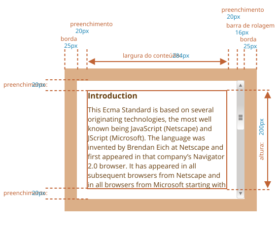
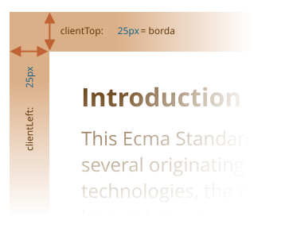
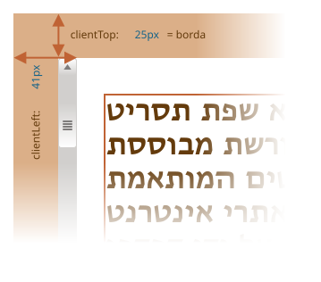
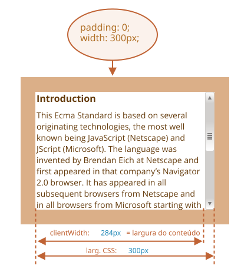

# Tamanho e rolagem de elementos

Existem muitas propriedades JavaScript que nos permitem ler informações sobre a largura, altura e outras características geométricas do elemento.

Frequentemente precisamos delas ao mover ou posicionar elementos em JavaScript.

## Elemento de exemplo

Como elemento de exemplo para demonstrar as propriedades, vamos usar o dado abaixo:

```html no-beautify
<div id="example">
  ...Texto...
</div>
<style>
  #example {
    width: 300px;
    height: 200px;
    border: 25px solid #E8C48F;
    padding: 20px;
    overflow: auto;
  }
</style>
```

Ele tem a borda, o preenchimento (padding) e a rolagem. O conjunto completo de características. Não há margens, pois elas não são parte do elemento em si, e não há propriedades especiais para elas.

O elemento fica assim:



Você pode [abrir o documento no sandbox](sandbox:metric).

```smart header="Atenção à barra de rolagem"
A imagem acima demonstra o caso mais complexo, quando o elemento tem uma barra de rolagem. Alguns navegadores (não todos) reservam espaço para ela, tirando-o do conteúdo (identificado como "largura do conteúdo" acima).

Então, sem a barra de rolagem a largura do conteúdo seria `300px`, mas se a barra de rolagem tiver `16px` de largura (a largura pode variar entre dispositivos e navegadores) então sobram apenas `300 - 16 = 284px`, e devemos levar isso em conta. É por isso que os exemplos deste capítulo assumem que há uma barra de rolagem. Sem ela, alguns cálculos são mais simples.
```

```smart header="A área do `padding-bottom` pode ficar preenchida com texto"
Normalmente os preenchimentos (paddings) são mostrados vazios em nossas ilustrações, mas se houver muito texto no elemento e ele ultrapassar o limite, os navegadores mostram o texto "excedente" no `padding-bottom`, isso é normal.
```

## Geometria

Aqui está a imagem geral com as propriedades de geometria:


Os valores dessas propriedades são tecnicamente números, mas esses números são "em pixels", então são medidas em pixels.

Vamos começar explorando as propriedades a partir de fora do elemento.

## offsetParent, offsetLeft/Top

Essas propriedades raramente são necessárias, mas ainda assim são as propriedades de geometria "mais externas", então vamos começar com elas.

O `offsetParent` é o ancestral mais próximo que o navegador usa para calcular coordenadas durante a renderização.

Esse é o ancestral mais próximo que seja um dos seguintes:

1. Posicionado via CSS (`position` é `absolute`, `relative`, `fixed` ou `sticky`), ou
2. `<td>`, `<th>`, ou `<table>`, ou
3. `<body>`.

As propriedades `offsetLeft/offsetTop` fornecem as coordenadas x/y relativas ao canto superior-esquerdo do `offsetParent`.

No exemplo abaixo, o `<div>` interno tem `<main>` como `offsetParent`, e `offsetLeft/offsetTop` são os deslocamentos a partir do seu canto superior-esquerdo (`180`):

```html run height=10
<main style="position: relative" id="main">
  <article>
    <div id="example" style="position: absolute; left: 180px; top: 180px">...</div>
  </article>
</main>
<script>
  alert(example.offsetParent.id); // main
  alert(example.offsetLeft); // 180 (note: um número, não a string "180px")
  alert(example.offsetTop); // 180
</script>
```


Existem várias ocasiões em que `offsetParent` é `null`:

1. Para elementos não exibidos (`display:none` ou não no documento).
2. Para `<body>` e `<html>`.
3. Para elementos com `position:fixed`.

## offsetWidth/Height

Agora vamos passar ao elemento em si.

Essas duas propriedades são as mais simples. Elas fornecem a largura/altura "externa" do elemento. Ou, em outras palavras, seu tamanho completo incluindo as bordas.


Para nosso elemento de exemplo:

- `offsetWidth = 390` -- a largura externa, pode ser calculada como a largura CSS interna (`300px`) mais os preenchimentos (`2 * 20px`) e as bordas (`2 * 25px`).
- `offsetHeight = 290` -- a altura externa.

````smart header="As propriedades de geometria são zero/null para elementos que não são exibidos"
As propriedades de geometria são calculadas apenas para elementos exibidos.

Se um elemento (ou qualquer um de seus ancestrais) tiver `display:none` ou não estiver no documento, então todas as propriedades de geometria serão zero (ou `null` para `offsetParent`).

Por exemplo, `offsetParent` é `null`, e `offsetWidth`, `offsetHeight` são `0` quando criamos um elemento, mas ainda não o inserimos no documento, ou ele (ou seu ancestral) tem `display:none`.

Podemos usar isso para verificar se um elemento está oculto, assim:

```js
function isHidden(elem) {
  return !elem.offsetWidth && !elem.offsetHeight;
}
```

Note que esse `isHidden` retorna `true` para elementos que estão visíveis na tela, mas têm tamanhos zero.
````

## clientTop/Left

Dentro do elemento temos as bordas.

Para medi-las, existem as propriedades `clientTop` e `clientLeft`.

No nosso exemplo:

- `clientLeft = 25` -- largura da borda esquerda
- `clientTop = 25` -- largura da borda superior



...Mas, para ser preciso -- essas propriedades não são a largura/altura da borda, mas sim as coordenadas relativas do lado interno em relação ao lado externo.

Qual é a diferença?

Ela se torna visível quando o documento é da direita para a esquerda (o sistema operacional está em árabe ou hebraico). A barra de rolagem fica então não à direita, mas à esquerda, e então `clientLeft` também inclui a largura da barra de rolagem.

Nesse caso, `clientLeft` não seria `25`, mas com a largura da barra de rolagem `25 + 16 = 41`.

Aqui está o exemplo em hebraico:



## clientWidth/Height

Essas propriedades fornecem o tamanho da área dentro das bordas do elemento.

Elas incluem a largura do conteúdo junto com os preenchimentos, mas sem a barra de rolagem:


Na imagem acima, vamos primeiro considerar o `clientHeight`.

Não há barra de rolagem horizontal, então é exatamente a soma do que está dentro das bordas: a altura CSS `200px` mais os preenchimentos superior e inferior (`2 * 20px`), totalizando `240px`.

Agora `clientWidth` -- aqui a largura do conteúdo não é `300px`, mas `284px`, porque `16px` são ocupados pela barra de rolagem. Então a soma é `284px` mais os preenchimentos esquerdo e direito, totalizando `324px`.

**Se não há preenchimentos, então `clientWidth/Height` é exatamente a área de conteúdo, dentro das bordas e da barra de rolagem (se houver).**



Então, quando não há preenchimento, podemos usar `clientWidth/clientHeight` para obter o tamanho da área de conteúdo.

## scrollWidth/Height

Essas propriedades são como `clientWidth/clientHeight`, mas também incluem as partes roladas para fora (ocultas):


Na imagem acima:

- `scrollHeight = 723` -- é a altura interna completa da área de conteúdo, incluindo as partes roladas para fora.
- `scrollWidth = 324` -- é a largura interna completa, aqui não temos rolagem horizontal, então é igual a `clientWidth`.

Podemos usar essas propriedades para expandir o elemento até sua largura/altura total.

Assim:

```js
// expande o elemento até a altura completa do conteúdo
element.style.height = `${element.scrollHeight}px`;
```

```online
Clique no botão para expandir o elemento:

<div id="element" style="width:300px;height:200px; padding: 0;overflow: auto; border:1px solid black;">text text text text text text text text text text text text text text text text text text text text text text text text text text text text text text text text text text text text text text text text text text text text text text text text text text text text text text text text text text text text text text text text text text text text text text text text text text text text text text text text text text text text text text text text text text text text text text text text text text text text text text text text text text text text text text text text text text text text text text text text text text text text text text text text text text text text text text text text text text text text</div>

<button style="padding:0" onclick="element.style.height = `${element.scrollHeight}px`">element.style.height = `${element.scrollHeight}px`</button>
```

## scrollLeft/scrollTop

As propriedades `scrollLeft/scrollTop` são a largura/altura da parte oculta e rolada para fora do elemento.

Na imagem abaixo podemos ver `scrollHeight` e `scrollTop` para um bloco com rolagem vertical.


Em outras palavras, `scrollTop` é "quanto foi rolado para cima".

````smart header="`scrollLeft/scrollTop` podem ser modificados"
A maioria das propriedades de geometria aqui são apenas leitura, mas `scrollLeft/scrollTop` podem ser alteradas, e o navegador vai rolar o elemento.

```online
Se você clicar no elemento abaixo, o código `elem.scrollTop += 10` é executado. Isso faz o conteúdo do elemento rolar `10px` para baixo.

<div onclick="this.scrollTop+=10" style="cursor:pointer;border:1px solid black;width:100px;height:80px;overflow:auto">Clique<br>Em<br>Mim<br>1<br>2<br>3<br>4<br>5<br>6<br>7<br>8<br>9</div>
```

Definir `scrollTop` como `0` ou um valor grande, como `1e9`, fará o elemento rolar até o topo/fundo, respectivamente.
````

## Não obtenha width/height a partir do CSS

Acabamos de abordar as propriedades de geometria dos elementos do DOM, que podem ser usadas para obter larguras, alturas e calcular distâncias.

Mas, como sabemos pelo capítulo <info:styles-and-classes>, podemos ler a altura e a largura CSS usando `getComputedStyle`.

Então por que não ler a largura de um elemento com `getComputedStyle`, assim?

```js run
let elem = document.body;

alert( getComputedStyle(elem).width ); // mostra a largura CSS de elem
```

Por que deveríamos usar as propriedades de geometria em vez disso? Há duas razões:

1. Primeiro, `width/height` do CSS dependem de outra propriedade: `box-sizing`, que define "o que é" a largura e a altura CSS. Uma mudança em `box-sizing` para fins de CSS pode quebrar esse JavaScript.
2. Segundo, `width/height` do CSS podem ser `auto`, por exemplo para um elemento inline:

    ```html run
    <span id="elem">Olá!</span>

    <script>
    *!*
      alert( getComputedStyle(elem).width ); // auto
    */!*
    </script>
    ```

    Do ponto de vista do CSS, `width:auto` é perfeitamente normal, mas em JavaScript precisamos de um tamanho exato em `px` que possamos usar em cálculos. Então aqui a largura CSS é inútil.

E há mais uma razão: a barra de rolagem. Às vezes, um código que funciona bem sem uma barra de rolagem fica com bugs quando ela aparece, porque a barra de rolagem toma espaço do conteúdo em alguns navegadores. Então a largura real disponível para o conteúdo é *menor* que a largura CSS. E `clientWidth/clientHeight` levam isso em conta.

...Mas com `getComputedStyle(elem).width` a situação é diferente. Alguns navegadores (por exemplo, Chrome) retornam a largura interna real, menos a barra de rolagem, e alguns deles (por exemplo, Firefox) -- a largura CSS (ignorando a barra de rolagem). Essas diferenças entre navegadores são a razão para não usar `getComputedStyle`, mas sim confiar nas propriedades de geometria.

```online
Se seu navegador reserva o espaço para uma barra de rolagem (a maioria dos navegadores para Windows faz isso), então você pode testar abaixo.

[iframe src="cssWidthScroll" link border=1]

O elemento com texto tem `width:300px` no CSS.

Em um Desktop com Windows, Firefox, Chrome e Edge todos reservam o espaço para a barra de rolagem. Mas o Firefox mostra `300px`, enquanto Chrome e Edge mostram menos. Isso ocorre porque o Firefox retorna a largura CSS e os outros navegadores retornam a largura "real".
```

Note que a diferença descrita é apenas sobre ler `getComputedStyle(...).width` a partir do JavaScript, visualmente tudo está correto.

## Resumo

Os elementos têm as seguintes propriedades de geometria:

- `offsetParent` -- é o ancestral posicionado mais próximo, ou `td`, `th`, `table`, `body`.
- `offsetLeft/offsetTop` -- coordenadas relativas à borda superior-esquerda do `offsetParent`.
- `offsetWidth/offsetHeight` -- largura/altura "externa" de um elemento, incluindo as bordas.
- `clientLeft/clientTop` -- as distâncias do canto externo superior-esquerdo até o canto interno (conteúdo + preenchimento) superior-esquerdo. Para sistemas operacionais da esquerda para a direita, elas são sempre as larguras das bordas esquerda/superior. Para sistemas operacionais da direita para a esquerda, a barra de rolagem vertical fica à esquerda, então `clientLeft` também inclui sua largura.
- `clientWidth/clientHeight` -- a largura/altura do conteúdo incluindo os preenchimentos, mas sem a barra de rolagem.
- `scrollWidth/scrollHeight` -- a largura/altura do conteúdo, assim como `clientWidth/clientHeight`, mas também incluem a parte rolada para fora, invisível, do elemento.
- `scrollLeft/scrollTop` -- largura/altura da parte superior rolada para fora do elemento, a partir do seu canto superior-esquerdo.

Todas as propriedades são apenas leitura, exceto `scrollLeft/scrollTop`, que fazem o navegador rolar o elemento se forem alteradas.
