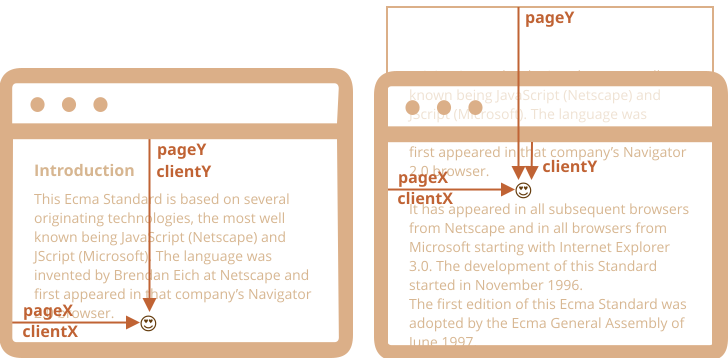
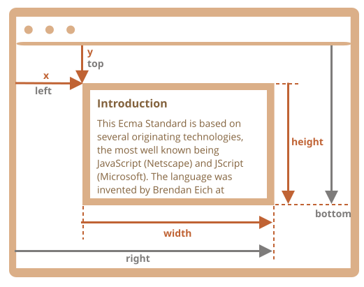
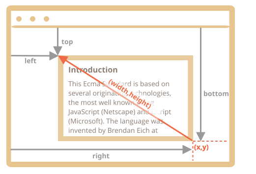

# Coordenadas

Para mover elementos de um lugar para outro, devemos estar familiarizados com coordenadas.

A maioria dos métodos JavaScript trabalha com um de dois sistemas de coordenadas:

1. **Relativo à janela** - parecido com `position:fixed`, calculado a partir da borda superior/esquerda da janela.
    - vamos chamar essas coordenadas de `clientX/clientY`, o motivo desse nome vai ficar claro mais adiante, quando estudarmos as propriedades de eventos.
2. **Relativo ao documento** - parecido com `position:absolute` na raiz do documento, calculado a partir da borda superior/esquerda do documento.
    - vamos chamá-las de `pageX/pageY`.

Quando a página está rolada até o início, de forma que o canto superior/esquerdo da janela é exatamente o canto superior/esquerdo do documento, essas coordenadas são iguais entre si. Mas depois que o documento é deslocado, as coordenadas relativas à janela dos elementos mudam, pois os elementos se movem pela janela, enquanto as coordenadas relativas ao documento permanecem as mesmas.

Nesta imagem, pegamos um ponto no documento e demonstramos suas coordenadas antes da rolagem (esquerda) e depois dela (direita):



Quando o documento rolou:
- `pageY` - a coordenada relativa ao documento permaneceu a mesma, ela é contada a partir do topo do documento (agora rolado para fora).
- `clientY` - a coordenada relativa à janela mudou (a flecha ficou mais curta), já que o mesmo ponto ficou mais perto do topo da janela.

## Coordenadas do elemento: getBoundingClientRect

O método `elem.getBoundingClientRect()` retorna as coordenadas na janela de um retângulo mínimo que envolve `elem`, como um objeto da classe interna [DOMRect](https://www.w3.org/TR/geometry-1/#domrect).

Principais propriedades do `DOMRect`:

- `x/y` -- coordenadas X/Y da origem do retângulo, relativas à janela,
- `width/height` -- largura/altura do retângulo (podem ser negativas).

Além disso, há propriedades derivadas:

- `top/bottom` -- coordenada Y da borda superior/inferior do retângulo,
- `left/right` -- coordenada X da borda esquerda/direita do retângulo.

```online
Por exemplo, clique neste botão para ver suas coordenadas na janela:

<p><input id="brTest" type="button" style="max-width: 90vw;" value="Obter coordenadas usando button.getBoundingClientRect() para este botão" onclick='showRect(this)'/></p>

<script>
function showRect(elem) {
  let r = elem.getBoundingClientRect();
  alert(`x:${r.x}
y:${r.y}
width:${r.width}
height:${r.height}
top:${r.top}
bottom:${r.bottom}
left:${r.left}
right:${r.right}
`);
}
</script>

Se você rolar a página e repetir, vai notar que, conforme a posição do botão relativa à janela muda, suas coordenadas na janela (`y/top/bottom` se você rolar verticalmente) também mudam.
```

Aqui está a imagem da saída de `elem.getBoundingClientRect()`:



Como você pode ver, `x/y` e `width/height` descrevem completamente o retângulo. As propriedades derivadas podem ser facilmente calculadas a partir delas:

- `left = x`
- `top = y`
- `right = x + width`
- `bottom = y + height`

Note:

- As coordenadas podem ser frações decimais, como `10.5`. Isso é normal, internamente o navegador usa frações nos cálculos. Não precisamos arredondá-las ao definir `style.left/top`.
- As coordenadas podem ser negativas. Por exemplo, se a página for rolada de forma que `elem` fique agora acima da janela, então `elem.getBoundingClientRect().top` é negativo.

```smart header="Por que as propriedades derivadas são necessárias? Por que `top/left` existem se já há `x/y`?"
Matematicamente, um retângulo é definido de forma única pelo seu ponto inicial `(x,y)` e pelo vetor de direção `(width,height)`. Então as propriedades derivadas adicionais existem por conveniência.

Tecnicamente é possível que `width/height` sejam negativos, o que permite um retângulo "direcionado", por exemplo, para representar uma seleção de mouse com início e fim marcados corretamente.

Valores negativos de `width/height` significam que o retângulo começa no seu canto inferior-direito e então "cresce" para a esquerda e para cima.

Aqui está um retângulo com `width` e `height` negativos (por exemplo, `width=-200`, `height=-100`):



Como você pode ver, `left/top` não são iguais a `x/y` nesse caso.

Na prática, porém, `elem.getBoundingClientRect()` sempre retorna width/height positivos, aqui mencionamos `width/height` negativos apenas para você entender por que essas propriedades aparentemente duplicadas não são, na verdade, duplicadas.
```

```warn header="Internet Explorer: sem suporte para `x/y`"
O Internet Explorer não suporta as propriedades `x/y` por razões históricas.

Então podemos fazer um polyfill (adicionar getters em `DomRect.prototype`) ou simplesmente usar `top/left`, já que eles são sempre iguais a `x/y` para `width/height` positivos, em particular no resultado de `elem.getBoundingClientRect()`.
```

```warn header="As coordenadas right/bottom são diferentes das propriedades de posição do CSS"
Há semelhanças óbvias entre as coordenadas relativas à janela e o `position:fixed` do CSS.

Mas no posicionamento CSS, a propriedade `right` significa a distância a partir da borda direita, e a propriedade `bottom` significa a distância a partir da borda inferior.

Se olharmos para a imagem acima, podemos ver que em JavaScript não é assim. Todas as coordenadas na janela são contadas a partir do canto superior-esquerdo, incluindo essas.
```

## elementFromPoint(x, y) [#elementFromPoint]

A chamada a `document.elementFromPoint(x, y)` retorna o elemento mais aninhado nas coordenadas da janela `(x, y)`.

A sintaxe é:

```js
let elem = document.elementFromPoint(x, y);
```

Por exemplo, o código abaixo destaca e exibe a tag do elemento que está agora no meio da janela:

```js run
let centerX = document.documentElement.clientWidth / 2;
let centerY = document.documentElement.clientHeight / 2;

let elem = document.elementFromPoint(centerX, centerY);

elem.style.background = "red";
alert(elem.tagName);
```

Como ele usa coordenadas da janela, o elemento pode ser diferente dependendo da posição atual de rolagem.

````warn header="Para coordenadas fora da janela, `elementFromPoint` retorna `null`"
O método `document.elementFromPoint(x,y)` só funciona se `(x,y)` estiverem dentro da área visível.

Se qualquer uma das coordenadas for negativa ou exceder a largura/altura da janela, então ele retorna `null`.

Aqui está um erro típico que pode ocorrer se não verificarmos isso:

```js
let elem = document.elementFromPoint(x, y);
// se as coordenadas estiverem fora da janela, então elem = null
*!*
elem.style.background = ''; // Erro!
*/!*
```
````

## Usando para posicionamento "fixed"

Na maioria das vezes precisamos de coordenadas para posicionar algo.

Para mostrar algo próximo a um elemento, podemos usar `getBoundingClientRect` para obter suas coordenadas, e então usar o `position` do CSS junto com `left/top` (ou `right/bottom`).

Por exemplo, a função `createMessageUnder(elem, html)` abaixo mostra a mensagem abaixo de `elem`:

```js
let elem = document.getElementById("coords-show-mark");

function createMessageUnder(elem, html) {
  // cria o elemento da mensagem
  let message = document.createElement('div');
  // é melhor usar uma classe css para o estilo aqui
  message.style.cssText = "position:fixed; color: red";

*!*
  // atribui as coordenadas, não esqueça o "px"!
  let coords = elem.getBoundingClientRect();

  message.style.left = coords.left + "px";
  message.style.top = coords.bottom + "px";
*/!*

  message.innerHTML = html;

  return message;
}

// Uso:
// adiciona ela por 5 segundos no documento
let message = createMessageUnder(elem, 'Olá, mundo!');
document.body.append(message);
setTimeout(() => message.remove(), 5000);
```

```online
Clique no botão para executar:

<button id="coords-show-mark">Botão com id="coords-show-mark", a mensagem vai aparecer abaixo dele</button>
```

O código pode ser modificado para mostrar a mensagem à esquerda, à direita, abaixo, aplicar animações CSS para "aparecer suavemente" e assim por diante. Isso é fácil, já que temos todas as coordenadas e tamanhos do elemento.

Mas note o detalhe importante: quando a página é rolada, a mensagem se afasta do botão.

O motivo é óbvio: o elemento da mensagem depende de `position:fixed`, então ele permanece no mesmo lugar da janela enquanto a página rola.

Para mudar isso, precisamos usar coordenadas baseadas no documento e `position:absolute`.

## Coordenadas do documento [#getCoords]

As coordenadas relativas ao documento começam a partir do canto superior-esquerdo do documento, não da janela.

No CSS, as coordenadas da janela correspondem a `position:fixed`, enquanto as coordenadas do documento são parecidas com `position:absolute` no topo.

Podemos usar `position:absolute` e `top/left` para colocar algo em um certo lugar do documento, de forma que permaneça lá durante a rolagem da página. Mas primeiro precisamos das coordenadas corretas.

Não há um método padrão para obter as coordenadas de um elemento relativas ao documento. Mas é fácil escrevê-lo.

Os dois sistemas de coordenadas são conectados pela fórmula:
- `pageY` = `clientY` + altura da parte vertical rolada para fora do documento.
- `pageX` = `clientX` + largura da parte horizontal rolada para fora do documento.

A função `getCoords(elem)` vai pegar as coordenadas da janela a partir de `elem.getBoundingClientRect()` e adicionar a rolagem atual a elas:

```js
// obtém as coordenadas do elemento relativas ao documento
function getCoords(elem) {
  let box = elem.getBoundingClientRect();

  return {
    top: box.top + window.pageYOffset,
    right: box.right + window.pageXOffset,
    bottom: box.bottom + window.pageYOffset,
    left: box.left + window.pageXOffset
  };
}
```

Se no exemplo acima a usássemos com `position:absolute`, então a mensagem permaneceria perto do elemento durante a rolagem.

A função `createMessageUnder` modificada:

```js
function createMessageUnder(elem, html) {
  let message = document.createElement('div');
  message.style.cssText = "*!*position:absolute*/!*; color: red";

  let coords = *!*getCoords(elem);*/!*

  message.style.left = coords.left + "px";
  message.style.top = coords.bottom + "px";

  message.innerHTML = html;

  return message;
}
```

## Resumo

Qualquer ponto na página tem coordenadas:

1. Relativas à janela -- `elem.getBoundingClientRect()`.
2. Relativas ao documento -- `elem.getBoundingClientRect()` mais a rolagem atual da página.

As coordenadas da janela são ótimas para usar com `position:fixed`, e as coordenadas do documento funcionam bem com `position:absolute`.

Ambos os sistemas de coordenadas têm seus prós e contras; há momentos em que precisamos de um ou de outro, assim como `position` `absolute` e `fixed` do CSS.
