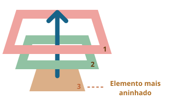
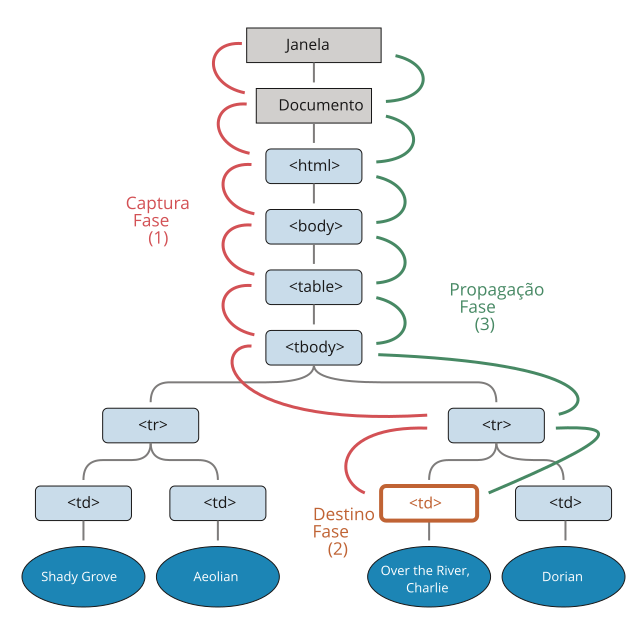

# Bubbling e capturing

Vamos começar com um exemplo.

Este manipulador é atribuído ao `<div>`, mas também é executado se você clicar em qualquer tag aninhada, como `<em>` ou `<code>`:

```html autorun height=60
<div onclick="alert('O manipulador!')">
  <em>Se você clicar em <code>EM</code>, o manipulador em <code>DIV</code> é executado.</em>
</div>
```

Não é um pouco estranho? Por que o manipulador em `<div>` é executado se o clique real foi em `<em>`?

## Bubbling

O princípio do bubbling é simples.

**Quando um evento acontece em um elemento, ele primeiro executa os manipuladores nele, depois no seu pai, e assim por diante, subindo por todos os outros ancestrais.**

Digamos que temos 3 elementos aninhados `FORM > DIV > P` com um manipulador em cada um deles:

```html run autorun
<style>
  body * {
    margin: 10px;
    border: 1px solid blue;
  }
</style>

<form onclick="alert('form')">FORM
  <div onclick="alert('div')">DIV
    <p onclick="alert('p')">P</p>
  </div>
</form>
```

Um clique no `<p>` interno executa `onclick` primeiro:
1. Nesse `<p>`.
2. Depois no `<div>` externo.
3. Depois no `<form>` externo.
4. E assim por diante subindo até o objeto `document`.



Então, se clicarmos em `<p>`, veremos 3 alertas: `p` -> `div` -> `form`.

O processo é chamado de "bubbling" (borbulhamento), porque os eventos "borbulham" do elemento interno para cima, através dos pais, como uma bolha na água.

```warn header="*Quase* todos os eventos fazem bubbling."
A palavra-chave nessa frase é "quase".

Por exemplo, um evento `focus` não faz bubbling. Há outros exemplos também, vamos encontrá-los. Mas ainda assim é uma exceção, e não uma regra, a maioria dos eventos faz bubbling.
```

## event.target

Um manipulador em um elemento pai pode sempre obter os detalhes sobre onde o evento realmente aconteceu.

**O elemento mais profundamente aninhado que causou o evento é chamado de elemento *target* (destino), acessível como `event.target`.**

Note as diferenças em relação a `this` (=`event.currentTarget`):

- `event.target` -- é o elemento "destino" que iniciou o evento, ele não muda durante o processo de bubbling.
- `this` -- é o elemento "atual", aquele que tem um manipulador em execução nele.

Por exemplo, se temos um único manipulador `form.onclick`, então ele pode "capturar" todos os cliques dentro do formulário. Não importa onde o clique aconteceu, ele borbulha até `<form>` e executa o manipulador.

No manipulador `form.onclick`:

- `this` (=`event.currentTarget`) é o elemento `<form>`, porque o manipulador é executado nele.
- `event.target` é o elemento real dentro do formulário que foi clicado.

Veja só:

[codetabs height=220 src="bubble-target"]

É possível que `event.target` seja igual a `this` -- isso acontece quando o clique é feito diretamente no elemento `<form>`.

## Parando o bubbling

Um evento em bubbling vai do elemento de destino direto para cima. Normalmente ele vai subindo até `<html>`, e depois para o objeto `document`, e alguns eventos até alcançam `window`, chamando todos os manipuladores pelo caminho.

Mas qualquer manipulador pode decidir que o evento já foi completamente processado e parar o bubbling.

O método para isso é `event.stopPropagation()`.

Por exemplo, aqui `body.onclick` não funciona se você clicar em `<button>`:

```html run autorun height=60
<body onclick="alert(`o bubbling não alcança aqui`)">
  <button onclick="event.stopPropagation()">Clique em mim</button>
</body>
```

```smart header="event.stopImmediatePropagation()"
Se um elemento tem múltiplos manipuladores de evento em um único evento, então, mesmo que um deles pare o bubbling, os outros ainda são executados.

Em outras palavras, `event.stopPropagation()` para o movimento para cima, mas no elemento atual todos os outros manipuladores vão ser executados.

Para parar o bubbling e impedir que outros manipuladores no elemento atual sejam executados, há um método `event.stopImmediatePropagation()`. Depois dele, nenhum outro manipulador é executado.
```

```warn header="Não pare o bubbling sem necessidade!"
O bubbling é conveniente. Não o interrompa sem uma necessidade real: óbvia e bem pensada arquiteturalmente.

Às vezes `event.stopPropagation()` cria armadilhas escondidas que mais tarde podem se tornar problemas.

Por exemplo:

1. Criamos um menu aninhado. Cada submenu trata cliques em seus elementos e chama `stopPropagation` para que o menu externo não seja acionado.
2. Mais tarde decidimos capturar cliques na janela inteira, para rastrear o comportamento dos usuários (onde as pessoas clicam). Alguns sistemas de análise fazem isso. Normalmente o código usa `document.addEventListener('click'…)` para capturar todos os cliques.
3. Nossa análise não vai funcionar sobre a área onde os cliques são interrompidos por `stopPropagation`. Infelizmente, temos uma "zona morta".

Normalmente não há necessidade real de impedir o bubbling. Uma tarefa que aparentemente exige isso pode ser resolvida por outros meios. Um deles é usar eventos personalizados, que vamos abordar mais adiante. Também podemos escrever nossos dados no objeto `event` em um manipulador e lê-los em outro, para que possamos passar aos manipuladores nos pais informações sobre o processamento abaixo.
```


## Capturing

Há outra fase do processamento de eventos chamada "capturing" (captura). Ela é raramente usada em código real, mas às vezes pode ser útil.

O padrão [DOM Events](https://www.w3.org/TR/DOM-Level-3-Events/) descreve 3 fases de propagação de eventos:

1. Fase de captura -- o evento desce até o elemento.
2. Fase de destino -- o evento chega ao elemento de destino.
3. Fase de bubbling -- o evento borbulha para cima a partir do elemento.

Aqui está a imagem, tirada da especificação, das fases de captura `(1)`, destino `(2)` e bubbling `(3)` para um evento de clique em um `<td>` dentro de uma tabela:



Ou seja: para um clique em `<td>`, o evento primeiro passa pela cadeia de ancestrais descendo até o elemento (fase de captura), depois alcança o destino e é acionado ali (fase de destino), e depois sobe (fase de bubbling), chamando os manipuladores pelo caminho.

Até agora, só falamos sobre bubbling, porque a fase de captura é raramente usada.

Na verdade, a fase de captura era invisível para nós, porque manipuladores adicionados usando a propriedade `on<event>` ou usando atributos HTML ou usando `addEventListener(event, handler)` com dois argumentos não sabem nada sobre captura, eles só são executados na 2ª e 3ª fases.

Para capturar um evento na fase de captura, precisamos definir a opção `capture` do manipulador como `true`:

```js
elem.addEventListener(..., {capture: true})

// ou, apenas "true" é um alias para {capture: true}
elem.addEventListener(..., true)
```

Há dois valores possíveis para a opção `capture`:

- Se for `false` (padrão), então o manipulador é definido na fase de bubbling.
- Se for `true`, então o manipulador é definido na fase de captura.


Note que, embora formalmente existam 3 fases, a 2ª fase ("fase de destino": o evento chegou ao elemento) não é tratada separadamente: manipuladores tanto da fase de captura quanto da fase de bubbling são acionados nessa fase.

Vamos ver tanto a captura quanto o bubbling em ação:

```html run autorun height=140 edit
<style>
  body * {
    margin: 10px;
    border: 1px solid blue;
  }
</style>

<form>FORM
  <div>DIV
    <p>P</p>
  </div>
</form>

<script>
  for(let elem of document.querySelectorAll('*')) {
    elem.addEventListener("click", e => alert(`Captura: ${elem.tagName}`), true);
    elem.addEventListener("click", e => alert(`Bubbling: ${elem.tagName}`));
  }
</script>
```

O código define manipuladores de clique em *todos* os elementos do documento para ver quais estão funcionando.

Se você clicar em `<p>`, então a sequência é:

1. `HTML` -> `BODY` -> `FORM` -> `DIV -> P` (fase de captura, o primeiro listener):
2. `P` -> `DIV` -> `FORM` -> `BODY` -> `HTML` (fase de bubbling, o segundo listener).

Note que `P` aparece duas vezes, porque definimos dois listeners: captura e bubbling. O destino é acionado no final da primeira fase e no início da segunda.

Há uma propriedade `event.eventPhase` que nos diz o número da fase em que o evento foi capturado. Mas ela é raramente usada, porque geralmente já a conhecemos no manipulador.

```smart header="Para remover o manipulador, `removeEventListener` precisa da mesma fase"
Se fizermos `addEventListener(..., true)`, então devemos mencionar a mesma fase em `removeEventListener(..., true)` para remover corretamente o manipulador.
```

````smart header="Listeners no mesmo elemento e na mesma fase são executados na ordem em que foram definidos"
Se tivermos múltiplos manipuladores de evento na mesma fase, atribuídos ao mesmo elemento com `addEventListener`, eles são executados na mesma ordem em que foram criados:

```js
elem.addEventListener("click", e => alert(1)); // garantido para ser acionado primeiro
elem.addEventListener("click", e => alert(2));
```
````

```smart header="`event.stopPropagation()` durante a captura também impede o bubbling"
O método `event.stopPropagation()` e seu irmão `event.stopImmediatePropagation()` também podem ser chamados na fase de captura. Então não só a captura adicional é interrompida, mas o bubbling também.

Em outras palavras, normalmente o evento primeiro desce ("captura") e depois sobe ("bubbling"). Mas se `event.stopPropagation()` for chamado durante a fase de captura, então a jornada do evento para, nenhum bubbling vai ocorrer.
```


## Resumo

Quando um evento acontece -- o elemento mais aninhado onde ele acontece é identificado como o "elemento de destino" (`event.target`).

- Então o evento se move do raiz do documento para baixo até `event.target`, chamando os manipuladores atribuídos com `addEventListener(..., true)` pelo caminho (`true` é uma forma abreviada de `{capture: true}`).
- Então os manipuladores são chamados no próprio elemento de destino.
- Então o evento borbulha de `event.target` até a raiz, chamando os manipuladores atribuídos usando `on<event>`, atributos HTML e `addEventListener` sem o 3º argumento ou com o 3º argumento `false/{capture:false}`.

Cada manipulador pode acessar as propriedades do objeto `event`:

- `event.target` -- o elemento mais profundo que originou o evento.
- `event.currentTarget` (=`this`) -- o elemento atual que trata o evento (aquele que tem o manipulador nele)
- `event.eventPhase` -- a fase atual (captura=1, destino=2, bubbling=3).

Qualquer manipulador de evento pode parar o evento chamando `event.stopPropagation()`, mas isso não é recomendado, porque não podemos ter certeza de que não vamos precisar dele mais acima, talvez para coisas completamente diferentes.

A fase de captura é usada muito raramente, geralmente tratamos eventos no bubbling. E há uma explicação lógica para isso.

No mundo real, quando um acidente acontece, as autoridades locais reagem primeiro. Elas conhecem melhor a área onde aconteceu. Depois, autoridades de nível mais alto, se necessário.

O mesmo vale para manipuladores de evento. O código que definiu o manipulador em um elemento específico conhece o máximo de detalhes sobre o elemento e o que ele faz. Um manipulador em um `<td>` específico pode ser adequado exatamente para aquele `<td>`, ele sabe tudo sobre ele, então deve ter a primeira chance. Depois, seu pai imediato também conhece o contexto, mas um pouco menos, e assim por diante até o elemento mais no topo, que trata conceitos gerais e é executado por último.

Bubbling e capturing são a base para "delegação de eventos" -- um padrão de tratamento de eventos extremamente poderoso que estudamos no próximo capítulo.
