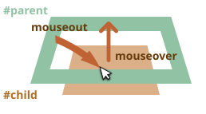

# Movendo o mouse: mouseover/out, mouseenter/leave

Vamos entrar em mais detalhes sobre os eventos que acontecem quando o mouse se move entre elementos.

## Eventos mouseover/mouseout, relatedTarget

O evento `mouseover` acontece quando um cursor de mouse entra sobre um elemento, e `mouseout` -- quando ele o deixa.


Esses eventos são especiais, porque têm a propriedade `relatedTarget`. Essa propriedade complementa `target`. Quando o mouse deixa um elemento por outro, um deles se torna `target`, e o outro -- `relatedTarget`.

Para `mouseover`:

- `event.target` -- é o elemento sobre o qual o mouse entrou.
- `event.relatedTarget` -- é o elemento de onde o mouse veio (`relatedTarget` -> `target`).

Para `mouseout`, o inverso:

- `event.target` -- é o elemento que o mouse deixou.
- `event.relatedTarget` -- é o novo elemento sob o cursor, para o qual o mouse foi (`target` -> `relatedTarget`).

```online
No exemplo abaixo, cada rosto e seus traços são elementos separados. Ao mover o mouse, você pode ver os eventos de mouse na área de texto.

Cada evento tem a informação tanto de `target` quanto de `relatedTarget`:

[codetabs src="mouseoverout" height=280]
```

```warn header="`relatedTarget` pode ser `null`"
A propriedade `relatedTarget` pode ser `null`.

Isso é normal e só significa que o mouse não veio de outro elemento, mas de fora da janela. Ou que ele saiu da janela.

Devemos ter essa possibilidade em mente ao usar `event.relatedTarget` em nosso código. Se acessarmos `event.relatedTarget.tagName`, então vai haver um erro.
```

## Pulando elementos

O evento `mousemove` é acionado quando o mouse se move. Mas isso não significa que todo pixel gere um evento.

O navegador verifica a posição do mouse de tempos em tempos. E se ele notar mudanças, então aciona os eventos.

Isso significa que, se o visitante estiver movendo o mouse muito rápido, então alguns elementos do DOM podem ser pulados:


Se o mouse se move muito rápido dos elementos `#FROM` para `#TO`, como pintado acima, então os elementos `<div>` intermediários (ou alguns deles) podem ser pulados. O evento `mouseout` pode ser acionado em `#FROM` e então imediatamente `mouseover` em `#TO`.

Isso é bom para a performance, porque pode haver muitos elementos intermediários. Realmente não queremos processar a entrada e a saída de cada um deles.

Por outro lado, devemos ter em mente que o cursor do mouse não "visita" todos os elementos ao longo do caminho. Ele pode "saltar".

Em particular, é possível que o cursor salte direto para o meio da página vindo de fora da janela. Nesse caso, `relatedTarget` é `null`, porque ele veio "de lugar nenhum":


```online
Você pode verificar isso "ao vivo" num campo de teste abaixo.

O HTML dele tem dois elementos aninhados: a `<div id="child">` está dentro da `<div id="parent">`. Se você mover o mouse rápido sobre eles, então talvez só a div filha acione eventos, ou talvez a pai, ou talvez não haja nenhum evento.

Também mova o cursor para dentro da `div` filha, e então mova-o para fora rapidamente, passando pela div pai. Se o movimento for rápido o suficiente, então o elemento pai é ignorado. O mouse vai cruzar o elemento pai sem notá-lo.

[codetabs height=360 src="mouseoverout-fast"]
```

```smart header="Se `mouseover` foi acionado, deve haver `mouseout`"
No caso de movimentos rápidos do mouse, elementos intermediários podem ser ignorados, mas uma coisa sabemos com certeza: se o cursor entrou "oficialmente" num elemento (o evento `mouseover` foi gerado), então, ao deixá-lo, sempre obtemos `mouseout`.
```

## Mouseout ao sair para um filho

Uma característica importante do `mouseout` -- ele é acionado quando o cursor se move de um elemento para um descendente dele, por exemplo de `#parent` para `#child` neste HTML:

```html
<div id="parent">
  <div id="child">...</div>
</div>
```

Se estamos em `#parent` e então movemos o cursor mais para dentro, até `#child`, obtemos `mouseout` em `#parent`!


Isso pode parecer estranho, mas pode ser facilmente explicado.

**Segundo a lógica do navegador, o cursor do mouse pode estar somente sobre um *único* elemento a qualquer momento -- o mais aninhado e o mais alto no z-index.**

Então, se ele vai para outro elemento (mesmo um descendente), ele deixa o anterior.

Observe outro detalhe importante do processamento de eventos.

O evento `mouseover` num descendente borbulha para cima. Então, se `#parent` tiver um manipulador de `mouseover`, ele é acionado:



```online
Você pode ver isso muito bem no exemplo abaixo: a `<div id="child">` está dentro da `<div id="parent">`. Há manipuladores de `mouseover/out` no elemento `#parent` que exibem os detalhes do evento.

Se você mover o mouse de `#parent` para `#child`, você verá dois eventos em `#parent`:
1. `mouseout [target: parent]` (deixou o pai), então
2. `mouseover [target: child]` (chegou ao filho, borbulhando).

[codetabs height=360 src="mouseoverout-child"]
```

Como mostrado, quando o cursor se move do elemento `#parent` para `#child`, dois manipuladores são acionados no elemento pai: `mouseout` e `mouseover`:

```js
parent.onmouseout = function(event) {
  /* event.target: elemento pai */
};
parent.onmouseover = function(event) {
  /* event.target: elemento filho (borbulhando) */
};
```

**Se não examinarmos `event.target` dentro dos manipuladores, então pode parecer que o cursor do mouse deixou o elemento `#parent`, e então imediatamente voltou sobre ele.**

Mas não é esse o caso! O cursor ainda está sobre o pai, ele só se moveu mais para dentro do elemento filho.

Se há algumas ações ao deixar o elemento pai, por exemplo uma animação que acontece em `parent.onmouseout`, geralmente não queremos isso quando o cursor só vai mais para dentro de `#parent`.

Para evitar isso, podemos verificar `relatedTarget` no manipulador e, se o mouse ainda estiver dentro do elemento, então ignorar tal evento.

Alternativamente, podemos usar outros eventos: `mouseenter` e `mouseleave`, que vamos cobrir agora, já que eles não têm esses problemas.

## Eventos mouseenter e mouseleave

Os eventos `mouseenter/mouseleave` são como `mouseover/mouseout`. Eles são acionados quando o cursor do mouse entra/sai do elemento.

Mas há duas diferenças importantes:

1. Transições dentro do elemento, de/para descendentes, não são contadas.
2. Os eventos `mouseenter/mouseleave` não borbulham.

Esses eventos são extremamente simples.

Quando o cursor entra num elemento -- `mouseenter` é acionado. A localização exata do cursor dentro do elemento ou de seus descendentes não importa.

Quando o cursor deixa um elemento -- `mouseleave` é acionado.

```online
Este exemplo é parecido com o de cima, mas agora o elemento do topo tem `mouseenter/mouseleave` em vez de `mouseover/mouseout`.

Como você pode ver, os únicos eventos gerados são os relacionados a mover o cursor para dentro e para fora do elemento do topo. Nada acontece quando o cursor vai para o filho e volta. Transições entre descendentes são ignoradas

[codetabs height=340 src="mouseleave"]
```

## Delegação de eventos

Os eventos `mouseenter/leave` são muito simples e fáceis de usar. Mas eles não borbulham. Então não podemos usar delegação de eventos com eles.

Imagine que queremos tratar a entrada/saída do mouse para células de tabela. E há centenas de células.

A solução natural seria -- definir o manipulador em `<table>` e processar os eventos lá. Mas `mouseenter/leave` não borbulham. Então, se tal evento acontece num `<td>`, só um manipulador naquele `<td>` é capaz de capturá-lo.

Manipuladores de `mouseenter/leave` em `<table>` só são acionados quando o cursor entra/sai da tabela como um todo. É impossível obter qualquer informação sobre transições dentro dela.

Então, vamos usar `mouseover/mouseout`.

Vamos começar com manipuladores simples que destacam o elemento sob o mouse:

```js
// vamos destacar um elemento sob o cursor
table.onmouseover = function(event) {
  let target = event.target;
  target.style.background = 'pink';
};

table.onmouseout = function(event) {
  let target = event.target;
  target.style.background = '';
};
```

```online
Aqui estão eles em ação. Conforme o mouse percorre os elementos desta tabela, o atual é destacado:

[codetabs height=480 src="mouseenter-mouseleave-delegation"]
```

No nosso caso, gostaríamos de tratar as transições entre células `<td>` da tabela: entrar numa célula e saí-la. Outras transições, como dentro da célula ou fora de qualquer célula, não nos interessam. Vamos filtrá-las.

Aqui está o que podemos fazer:

- Lembrar o `<td>` atualmente destacado numa variável, vamos chamá-la de `currentElem`.
- No `mouseover` -- ignorar o evento se ainda estivermos dentro do `<td>` atual.
- No `mouseout` -- ignorar se não deixamos o `<td>` atual.

Aqui está um exemplo de código que leva em conta todas as situações possíveis:

[js src="mouseenter-mouseleave-delegation-2/script.js"]

Mais uma vez, as características importantes são:
1. Ele usa delegação de eventos para tratar a entrada/saída de qualquer `<td>` dentro da tabela. Então ele depende de `mouseover/out` em vez de `mouseenter/leave`, que não borbulham e, portanto, não permitem delegação.
2. Eventos extras, como mover entre descendentes de `<td>`, são filtrados, de forma que `onEnter/Leave` só é executado se o cursor deixar ou entrar no `<td>` como um todo.

```online
Aqui está o exemplo completo com todos os detalhes:

[codetabs height=460 src="mouseenter-mouseleave-delegation-2"]

Tente mover o cursor para dentro e para fora das células da tabela e dentro delas. Rápido ou lento -- não importa. Só o `<td>` como um todo é destacado, diferente do exemplo anterior.
```

## Resumo

Cobrimos os eventos `mouseover`, `mouseout`, `mousemove`, `mouseenter` e `mouseleave`.

Essas coisas são boas de notar:

- Um movimento rápido do mouse pode pular elementos intermediários.
- Os eventos `mouseover/out` e `mouseenter/leave` têm uma propriedade adicional: `relatedTarget`. Esse é o elemento de onde/para onde estamos indo, complementar a `target`.

Os eventos `mouseover/out` são acionados mesmo quando vamos do elemento pai para um elemento filho. O navegador assume que o mouse só pode estar sobre um elemento a cada momento -- o mais profundo.

Os eventos `mouseenter/leave` são diferentes nesse aspecto: eles só são acionados quando o mouse entra e sai do elemento como um todo. Além disso, eles não borbulham.
