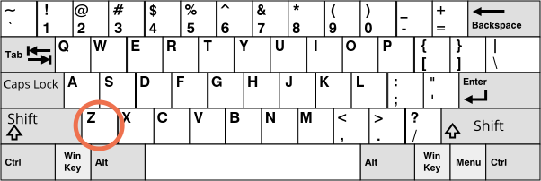
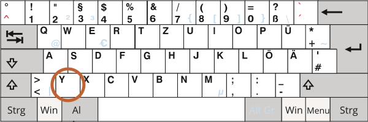

# Teclado: keydown e keyup

Antes de falarmos sobre teclado, note que em dispositivos modernos existem outras formas de "inserir algo". Por exemplo, as pessoas usam reconhecimento de voz (especialmente em dispositivos móveis) ou copiar/colar com o mouse.

Então, se quisermos rastrear qualquer entrada em um campo `<input>`, os eventos de teclado não são suficientes. Existe outro evento chamado `input` para rastrear alterações de um campo `<input>`, por qualquer meio. E ele pode ser uma escolha melhor para essa tarefa. Vamos cobri-lo mais adiante no capítulo <info:events-change-input>.

Eventos de teclado devem ser usados quando queremos tratar ações de teclado (teclado virtual também conta). Por exemplo, para reagir às teclas de seta `key:Up` e `key:Down` ou hotkeys (incluindo combinações de teclas).


## Área de teste [#keyboard-test-stand]

```offline
Para entender melhor os eventos de teclado, você pode usar a [área de teste](sandbox:keyboard-dump).
```

```online
Para entender melhor os eventos de teclado, você pode usar a área de teste abaixo.

Tente diferentes combinações de teclas no campo de texto.

[codetabs src="keyboard-dump" height=480]
```


## Keydown e keyup

O evento `keydown` acontece quando uma tecla é pressionada, e depois `keyup` -- quando ela é liberada.

### event.code e event.key

A propriedade `key` do objeto de evento permite obter o caractere, enquanto a propriedade `code` do objeto de evento permite obter o "código físico da tecla".

Por exemplo, a mesma tecla `key:Z` pode ser pressionada com ou sem `key:Shift`. Isso nos dá dois caracteres diferentes: `z` minúsculo e `Z` maiúsculo.

O `event.key` é exatamente o caractere, e ele vai ser diferente. Mas `event.code` é o mesmo:

| Tecla          | `event.key` | `event.code` |
|--------------|-------------|--------------|
| `key:Z`      |`z` (minúsculo)         |`KeyZ`        |
| `key:Shift+Z`|`Z` (maiúsculo)          |`KeyZ`        |


Se um usuário trabalha com idiomas diferentes, então trocar para outro idioma geraria um caractere totalmente diferente em vez de `"Z"`. Esse será o valor de `event.key`, enquanto `event.code` é sempre o mesmo: `"KeyZ"`.

```smart header="\"KeyZ\" e outros códigos de tecla"
Toda tecla tem um código que depende da sua localização no teclado. Os códigos de tecla são descritos na [especificação de código de eventos de UI](https://www.w3.org/TR/uievents-code/).

Por exemplo:
- Teclas de letras têm códigos `"Key<letra>"`: `"KeyA"`, `"KeyB"` etc.
- Teclas de dígitos têm códigos: `"Digit<número>"`: `"Digit0"`, `"Digit1"` etc.
- Teclas especiais são codificadas pelos seus nomes: `"Enter"`, `"Backspace"`, `"Tab"` etc.

Existem vários layouts de teclado amplamente usados, e a especificação fornece códigos de tecla para cada um deles.

Leia a [seção alfanumérica da especificação](https://www.w3.org/TR/uievents-code/#key-alphanumeric-section) para mais códigos, ou simplesmente pressione uma tecla na [área de teste](#keyboard-test-stand) acima.
```

```warn header="Maiúsculas importam: `\"KeyZ\"`, não `\"keyZ\"`"
Parece óbvio, mas as pessoas ainda cometem erros.

Evite erros de digitação: é `KeyZ`, não `keyZ`. A verificação `event.code=="keyZ"` não vai funcionar: a primeira letra de `"Key"` precisa ser maiúscula.
```

E se uma tecla não gerar nenhum caractere? Por exemplo, `key:Shift` ou `key:F1` ou outras. Para essas teclas, `event.key` é aproximadamente o mesmo que `event.code`:

| Tecla          | `event.key` | `event.code` |
|--------------|-------------|--------------|
| `key:F1`      |`F1`          |`F1`        |
| `key:Backspace`      |`Backspace`          |`Backspace`        |
| `key:Shift`|`Shift`          |`ShiftRight` ou `ShiftLeft`        |

Note que `event.code` especifica exatamente qual tecla foi pressionada. Por exemplo, a maioria dos teclados tem duas teclas `key:Shift`: uma à esquerda e outra à direita. O `event.code` nos diz exatamente qual delas foi pressionada, e `event.key` é responsável pelo "significado" da tecla: o que ela é (um "Shift").

Digamos que queremos tratar uma hotkey: `key:Ctrl+Z` (ou `key:Cmd+Z` no Mac). A maioria dos editores de texto associa a ação "Desfazer" a ela. Podemos definir um listener em `keydown` e verificar qual tecla foi pressionada.

Existe um dilema aqui: nesse listener, devemos verificar o valor de `event.key` ou de `event.code`?

Por um lado, o valor de `event.key` é um caractere, ele muda dependendo do idioma. Se o visitante tem vários idiomas no sistema operacional e troca entre eles, a mesma tecla gera caracteres diferentes. Então faz sentido verificar `event.code`, que é sempre o mesmo.

Assim:

```js run
document.addEventListener('keydown', function(event) {
  if (event.code == 'KeyZ' && (event.ctrlKey || event.metaKey)) {
    alert('Desfazer!')
  }
});
```

Por outro lado, existe um problema com `event.code`. Para layouts de teclado diferentes, a mesma tecla pode ter caracteres diferentes.

Por exemplo, aqui estão o layout dos EUA ("QWERTY") e o layout alemão ("QWERTZ") abaixo dele (da Wikipédia):





Para a mesma tecla, o layout dos EUA tem "Z", enquanto o layout alemão tem "Y" (as letras estão trocadas).

Literalmente, `event.code` vai ser igual a `KeyZ` para pessoas com layout alemão quando elas pressionam `key:Y`.

Se verificarmos `event.code == 'KeyZ'` no nosso código, então para pessoas com layout alemão esse teste vai passar quando elas pressionarem `key:Y`.

Isso parece bem estranho, mas é assim mesmo. A [especificação](https://www.w3.org/TR/uievents-code/#table-key-code-alphanumeric-writing-system) menciona explicitamente esse comportamento.

Então, `event.code` pode corresponder a um caractere errado para um layout inesperado. As mesmas letras em layouts diferentes podem corresponder a teclas físicas diferentes, levando a códigos diferentes. Felizmente, isso acontece apenas com alguns códigos, por exemplo `keyA`, `keyQ`, `keyZ` (como vimos), e não acontece com teclas especiais como `Shift`. Você pode encontrar a lista na [especificação](https://www.w3.org/TR/uievents-code/#table-key-code-alphanumeric-writing-system).

Para rastrear com confiabilidade caracteres dependentes de layout, `event.key` pode ser a melhor forma.

Por outro lado, `event.code` tem o benefício de permanecer sempre o mesmo, ligado à localização física da tecla. Então hotkeys que dependem dele funcionam bem mesmo em caso de troca de idioma.

Queremos tratar teclas dependentes de layout? Então `event.key` é o caminho.

Ou queremos que uma hotkey funcione mesmo depois de uma troca de idioma? Então `event.code` pode ser melhor.

## Auto-repeat

Se uma tecla for mantida pressionada por tempo suficiente, ela começa a "auto-repetir": o `keydown` é acionado repetidamente, e então quando ela é liberada finalmente recebemos `keyup`. Então é meio normal ter muitos `keydown` e um único `keyup`.

Para eventos acionados por auto-repeat, o objeto de evento tem a propriedade `event.repeat` definida como `true`.


## Ações padrão

As ações padrão variam, pois existem muitas coisas possíveis que podem ser iniciadas pelo teclado.

Por exemplo:

- Um caractere aparece na tela (o resultado mais óbvio).
- Um caractere é excluído (tecla `key:Delete`).
- A página é rolada (tecla `key:PageDown`).
- O navegador abre a caixa de diálogo "Salvar Página" (`key:Ctrl+S`)
-  ...e assim por diante.

Prevenir a ação padrão em `keydown` pode cancelar a maioria delas, com exceção de teclas especiais baseadas no sistema operacional. Por exemplo, no Windows `key:Alt+F4` fecha a janela atual do navegador. E não há como impedir isso prevenindo a ação padrão em JavaScript.

Por exemplo, o `<input>` abaixo espera um número de telefone, então não aceita teclas exceto dígitos, `+`, `()` ou `-`:

```html autorun height=60 run
<script>
function checkPhoneKey(key) {
  return (key >= '0' && key <= '9') || ['+','(',')','-'].includes(key);
}
</script>
<input *!*onkeydown="return checkPhoneKey(event.key)"*/!* placeholder="Telefone, por favor" type="tel">
```

O manipulador `onkeydown` aqui usa `checkPhoneKey` para verificar a tecla pressionada. Se for válida (de `0..9` ou uma de `+-()`), então retorna `true`, caso contrário `false`.

Como sabemos, o valor `false` retornado do manipulador de evento, atribuído usando uma propriedade DOM ou um atributo, como acima, previne a ação padrão, então nada aparece no `<input>` para teclas que não passam o teste. (O valor `true` retornado não afeta nada, só o retorno de `false` importa)

Note que teclas especiais, como `key:Backspace`, `key:Left`, `key:Right`, não funcionam no input. Esse é um efeito colateral do filtro estrito `checkPhoneKey`. Essas teclas fazem ele retornar `false`.

Vamos relaxar um pouco o filtro, permitindo as teclas de seta `key:Left`, `key:Right` e `key:Delete`, `key:Backspace`:

```html autorun height=60 run
<script>
function checkPhoneKey(key) {
  return (key >= '0' && key <= '9') ||
    ['+','(',')','-',*!*'ArrowLeft','ArrowRight','Delete','Backspace'*/!*].includes(key);
}
</script>
<input onkeydown="return checkPhoneKey(event.key)" placeholder="Telefone, por favor" type="tel">
```

Agora as setas e a exclusão funcionam bem.

Mesmo tendo o filtro de tecla, ainda é possível inserir qualquer coisa usando o mouse e clique direito + Colar. Dispositivos móveis oferecem outros meios de inserir valores. Então o filtro não é 100% confiável.

A abordagem alternativa seria rastrear o evento `oninput` -- ele é acionado *depois* de qualquer modificação. Ali podemos verificar o novo `input.value` e modificá-lo/destacar o `<input>` quando ele for inválido. Ou podemos usar os dois manipuladores de evento juntos.

## Legado

No passado, existia um evento `keypress`, e também as propriedades `keyCode`, `charCode`, `which` do objeto de evento.

Havia tantas incompatibilidades entre navegadores ao trabalhar com eles, que os desenvolvedores da especificação não tiveram outra opção senão depreciar todos eles e criar eventos novos e modernos (descritos acima neste capítulo). O código antigo ainda funciona, pois os navegadores continuam dando suporte a eles, mas não há mais nenhuma necessidade de usá-los.

## Teclados Móveis

Ao usar teclados virtuais/móveis, formalmente conhecidos como IME (Input-Method Editor), o padrão W3C estabelece que o [`e.keyCode` de um KeyboardEvent deve ser `229`](https://www.w3.org/TR/uievents/#determine-keydown-keyup-keyCode) e [`e.key` deve ser `"Unidentified"`](https://www.w3.org/TR/uievents-key/#key-attr-values).

Embora alguns desses teclados ainda possam usar os valores corretos para `e.key`, `e.code`, `e.keyCode`... ao pressionar certas teclas como setas ou backspace, não há garantia, então sua lógica de teclado pode não funcionar sempre em dispositivos móveis.

## Resumo

Pressionar uma tecla sempre gera um evento de teclado, seja ela uma tecla de símbolo ou uma tecla especial como `key:Shift` ou `key:Ctrl` e assim por diante. A única exceção é a tecla `key:Fn`, que às vezes está presente em um teclado de laptop. Não há evento de teclado para ela, porque geralmente ela é implementada em um nível mais baixo do que o sistema operacional.

Eventos de teclado:

- `keydown` -- ao pressionar a tecla (auto-repete se a tecla for mantida pressionada por muito tempo),
- `keyup` -- ao liberar a tecla.

Principais propriedades de evento de teclado:

- `code` -- o "código da tecla" (`"KeyA"`, `"ArrowLeft"` e assim por diante), específico da localização física da tecla no teclado.
- `key` -- o caractere (`"A"`, `"a"` e assim por diante), para teclas sem caractere, como `key:Esc`, geralmente tem o mesmo valor que `code`.

No passado, eventos de teclado eram às vezes usados para rastrear a entrada do usuário em campos de formulário. Isso não é confiável, porque a entrada pode vir de diversas fontes. Temos os eventos `input` e `change` para tratar qualquer entrada (cobertos mais adiante no capítulo <info:events-change-input>). Eles são acionados depois de qualquer tipo de entrada, incluindo copiar e colar ou reconhecimento de voz.

Devemos usar eventos de teclado quando realmente queremos o teclado. Por exemplo, para reagir a hotkeys ou teclas especiais.
