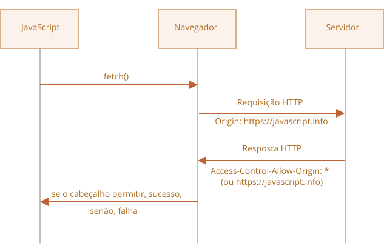
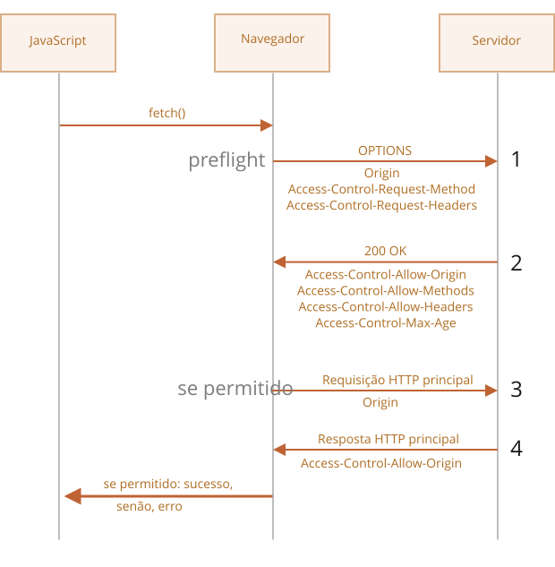

# Fetch: Requisições Cross-Origin

Se enviarmos uma requisição `fetch` para outro site, provavelmente ela vai falhar.

Por exemplo, vamos tentar buscar `http://example.com`:

```js run async
try {
  await fetch('http://example.com');
} catch(err) {
  alert(err); // Failed to fetch
}
```

O fetch falha, como esperado.

O conceito central aqui é *origin* -- uma tripla domínio/porta/protocolo.

Requisições cross-origin -- aquelas enviadas para outro domínio (até mesmo um subdomínio) ou protocolo ou porta -- exigem cabeçalhos especiais do lado remoto.

Essa política é chamada de "CORS": Cross-Origin Resource Sharing.

## Por que o CORS é necessário? Um breve histórico

O CORS existe para proteger a internet de hackers mal-intencionados.

Sério. Vamos fazer uma breve digressão histórica.

**Por muitos anos, um script de um site não conseguia acessar o conteúdo de outro site.**

Essa regra simples, mas poderosa, era um fundamento da segurança da internet. Por exemplo, um script mal-intencionado do site `hacker.com` não conseguia acessar a caixa de e-mail do usuário no site `gmail.com`. As pessoas se sentiam seguras.

O JavaScript também não tinha nenhum método especial para realizar requisições de rede naquela época. Era uma linguagem de brinquedo para decorar uma página web.

Mas os desenvolvedores web exigiam mais poder. Uma variedade de truques foi inventada para contornar a limitação e fazer requisições para outros sites.

### Usando formulários

Uma forma de se comunicar com outro servidor era enviar um `<form>` para lá. As pessoas o enviavam para um `<iframe>`, só para continuar na página atual, assim:

```html
<!-- alvo do formulário -->
*!*
<iframe name="iframe"></iframe>
*/!*

<!-- um formulário poderia ser gerado dinamicamente e enviado pelo JavaScript -->
*!*
<form target="iframe" method="POST" action="http://another.com/…">
*/!*
  ...
</form>
```

Então, era possível fazer uma requisição GET/POST para outro site, até mesmo sem métodos de rede, já que formulários podem enviar dados para qualquer lugar. Mas como é proibido acessar o conteúdo de um `<iframe>` de outro site, não era possível ler a resposta.

Para ser preciso, na verdade existiam truques para isso, eles exigiam scripts especiais tanto no iframe quanto na página. Então a comunicação com o iframe era tecnicamente possível. Agora não há sentido em entrar em detalhes, vamos deixar esses dinossauros descansarem em paz.

### Usando scripts

Outro truque era usar uma tag `script`. Um script podia ter qualquer `src`, com qualquer domínio, como `<script src="http://another.com/…">`. É possível executar um script de qualquer site.

Se um site, por exemplo `another.com`, pretendia expor dados para esse tipo de acesso, então um protocolo chamado "JSONP (JSON with padding)" era usado.

Veja como funcionava.

Digamos que nós, no nosso site, precisamos obter os dados de `http://another.com`, como o clima:

1. Primeiro, com antecedência, declaramos uma função global para receber os dados, por exemplo, `gotWeather`.

    ```js
    // 1. Declara a função para processar os dados do clima
    function gotWeather({ temperature, humidity }) {
      alert(`temperatura: ${temperature}, umidade: ${humidity}`);
    }
    ```
2. Então criamos uma tag `<script>` com `src="http://another.com/weather.json?callback=gotWeather"`, usando o nome da nossa função como o parâmetro de URL `callback`.

    ```js
    let script = document.createElement('script');
    script.src = `http://another.com/weather.json?callback=gotWeather`;
    document.body.append(script);
    ```
3. O servidor remoto `another.com` gera dinamicamente um script que chama `gotWeather(...)` com os dados que ele quer que recebamos.
    ```js
    // A resposta esperada do servidor se parece com isso:
    gotWeather({
      temperature: 25,
      humidity: 78
    });
    ```
4. Quando o script remoto carrega e executa, `gotWeather` roda, e, como é nossa função, temos os dados.

Isso funciona, e não viola a segurança, porque os dois lados concordaram em passar os dados dessa forma. E, quando os dois lados concordam, definitivamente não é um hack. Ainda existem serviços que fornecem esse tipo de acesso, já que funciona até mesmo em navegadores muito antigos.

Depois de um tempo, métodos de rede surgiram no JavaScript do navegador.

No início, requisições cross-origin eram proibidas. Mas, como resultado de longas discussões, requisições cross-origin passaram a ser permitidas, mas com qualquer nova capacidade exigindo uma permissão explícita do servidor, expressa em cabeçalhos especiais.

## Requisições seguras

Existem dois tipos de requisições cross-origin:

1. Requisições seguras.
2. Todas as outras.

Requisições seguras são mais simples de fazer, então vamos começar por elas.

Uma requisição é segura se ela satisfaz duas condições:

1. [Método seguro](https://fetch.spec.whatwg.org/#cors-safelisted-method): GET, POST ou HEAD
2. [Cabeçalhos seguros](https://fetch.spec.whatwg.org/#cors-safelisted-request-header) -- os únicos cabeçalhos personalizados permitidos são:
    - `Accept`,
    - `Accept-Language`,
    - `Content-Language`,
    - `Content-Type` com o valor `application/x-www-form-urlencoded`, `multipart/form-data` ou `text/plain`.

Qualquer outra requisição é considerada "insegura". Por exemplo, uma requisição com o método `PUT` ou com um cabeçalho HTTP `API-Key` não se encaixa nas limitações.

**A diferença essencial é que uma requisição segura pode ser feita com um `<form>` ou um `<script>`, sem nenhum método especial.**

Então, até mesmo um servidor muito antigo deveria estar pronto para aceitar uma requisição segura.

Em contraste, requisições com cabeçalhos não padronizados ou, por exemplo, o método `DELETE`, não podem ser criadas dessa forma. Por muito tempo o JavaScript não conseguia fazer esse tipo de requisição. Então um servidor antigo pode assumir que esse tipo de requisição vem de uma fonte privilegiada, "porque uma página web não é capaz de enviá-las".

Quando tentamos fazer uma requisição insegura, o navegador envia uma requisição especial de "preflight" que pergunta ao servidor -- ele concorda em aceitar esse tipo de requisição cross-origin, ou não?

E, a menos que o servidor confirme isso explicitamente com cabeçalhos, uma requisição insegura não é enviada.

Agora vamos entrar em detalhes.

## CORS para requisições seguras

Se uma requisição é cross-origin, o navegador sempre adiciona o cabeçalho `Origin` a ela.

Por exemplo, se requisitarmos `https://anywhere.com/request` a partir de `https://javascript.info/page`, os cabeçalhos vão se parecer com:

```http
GET /request
Host: anywhere.com
*!*
Origin: https://javascript.info
*/!*
...
```

Como você pode ver, o cabeçalho `Origin` contém exatamente a origem (domínio/protocolo/porta), sem um caminho.

O servidor pode inspecionar o `Origin` e, se concordar em aceitar essa requisição, adicionar um cabeçalho especial `Access-Control-Allow-Origin` à resposta. Esse cabeçalho deve conter a origem permitida (no nosso caso `https://javascript.info`), ou um asterisco `*`. Então a resposta é bem-sucedida, caso contrário é um erro.

O navegador exerce o papel de um mediador confiável aqui:
1. Ele garante que o `Origin` correto é enviado com uma requisição cross-origin.
2. Ele checa a permissão `Access-Control-Allow-Origin` na resposta, se ela existir, então o JavaScript tem permissão para acessar a resposta, caso contrário ele falha com um erro.



Aqui está um exemplo de uma resposta permissiva do servidor:
```http
200 OK
Content-Type:text/html; charset=UTF-8
*!*
Access-Control-Allow-Origin: https://javascript.info
*/!*
```

## Cabeçalhos de resposta

Para requisições cross-origin, por padrão o JavaScript só pode acessar os chamados cabeçalhos de resposta "seguros":

- `Cache-Control`
- `Content-Language`
- `Content-Length`
- `Content-Type`
- `Expires`
- `Last-Modified`
- `Pragma`

Acessar qualquer outro cabeçalho de resposta causa um erro.

Para dar ao JavaScript acesso a qualquer outro cabeçalho de resposta, o servidor deve enviar o cabeçalho `Access-Control-Expose-Headers`. Ele contém uma lista, separada por vírgulas, dos nomes de cabeçalhos inseguros que devem ser tornados acessíveis.

Por exemplo:

```http
200 OK
Content-Type:text/html; charset=UTF-8
Content-Length: 12345
Content-Encoding: gzip
API-Key: 2c9de507f2c54aa1
Access-Control-Allow-Origin: https://javascript.info
*!*
Access-Control-Expose-Headers: Content-Encoding,API-Key
*/!*
```

Com esse cabeçalho `Access-Control-Expose-Headers`, o script tem permissão para ler os cabeçalhos `Content-Encoding` e `API-Key` da resposta.

## Requisições "inseguras"

Podemos usar qualquer método HTTP: não só `GET/POST`, mas também `PATCH`, `DELETE` e outros.

Algum tempo atrás, ninguém conseguia nem imaginar que uma página web pudesse fazer esse tipo de requisição. Então ainda podem existir serviços web que tratam um método não padronizado como um sinal de: "Isso não é um navegador". Eles podem levar isso em conta ao checar direitos de acesso.

Então, para evitar mal-entendidos, para qualquer requisição "insegura" -- que não podia ser feita nos tempos antigos, o navegador não faz esse tipo de requisição imediatamente. Primeiro, ele envia uma requisição preliminar, chamada de "preflight", para pedir permissão.

Uma requisição preflight usa o método `OPTIONS`, sem corpo e com três cabeçalhos:

- O cabeçalho `Access-Control-Request-Method` tem o método da requisição insegura.
- O cabeçalho `Access-Control-Request-Headers` fornece uma lista, separada por vírgulas, dos seus cabeçalhos HTTP inseguros.
- O cabeçalho `Origin` diz de onde a requisição veio. (como `https://javascript.info`)

Se o servidor concordar em atender as requisições, então ele deve responder com corpo vazio, status 200 e cabeçalhos:

- `Access-Control-Allow-Origin` deve ser `*` ou a origem que está requisitando, como `https://javascript.info`, para permiti-la.
- `Access-Control-Allow-Methods` deve ter o método permitido.
- `Access-Control-Allow-Headers` deve ter uma lista de cabeçalhos permitidos.
- Além disso, o cabeçalho `Access-Control-Max-Age` pode especificar um número de segundos para armazenar as permissões em cache. Assim o navegador não vai precisar enviar um preflight para requisições subsequentes que satisfaçam as permissões dadas.



Vamos ver como isso funciona passo a passo no exemplo de uma requisição `PATCH` cross-origin (esse método é frequentemente usado para atualizar dados):

```js
let response = await fetch('https://site.com/service.json', {
  method: 'PATCH',
  headers: {
    'Content-Type': 'application/json',
    'API-Key': 'secret'
  }
});
```

Existem três motivos pelos quais a requisição é insegura (um já basta):
- Método `PATCH`
- `Content-Type` não é um destes: `application/x-www-form-urlencoded`, `multipart/form-data`, `text/plain`.
- Cabeçalho `API-Key` "inseguro".

### Passo 1 (requisição preflight)

Antes de enviar essa requisição, o navegador, por conta própria, envia uma requisição preflight que se parece com isto:

```http
OPTIONS /service.json
Host: site.com
Origin: https://javascript.info
Access-Control-Request-Method: PATCH
Access-Control-Request-Headers: Content-Type,API-Key
```

- Método: `OPTIONS`.
- O caminho -- exatamente o mesmo da requisição principal: `/service.json`.
- Cabeçalhos especiais cross-origin:
    - `Origin` -- a origem de onde partiu.
    - `Access-Control-Request-Method` -- método requisitado.
    - `Access-Control-Request-Headers` -- uma lista, separada por vírgulas, de cabeçalhos "inseguros".

### Passo 2 (resposta do preflight)

O servidor deve responder com status 200 e os cabeçalhos:
- `Access-Control-Allow-Origin: https://javascript.info`
- `Access-Control-Allow-Methods: PATCH`
- `Access-Control-Allow-Headers: Content-Type,API-Key`.

Isso permite a comunicação futura, caso contrário um erro é disparado.

Se o servidor espera outros métodos e cabeçalhos no futuro, faz sentido permiti-los com antecedência, adicionando-os à lista.

Por exemplo, esta resposta também permite `PUT`, `DELETE` e cabeçalhos adicionais:

```http
200 OK
Access-Control-Allow-Origin: https://javascript.info
Access-Control-Allow-Methods: PUT,PATCH,DELETE
Access-Control-Allow-Headers: API-Key,Content-Type,If-Modified-Since,Cache-Control
Access-Control-Max-Age: 86400
```

Agora o navegador consegue ver que `PATCH` está em `Access-Control-Allow-Methods` e `Content-Type,API-Key` estão na lista `Access-Control-Allow-Headers`, então ele envia a requisição principal.

Se existir o cabeçalho `Access-Control-Max-Age` com um número de segundos, então as permissões do preflight são armazenadas em cache pelo tempo dado. A resposta acima vai ser armazenada em cache por 86400 segundos (um dia). Dentro desse período, requisições subsequentes não vão causar um preflight. Assumindo que elas se encaixem nas permissões em cache, elas vão ser enviadas diretamente.

### Passo 3 (requisição real)

Quando o preflight é bem-sucedido, o navegador agora faz a requisição principal. O processo aqui é o mesmo das requisições seguras.

A requisição principal tem o cabeçalho `Origin` (porque ela é cross-origin):

```http
PATCH /service.json
Host: site.com
Content-Type: application/json
API-Key: secret
Origin: https://javascript.info
```

### Passo 4 (resposta real)

O servidor não deve esquecer de adicionar `Access-Control-Allow-Origin` à resposta principal. Um preflight bem-sucedido não dispensa isso:

```http
Access-Control-Allow-Origin: https://javascript.info
```

Então o JavaScript consegue ler a resposta principal do servidor.

```smart
A requisição preflight ocorre "nos bastidores", é invisível para o JavaScript.

O JavaScript só recebe a resposta da requisição principal ou um erro, se não houver permissão do servidor.
```

## Credenciais

Uma requisição cross-origin iniciada pelo código JavaScript, por padrão, não traz nenhuma credencial (cookies ou autenticação HTTP).

Isso é incomum para requisições HTTP. Normalmente, uma requisição para `http://site.com` vem acompanhada de todos os cookies daquele domínio. Requisições cross-origin feitas por métodos do JavaScript, por outro lado, são uma exceção.

Por exemplo, `fetch('http://another.com')` não envia nenhum cookie, nem mesmo aqueles (!) que pertencem ao domínio `another.com`.

Por quê?

Isso acontece porque uma requisição com credenciais é muito mais poderosa do que sem elas. Se permitida, ela dá ao JavaScript o poder total de agir em nome do usuário e acessar informações sensíveis usando as credenciais dele.

O servidor realmente confia tanto assim no script? Então ele precisa permitir explicitamente requisições com credenciais com um cabeçalho adicional.

Para enviar credenciais no `fetch`, precisamos adicionar a opção `credentials: "include"`, assim:

```js
fetch('http://another.com', {
  credentials: "include"
});
```

Agora `fetch` envia cookies originários de `another.com` na requisição para esse site.

Se o servidor concordar em aceitar a requisição *com credenciais*, ele deve adicionar um cabeçalho `Access-Control-Allow-Credentials: true` à resposta, além de `Access-Control-Allow-Origin`.

Por exemplo:

```http
200 OK
Access-Control-Allow-Origin: https://javascript.info
Access-Control-Allow-Credentials: true
```

Observe: `Access-Control-Allow-Origin` é proibido de usar um asterisco `*` para requisições com credenciais. Como mostrado acima, ele deve fornecer a origem exata ali. Essa é uma medida de segurança adicional, para garantir que o servidor realmente saiba em quem confia para fazer esse tipo de requisição.

## Resumo

Do ponto de vista do navegador, existem dois tipos de requisições cross-origin: "seguras" e todas as outras.

Requisições "seguras" devem satisfazer as seguintes condições:
- Método: GET, POST ou HEAD.
- Cabeçalhos -- só podemos definir:
    - `Accept`
    - `Accept-Language`
    - `Content-Language`
    - `Content-Type` com o valor `application/x-www-form-urlencoded`, `multipart/form-data` ou `text/plain`.

A diferença essencial é que requisições seguras eram possíveis desde tempos antigos usando tags `<form>` ou `<script>`, enquanto as inseguras eram impossíveis para navegadores por muito tempo.

Então, a diferença prática é que requisições seguras são enviadas imediatamente, com o cabeçalho `Origin`, enquanto para as outras o navegador faz uma requisição preliminar de "preflight", pedindo permissão.

**Para requisições seguras:**

- → O navegador envia o cabeçalho `Origin` com a origem.
- ← Para requisições sem credenciais (não enviadas por padrão), o servidor deve definir:
    - `Access-Control-Allow-Origin` como `*` ou o mesmo valor de `Origin`
- ← Para requisições com credenciais, o servidor deve definir:
    - `Access-Control-Allow-Origin` como o mesmo valor de `Origin`
    - `Access-Control-Allow-Credentials` como `true`

Além disso, para dar ao JavaScript acesso a qualquer cabeçalho de resposta, exceto `Cache-Control`, `Content-Language`, `Content-Type`, `Expires`, `Last-Modified` ou `Pragma`, o servidor deve listar os permitidos no cabeçalho `Access-Control-Expose-Headers`.

**Para requisições inseguras, uma requisição preliminar de "preflight" é emitida antes da requisição desejada:**

- → O navegador envia uma requisição `OPTIONS` para a mesma URL, com os cabeçalhos:
    - `Access-Control-Request-Method` tem o método requisitado.
    - `Access-Control-Request-Headers` lista os cabeçalhos inseguros requisitados.
- ← O servidor deve responder com status 200 e os cabeçalhos:
    - `Access-Control-Allow-Methods` com uma lista de métodos permitidos,
    - `Access-Control-Allow-Headers` com uma lista de cabeçalhos permitidos,
    - `Access-Control-Max-Age` com um número de segundos para armazenar as permissões em cache.
- Então a requisição real é enviada, e o esquema "seguro" anterior é aplicado.
