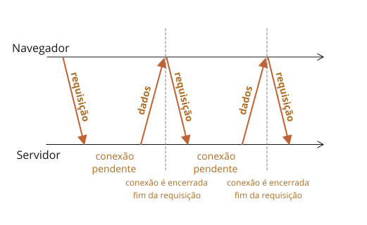

# Long polling

Long polling é a forma mais simples de ter uma conexão persistente com o servidor, que não usa nenhum protocolo específico como WebSocket ou Server Sent Events.

Por ser muito fácil de implementar, também é bom o suficiente em muitos casos.

## Polling comum

A forma mais simples de obter novas informações do servidor é o polling periódico. Ou seja, requisições regulares ao servidor: "Olá, estou aqui, você tem alguma informação para mim?". Por exemplo, uma vez a cada 10 segundos.

Em resposta, o servidor primeiro anota para si mesmo que o cliente está online, e segundo - envia um pacote de mensagens que recebeu até aquele momento.

Isso funciona, mas tem desvantagens:
1. As mensagens são entregues com um atraso de até 10 segundos (entre as requisições).
2. Mesmo que não haja mensagens, o servidor é bombardeado com requisições a cada 10 segundos, mesmo que o usuário tenha ido para outro lugar ou esteja dormindo. Isso é uma carga e tanto para lidar, falando em termos de desempenho.

Então, se estivermos falando de um serviço bem pequeno, a abordagem pode ser viável, mas geralmente precisa de uma melhoria.

## Long polling

O chamado "long polling" é uma forma muito melhor de fazer polling no servidor.

Também é muito fácil de implementar, e entrega mensagens sem atrasos.

O fluxo:

1. Uma requisição é enviada ao servidor.
2. O servidor não fecha a conexão até ter uma mensagem para enviar.
3. Quando uma mensagem aparece - o servidor responde à requisição com ela.
4. O navegador faz uma nova requisição imediatamente.

Essa situação, em que o navegador enviou uma requisição e mantém uma conexão pendente com o servidor, é padrão para esse método. Só quando uma mensagem é entregue, a conexão é fechada e restabelecida.



Se a conexão for perdida, por causa de, digamos, um erro de rede, o navegador imediatamente envia uma nova requisição.

Um esboço da função `subscribe` do lado do cliente que faz as requisições longas:

```js
async function subscribe() {
  let response = await fetch("/subscribe");

  if (response.status == 502) {
    // O status 502 é um erro de timeout de conexão,
    // pode acontecer quando a conexão ficou pendente por tempo demais,
    // e o servidor remoto ou um proxy a fechou
    // vamos reconectar
    await subscribe();
  } else if (response.status != 200) {
    // Um erro - vamos mostrá-lo
    showMessage(response.statusText);
    // Reconecta em um segundo
    await new Promise(resolve => setTimeout(resolve, 1000));
    await subscribe();
  } else {
    // Obtém e mostra a mensagem
    let message = await response.text();
    showMessage(message);
    // Chama subscribe() de novo para obter a próxima mensagem
    await subscribe();
  }
}

subscribe();
```

Como você pode ver, a função `subscribe` faz um fetch, depois espera a resposta, trata ela e se chama de novo.

```warn header="O servidor deve estar bem com muitas conexões pendentes"
A arquitetura do servidor deve ser capaz de trabalhar com muitas conexões pendentes.

Certas arquiteturas de servidor rodam um processo por conexão, resultando em tantos processos quantas conexões existirem, enquanto cada processo consome uma boa quantidade de memória. Então, conexões demais vão simplesmente consumir tudo.

Isso costuma ser o caso para backends escritos em linguagens como PHP e Ruby.

Servidores escritos usando Node.js geralmente não têm esse tipo de problema.

Dito isso, não é uma questão da linguagem de programação. A maioria das linguagens modernas, incluindo PHP e Ruby, permite implementar um backend adequado. Só certifique-se de que sua arquitetura de servidor funciona bem com muitas conexões simultâneas.
```

## Demo: um chat

Aqui está uma demo de chat, você também pode baixá-la e rodar localmente (se você estiver familiarizado com Node.js e conseguir instalar módulos):

[codetabs src="longpoll" height=500]

O código do navegador está em `browser.js`.

## Área de uso

Long polling funciona muito bem em situações em que as mensagens são raras.

Se as mensagens vêm com muita frequência, então o gráfico de requisição-recebimento de mensagens, desenhado acima, fica parecido com um dente de serra.

Cada mensagem é uma requisição separada, acompanhada de cabeçalhos, sobrecarga de autenticação, e assim por diante.

Então, nesse caso, outro método é preferível, como [Websocket](info:websocket) ou [Server Sent Events](info:server-sent-events).
