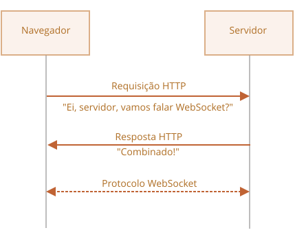

# WebSocket

O protocolo `WebSocket`, descrito na especificação [RFC 6455](https://datatracker.ietf.org/doc/html/rfc6455), fornece uma forma de trocar dados entre o navegador e o servidor por meio de uma conexão persistente. Os dados podem ser passados nas duas direções como "pacotes", sem quebrar a conexão e sem a necessidade de requisições HTTP adicionais.

WebSocket é especialmente ótimo para serviços que exigem troca contínua de dados, por exemplo, jogos online, sistemas de negociação em tempo real e assim por diante.

## Um exemplo simples

Para abrir uma conexão websocket, precisamos criar um `new WebSocket` usando o protocolo especial `ws` na url:

```js
let socket = new WebSocket("*!*ws*/!*://javascript.info");
```

Também existe o protocolo criptografado `wss://`. É como o HTTPS para websockets.

```smart header="Sempre prefira `wss://`"
O protocolo `wss://` não é só criptografado, mas também mais confiável.

Isso acontece porque os dados de `ws://` não são criptografados, visíveis para qualquer intermediário. Servidores proxy antigos não sabem sobre o WebSocket, eles podem ver cabeçalhos "estranhos" e abortar a conexão.

Por outro lado, `wss://` é o WebSocket sobre TLS (assim como HTTPS é HTTP sobre TLS), a camada de segurança de transporte criptografa os dados no remetente e os decriptografa no destinatário. Então os pacotes de dados são passados criptografados através dos proxies. Eles não conseguem ver o que tem dentro e os deixam passar.
```

Uma vez que o socket é criado, devemos escutar eventos nele. Existem, ao todo, 4 eventos:
- **`open`** -- conexão estabelecida,
- **`message`** -- dado recebido,
- **`error`** -- erro de websocket,
- **`close`** -- conexão fechada.

...E se quisermos enviar alguma coisa, então `socket.send(data)` vai fazer isso.

Aqui está um exemplo:

```js run
let socket = new WebSocket("wss://javascript.info/article/websocket/demo/hello");

socket.onopen = function(e) {
  alert("[open] Connection established");
  alert("Sending to server");
  socket.send("My name is John");
};

socket.onmessage = function(event) {
  alert(`[message] Data received from server: ${event.data}`);
};

socket.onclose = function(event) {
  if (event.wasClean) {  
    alert(`[close] Connection closed cleanly, code=${event.code} reason=${event.reason}`);
  } else {
    // por exemplo, o processo do servidor foi morto ou a rede caiu
    // event.code geralmente é 1006 nesse caso
    alert('[close] Connection died');
  }
};

socket.onerror = function(error) {
  alert(`[error]`);
};
```

Para fins de demonstração, existe um pequeno servidor [server.js](demo/server.js) escrito em Node.js, rodando para o exemplo acima. Ele responde com "Hello from server, John", depois espera 5 segundos e fecha a conexão.

Então você vai ver os eventos `open` -> `message` -> `close`.

Na verdade, isso é tudo, já podemos falar WebSocket. Bem simples, não é?

Agora vamos falar mais a fundo.

## Abrindo um websocket

Quando `new WebSocket(url)` é criado, ele começa a se conectar imediatamente.

Durante a conexão, o navegador (usando cabeçalhos) pergunta ao servidor: "Você suporta Websocket?" E se o servidor responder "sim", então a conversa continua no protocolo WebSocket, que não é HTTP de forma alguma.



Aqui está um exemplo de cabeçalhos do navegador para uma requisição feita por `new WebSocket("wss://javascript.info/chat")`.

```
GET /chat
Host: javascript.info
Origin: https://javascript.info
Connection: Upgrade
Upgrade: websocket
Sec-WebSocket-Key: Iv8io/9s+lYFgZWcXczP8Q==
Sec-WebSocket-Version: 13
```

- `Origin` -- a origem da página do cliente, por exemplo, `https://javascript.info`. Objetos WebSocket são cross-origin por natureza. Não existem cabeçalhos especiais ou outras limitações. Servidores antigos são incapazes de lidar com WebSocket de qualquer forma, então não há problemas de compatibilidade. Mas o cabeçalho `Origin` é importante, já que permite ao servidor decidir se deve ou não falar WebSocket com esse site.
- `Connection: Upgrade` -- sinaliza que o cliente gostaria de mudar o protocolo.
- `Upgrade: websocket` -- o protocolo requisitado é "websocket".
- `Sec-WebSocket-Key` -- uma chave aleatória gerada pelo navegador, usada para garantir que o servidor suporta o protocolo WebSocket. É aleatória para evitar que proxies façam cache de qualquer comunicação seguinte.
- `Sec-WebSocket-Version` -- versão do protocolo WebSocket, 13 é a atual.

```smart header="O handshake do WebSocket não pode ser emulado"
Não podemos usar `XMLHttpRequest` ou `fetch` para fazer esse tipo de requisição HTTP, porque o JavaScript não tem permissão para definir esses cabeçalhos.
```

Se o servidor concordar em mudar para WebSocket, ele deve enviar uma resposta com código 101:

```
101 Switching Protocols
Upgrade: websocket
Connection: Upgrade
Sec-WebSocket-Accept: hsBlbuDTkk24srzEOTBUlZAlC2g=
```

Aqui `Sec-WebSocket-Accept` é `Sec-WebSocket-Key`, recodificado usando um algoritmo especial. Ao ver isso, o navegador entende que o servidor realmente suporta o protocolo WebSocket.

Depois disso, os dados são transferidos usando o protocolo WebSocket, vamos ver sua estrutura ("frames") em breve. E isso não é HTTP de forma alguma.

### Extensões e subprotocolos

Pode haver cabeçalhos adicionais `Sec-WebSocket-Extensions` e `Sec-WebSocket-Protocol` que descrevem extensões e subprotocolos.

Por exemplo:

- `Sec-WebSocket-Extensions: deflate-frame` significa que o navegador suporta compressão de dados. Uma extensão é algo relacionado à transferência dos dados, uma funcionalidade que estende o protocolo WebSocket. O cabeçalho `Sec-WebSocket-Extensions` é enviado automaticamente pelo navegador, com a lista de todas as extensões que ele suporta.

- `Sec-WebSocket-Protocol: soap, wamp` significa que gostaríamos de transferir não só qualquer dado, mas dados nos protocolos [SOAP](https://en.wikipedia.org/wiki/SOAP) ou WAMP ("The WebSocket Application Messaging Protocol"). Subprotocolos WebSocket são registrados no [catálogo IANA](https://www.iana.org/assignments/websocket/websocket.xml). Então, esse cabeçalho descreve os formatos de dados que vamos usar.

    Esse cabeçalho opcional é definido usando o segundo parâmetro de `new WebSocket`. É o array de subprotocolos, por exemplo, se quisermos usar SOAP ou WAMP:

    ```js
    let socket = new WebSocket("wss://javascript.info/chat", ["soap", "wamp"]);
    ```

O servidor deve responder com uma lista de protocolos e extensões que ele concorda em usar.

Por exemplo, a requisição:

```
GET /chat
Host: javascript.info
Upgrade: websocket
Connection: Upgrade
Origin: https://javascript.info
Sec-WebSocket-Key: Iv8io/9s+lYFgZWcXczP8Q==
Sec-WebSocket-Version: 13
*!*
Sec-WebSocket-Extensions: deflate-frame
Sec-WebSocket-Protocol: soap, wamp
*/!*
```

Resposta:

```
101 Switching Protocols
Upgrade: websocket
Connection: Upgrade
Sec-WebSocket-Accept: hsBlbuDTkk24srzEOTBUlZAlC2g=
*!*
Sec-WebSocket-Extensions: deflate-frame
Sec-WebSocket-Protocol: soap
*/!*
```

Aqui o servidor responde que suporta a extensão "deflate-frame", e só SOAP dos subprotocolos requisitados.

## Transferência de dados

A comunicação WebSocket consiste em "frames" -- fragmentos de dados, que podem ser enviados por qualquer um dos lados, e podem ser de vários tipos:

- "frames de texto" -- contêm dados de texto que as partes enviam uma à outra.
- "frames de dados binários" -- contêm dados binários que as partes enviam uma à outra.
- "frames de ping/pong" são usados para checar a conexão, enviados pelo servidor, o navegador responde a eles automaticamente.
- também existe o "frame de fechamento de conexão" e alguns outros frames de serviço.

No navegador, trabalhamos diretamente só com frames de texto ou binários.

**O método `.send()` do WebSocket pode enviar tanto texto quanto dados binários.**

Uma chamada `socket.send(body)` permite que `body` seja em formato string ou binário, incluindo `Blob`, `ArrayBuffer`, etc. Nenhuma configuração é necessária: só envie no formato que for.

**Quando recebemos os dados, o texto sempre vem como string. E para dados binários, podemos escolher entre os formatos `Blob` e `ArrayBuffer`.**

Isso é definido pela propriedade `socket.binaryType`, é `"blob"` por padrão, então os dados binários vêm como objetos `Blob`.

[Blob](info:blob) é um objeto binário de alto nível, ele se integra diretamente com `<a>`, `` e outras tags, então esse é um padrão sensato. Mas para processamento binário, para acessar bytes de dados individuais, podemos mudá-lo para `"arraybuffer"`:

```js
socket.binaryType = "arraybuffer";
socket.onmessage = (event) => {
  // event.data é uma string (se texto) ou arraybuffer (se binário)
};
```

## Limitação de taxa

Imagine que nosso app está gerando muitos dados para enviar. Mas o usuário tem uma conexão de rede lenta, talvez numa internet móvel, fora da cidade.

Podemos chamar `socket.send(data)` repetidamente. Mas os dados vão ficar em buffer (armazenados) na memória e enviados só tão rápido quanto a velocidade da rede permitir.

A propriedade `socket.bufferedAmount` armazena quantos bytes permanecem em buffer nesse momento, esperando para serem enviados pela rede.

Podemos examiná-la para ver se o socket está realmente disponível para transmissão.

```js
// a cada 100ms examina o socket e envia mais dados
// só se todos os dados existentes já foram enviados
setInterval(() => {
  if (socket.bufferedAmount == 0) {
    socket.send(moreData());
  }
}, 100);
```


## Fechamento da conexão

Normalmente, quando uma das partes quer fechar a conexão (tanto navegador quanto servidor têm direitos iguais), elas enviam um "frame de fechamento de conexão" com um código numérico e um motivo textual.

O método para isso é:
```js
socket.close([code], [reason]);
```

- `code` é um código especial de fechamento do WebSocket (opcional)
- `reason` é uma string que descreve o motivo do fechamento (opcional)

Então a outra parte, no tratador do evento `close`, recebe o código e o motivo, por exemplo:

```js
// parte que fecha:
socket.close(1000, "Work complete");

// a outra parte
socket.onclose = event => {
  // event.code === 1000
  // event.reason === "Work complete"
  // event.wasClean === true (fechamento limpo)
};
```

Valores de código mais comuns:

- `1000` -- o padrão, fechamento normal (usado se nenhum `code` for fornecido),
- `1006` -- não há como definir esse código manualmente, indica que a conexão foi perdida (sem frame de fechamento).

Existem outros códigos como:

- `1001` -- a parte está saindo, por exemplo, o servidor está desligando, ou um navegador sai da página,
- `1009` -- a mensagem é grande demais para processar,
- `1011` -- erro inesperado no servidor,
- ...e assim por diante.

A lista completa pode ser encontrada em [RFC6455, §7.4.1](https://tools.ietf.org/html/rfc6455#section-7.4.1).

Os códigos WebSocket são de certa forma como os códigos HTTP, mas diferentes. Em particular, códigos menores que `1000` são reservados, vai haver um erro se tentarmos definir um código assim.

```js
// no caso da conexão estar quebrada
socket.onclose = event => {
  // event.code === 1006
  // event.reason === ""
  // event.wasClean === false (sem frame de fechamento)
};
```


## Estado da conexão

Para obter o estado da conexão, adicionalmente existe a propriedade `socket.readyState` com os valores:

- **`0`** -- "CONNECTING": a conexão ainda não foi estabelecida,
- **`1`** -- "OPEN": comunicando,
- **`2`** -- "CLOSING": a conexão está fechando,
- **`3`** -- "CLOSED": a conexão está fechada.


## Exemplo de chat

Vamos revisar um exemplo de chat usando a API WebSocket do navegador e o módulo WebSocket do Node.js <https://github.com/websockets/ws>. Vamos dar a atenção principal ao lado do cliente, mas o servidor também é simples.

HTML: precisamos de um `<form>` para enviar mensagens e um `<div>` para mensagens recebidas:

```html
<!-- formulário de mensagem -->
<form name="publish">
  <input type="text" name="message">
  <input type="submit" value="Enviar">
</form>

<!-- div com mensagens -->
<div id="messages"></div>
```

Do JavaScript queremos três coisas:
1. Abrir a conexão.
2. No envio do formulário -- `socket.send(message)` para a mensagem.
3. Em uma mensagem recebida -- acrescentá-la ao `div#messages`.

Aqui está o código:

```js
let socket = new WebSocket("wss://javascript.info/article/websocket/chat/ws");

// envia a mensagem do formulário
document.forms.publish.onsubmit = function() {
  let outgoingMessage = this.message.value;

  socket.send(outgoingMessage);
  return false;
};

// mensagem recebida - mostra a mensagem em div#messages
socket.onmessage = function(event) {
  let message = event.data;

  let messageElem = document.createElement('div');
  messageElem.textContent = message;
  document.getElementById('messages').prepend(messageElem);
}
```

O código do lado do servidor está um pouco além do nosso escopo. Aqui vamos usar Node.js, mas você não é obrigado a isso. Outras plataformas também têm seus meios de trabalhar com WebSocket.

O algoritmo do lado do servidor vai ser:

1. Cria `clients = new Set()` -- um conjunto de sockets.
2. Para cada websocket aceito, adiciona ele ao conjunto `clients.add(socket)` e define o ouvinte de evento `message` para obter suas mensagens.
3. Quando uma mensagem é recebida: percorre os clientes e a envia para todo mundo.
4. Quando uma conexão é fechada: `clients.delete(socket)`.

```js
const ws = new require('ws');
const wss = new ws.Server({noServer: true});

const clients = new Set();

http.createServer((req, res) => {
  // aqui só tratamos conexões websocket
  // num projeto real teríamos algum outro código aqui para tratar requisições não websocket
  wss.handleUpgrade(req, req.socket, Buffer.alloc(0), onSocketConnect);
});

function onSocketConnect(ws) {
  clients.add(ws);

  ws.on('message', function(message) {
    message = message.slice(0, 50); // o tamanho máximo da mensagem vai ser 50

    for(let client of clients) {
      client.send(message);
    }
  });

  ws.on('close', function() {
    clients.delete(ws);
  });
}
```


Aqui está o exemplo funcionando:

[iframe src="chat" height="100" zip]

Você também pode baixá-lo (botão no canto superior direito do iframe) e rodá-lo localmente. Só não esqueça de instalar o [Node.js](https://nodejs.org/en/) e `npm install ws` antes de rodar.

## Resumo

WebSocket é uma forma moderna de ter conexões persistentes entre navegador e servidor.

- WebSockets não têm limitações cross-origin.
- Eles têm bom suporte nos navegadores.
- Podem enviar/receber strings e dados binários.

A API é simples.

Métodos:
- `socket.send(data)`,
- `socket.close([code], [reason])`.

Eventos:
- `open`,
- `message`,
- `error`,
- `close`.

O WebSocket por si só não inclui reconexão, autenticação e muitos outros mecanismos de alto nível. Então existem bibliotecas de cliente/servidor para isso, e também é possível implementar essas capacidades manualmente.

Às vezes, para integrar o WebSocket em projetos existentes, as pessoas rodam um servidor WebSocket em paralelo com o servidor HTTP principal, e eles compartilham um único banco de dados. Requisições para o WebSocket usam `wss://ws.site.com`, um subdomínio que leva ao servidor WebSocket, enquanto `https://site.com` vai para o servidor HTTP principal.

Com certeza, outras formas de integração também são possíveis.
